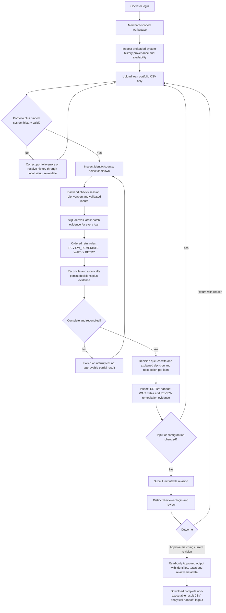
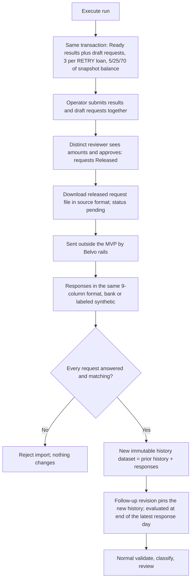
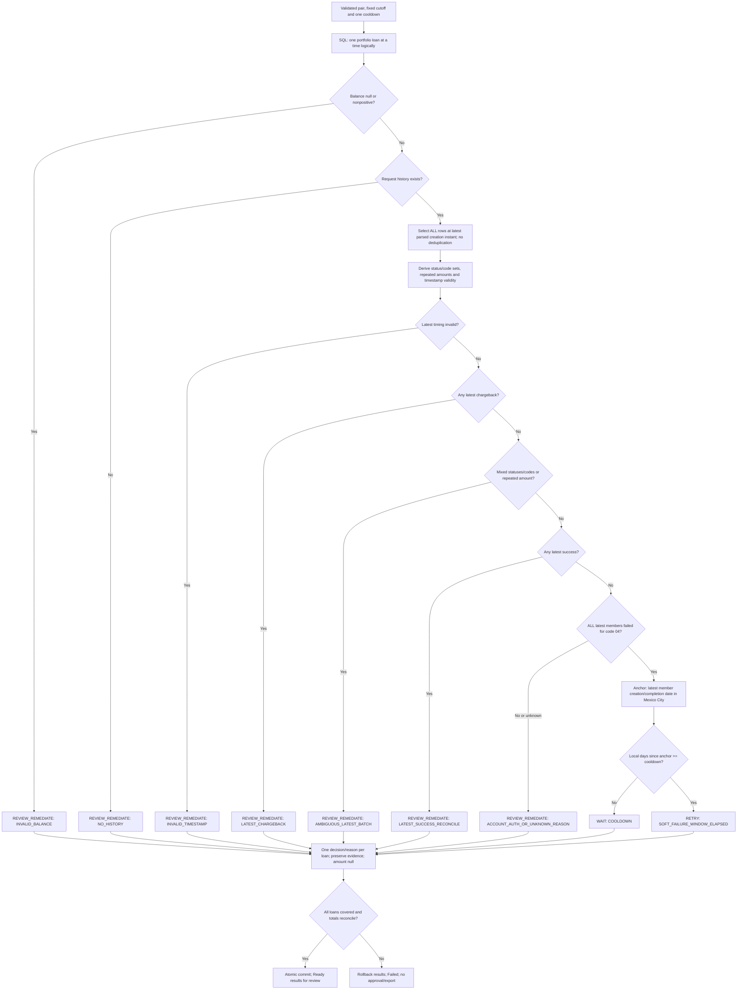
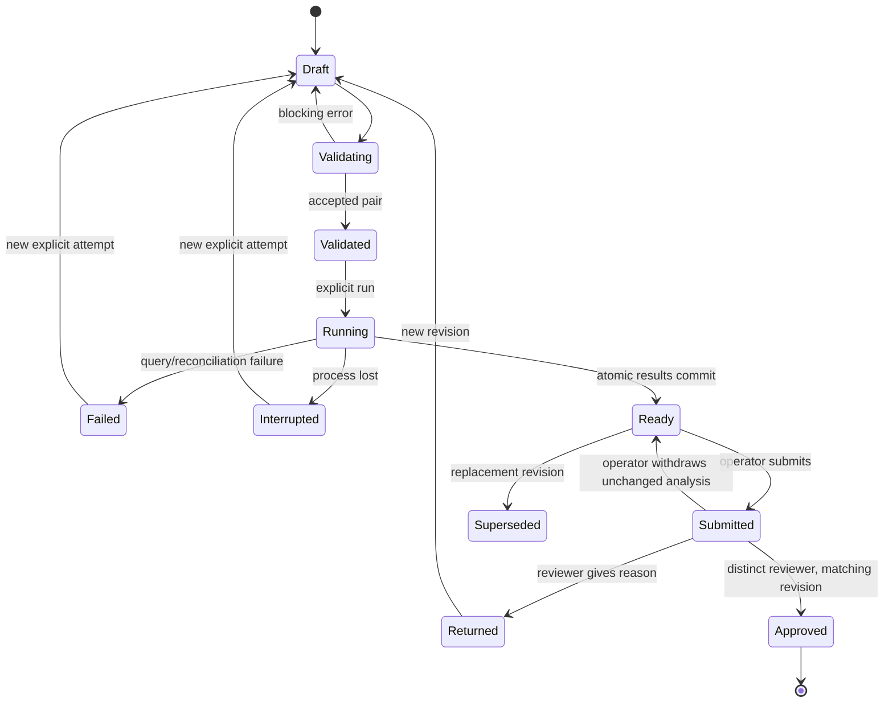

# Belvo Smart Retry: Source of Truth

## 1. Authority and current status

This is the **only canonical specification** for the local MVP, result CSV, testing CSV, post-GTM demo CSV and summary presentation. Implement and generate deliverables from its current requirements, not earlier documents or conversations. A pending decision is not an approved default.

Document responsibilities are separate:

| Document | Authority |
|---|---|
| This master | Current implementation requirements and expected acceptance results |
| [Belvo_Smart_Retry_Analytical_Diagnostic.md](Belvo_Smart_Retry_Analytical_Diagnostic.md) | Observed analytical results, diagnostic method, executed checks and limitations; evidence only, not additional product rules |
| [Belvo_Smart_Retry_Decision_Log.md](Belvo_Smart_Retry_Decision_Log.md) | Decision history, historical research, alternatives, simulated-agent findings and immutable archive; not implementation instructions |

Neither supporting document can override this master. `Belvo_Smart_Retry_Analysis_v2.md` is noncanonical and remains unmodified. The challenge brief and two source CSVs are read-only inputs, not instructions that expand the agreed scope.

Update current requirements **in place** and record the prior value and rationale in the log. Do not append contradictory requirements. Every generated artifact must identify the master SHA-256 and implemented rule/application version it used. A master change invalidates a claim that an older artifact is synchronized.

Current state: specification, selected stack, technical API contract, separately documented analytical diagnostic and a low-fidelity navigable wireframe exist. The wireframe is simulated navigation, not the implemented app or SQL engine. Implementation started 2026-11-02 in `app/` (see app/README.md): backend, SQL rules, portal, payment-request loop (D34), pytest suite and Playwright E2E suite exist; final delivery CSVs and presentation refresh are not done. Dependency resolution and actual compatibility tests occur during implementation. The existing PPTX is historical; its legacy generator is guarded until re-mapped to this schema. No application construction or GTM completion is claimed.

## 2. Product definition and acceptance sequence

**Objective:** automate consistent preparation of analytical collection recommendations from the two Belvo CSVs, reducing repetitive preparation for a Belvo agent while preserving review and explicit exceptions.

| Aspect | Current definition |
|---|---|
| Market | Mexico; source monetary values assumed MXN |
| B2B target | Lender serving users with low banking inclusion; sponsor premise, not measured in the CSVs |
| Current challenge workflow | A Belvo agent uploads transaction lists and initiates runs manually; exercise premise, not a statement about Belvo's live commercial automation |
| Primary user | Belvo operator in a local hypothetical merchant workspace, not merchant self-service |
| Initial client population | Existing Belvo clients; new entrants after other collection efforts require separate future evaluation |
| Initial portfolio population | All supplied loans; no bank or overdue-age exclusion |
| Success sequence | Consistency first, operational impact second, collection-policy impact separately |

First prove complete, deterministic, explainable classification and the local E2E. After functional acceptance, compare workflow automation with the manual baseline while keeping policy unchanged. Evaluate later policy changes using retained recovery per eligible enrolled loan over 90 days, with reversal maturity reported separately.

Candidate counts and consistency tests do not demonstrate recovery lift, avoidable chargebacks, optimal cooldown, savings or production eligibility.

## 3. Deliverables and release gates

| Deliverable | Planned target | Required content | Gate |
|---|---|---|---|
| Local web MVP | App source and reproducible local launch instructions | Upload, validation, SQL decisions, results, login/permissions and analytical review | Stack/contract closed; actual functional and E2E tests pass |
| Result CSV | `Belvo_Smart_Retry_Results.csv` | One analytical decision per loan for one active run | Reconciled completed run; export contract implemented |
| Testing CSV | `Belvo_Smart_Retry_Testing.csv` | Executed test outcomes with expected/actual evidence | Generated by actual tests, not manually declared passing |
| Post-GTM demo CSV | `Belvo_Smart_Retry_Demo.csv` | Clearly labeled synthetic demonstration data | MVP accepted, sponsor confirms GTM milestone and demo schema |
| Payment request file | `Belvo_Smart_Retry_Payment_Requests_<run>.csv` | Pending requests for the RETRY candidates of one run, in the source request format | Drafted with Ready results; released by the distinct reviewer's approval; not sent by the MVP |
| Summary presentation | `Belvo_Smart_Retry_Presentation.pptx` (32 slides including 5 section dividers, built by `scripts/deck/build_deck.js`) | Problem, data analysis, hypotheses, scope and constraints, logic and heuristics, trade-offs, end-to-end process, operator interaction, what the operator sees, parameter configuration, results, impact, green-light metrics, evidence, scalable product and expansion (Brazil, Colombia), strategy options, GTM, short and long-term vision, business model and kill criteria | Built from this master and executed results; visually reviewed from a PowerPoint PDF export on 2026-11-02. `Belvo_Payments_Data_Analysis.pptx` stays as the historical deck |
| Short presentation | `Belvo_Smart_Retry_Presentation_Short.pptx` (14 slides, built by `scripts/deck/build_deck_short.js`) | Same topics as the full deck, condensed: scope with trade-offs, configuration with buttons, results with impact, strategy with GTM, vision with next steps | Sponsor asked for a short version; visually reviewed from a PowerPoint export; the full deck stays as backup |
| One-page summary | `Belvo_Smart_Retry_Summary.md` / `.docx` | Approach, logic, results, trade-offs, measurement, next steps | One page at letter size |
| Demo videos | `Belvo_Smart_Retry_Demo_Happy_Path.mp4` (61 s) and `Belvo_Smart_Retry_Demo_Edge_Cases.mp4` (68 s), captioned | Recorded by Playwright from the real app (`app/web/demo/walkthrough.spec.ts`, `edge_cases.spec.ts`) | Re-record after UI changes |
| User guide | `Belvo_Smart_Retry_User_Guide.md` / `.docx` | Install, roles, operator and reviewer walkthroughs, configuration, outputs, responses, troubleshooting | Derived from the built app |
| PRD | `Belvo_Smart_Retry_PRD.md` / `.docx` | Problem, goals, users, stories with acceptance criteria, requirements, UX, NFRs, metrics, launch, risks | Derived from this master; the master wins on conflict |
| Delivery manifest | `Belvo_Smart_Retry_Deliverables.md` | Hashes, run identity, policy and test status of the delivered CSVs | Generated by `app/tools/generate_deliverables.py` |

Only the original two CSVs are mandatory business inputs. Derived exports, internal tables and test fixtures are not new mandatory source files. Disposable synthetic test fixtures may exist before GTM; they are not the post-GTM demo deliverable. Demo behavior cannot be presented as measured business impact.

The two sources have different delivery paths: the payment-request CSV is imported internally during explicit local setup as immutable, workspace-scoped system history; the Operator uploads only the loan-portfolio CSV. This is a challenge emulation of already available Belvo history, not a live integration. No transaction-upload control exists in the portal. Setup verifies the original history hash/schema/keys and records its import timestamp, source event range and dataset identity; an import timestamp is not a claim of current bank synchronization. Missing or invalid system history blocks validation and directs the Operator to local setup, not a portal upload workaround. History replacement is an explicit offline setup operation creating a new dataset identity; existing revisions retain their pinned history.

For this bounded challenge the supported portfolio is the supplied complete snapshot (or disposable test versions), not arbitrary merchant subsets. Existing orphan checks remain active. Production history scoping/subset behavior requires a separate contract; do not silently drop history rows to accommodate a different portfolio. Valid portfolio loans without requests remain included and route to NO_HISTORY. Classification still produces recommendations only, never new payment requests.

A filename's existence is not evidence of delivery. Record generation time, dataset kind, source identity and actual test status. Do not deliver temporary build artifacts as final results.

## 4. Input and data integrity contract

### Original files

| File | Required columns |
|---|---|
| `PaymentsPM_Challenge_loan_info.csv` | `loan_id`, `payment_method_bank`, `loan_amount`, `total_amount_outstanding`, `overdue_at`, `overdue_days` |
| `PaymentsPM_Challenge_payment_requests.csv` | `payment_request_id`, `created_at`, `completed_at`, `chargeback_at`, `status`, `amount`, `failed_reason`, `failed_message`, `loan_id` |

Treat identifiers as opaque strings and money as exact decimals. Preserve raw values, row lineage and original failure code/message alongside typed staging. Parse `overdue_at` as M/D/YYYY. Parse ISO-8601 UTC timestamps with fractional or nonfractional seconds. Normalize integer-like failure codes to two-character text for classification; preserve unknown string codes rather than dropping them or inferring eligibility.

### Grains and invariants

- Raw request: unique `payment_request_id`; retain every source row.
- Collection batch: all rows sharing `loan_id` and parsed `created_at` instant.
- Latest batch: maximum creation instant for the loan; evaluate every member, never an arbitrary tied row.
- Output: one unique portfolio loan per run, using a left join so no-history loans remain.
- Repeated amount within the latest batch is an ambiguity signal, not proof of a defect. No deduplication.
- Snapshot `total_amount_outstanding` is already updated. Never subtract historical payments or reversals again.
- Bank, age and previous attempt count can be displayed but do not alter initial decisions.

Block calculation with specific errors for missing files/columns, malformed CSV, invalid/duplicate primary keys, unparseable creation times, orphan request-loan references and unparseable required numeric fields. Never silently trim rows or show partial results as complete.

Within a valid pair, invalid current balance and invalid/missing latest terminal timing route the affected loan to review under section 5. Older historical anomalies remain warnings and do not create undocumented lifetime exclusions. Unexpected statuses or absent/unknown failed reasons must not fall through to RETRY.

Use server-generated storage identities; upload names are not filesystem paths. Enforce schema/parsing checks and the resource limits in section 13, not just a `.csv` suffix.

### Reference source identity

| Control | Expected for original files |
|---|---:|
| Unique loans | 3,062 |
| Unique requests | 253,006 |
| Collection batches | 193,629 |
| Loans with / without history | 3,033 / 29 |
| Orphan payment rows | 0 |
| Requested amount | 140,930,816.15 |
| Snapshot outstanding | 10,952,619.00 |

```text
PaymentsPM_Challenge_loan_info.csv
667ce705f2e9c89c3ac2f5965ff3492601684c979cf3d55f7ceed1218cb7fc86
PaymentsPM_Challenge_payment_requests.csv
27b608789d22c87703dd8bb4d70bd0283e468d91dde47adafe5dc2b4738f4b82
```

These are regression controls for the exact supplied files, not hard-coded cardinality limits for every dataset.

## 5. Authoritative classification rules

### Active configuration and clock

| Setting | Contract |
|---|---|
| `evaluated_at` | Fixed `2025-11-11T23:59:59-06:00` for the supplied exercise |
| Source/business timezone | UTC / America/Mexico_City |
| `cooldown_days` | One active value from 3, 7, 14; reference scenario 7 |
| `fatigue_attempts` | Off (null) or 10, 20, 30; portal default 20, API default off. Off reproduces minimal-v1 exactly (D38) |
| `rest_days` | Fixed 30; replaces the cooldown once a loan's insufficient-funds streak reaches `fatigue_attempts` |
| `holdout_pct` | 0, 10 or 20; portal default 10, API default 0. Control loans stay RETRY but get no payment requests (D39) |
| Other policy parameters | None |

The cutoff is an analytical convention for the inferred snapshot date, not a verified extraction timestamp. Do not use today's date or silently make the cutoff editable. Seven days is not a proven optimum.

For the latest batch derive member count, full status/code sets, repeated-amount flag, mixed-status/mixed-failed-code flags, any-chargeback, any-success and whether every member is failed for normalized reason `04`.

Per member, anchor to the later of creation and completion; take the latest member anchor and convert to a Mexico City calendar date. `days_since_anchor` is the local evaluation date minus that date. The cooldown elapses when the difference is **greater than or equal to** the configured days.

Latest timing is invalid if creation is after cutoff; completion is missing/unparseable, earlier than creation or after cutoff; or a populated chargeback timestamp is earlier than creation/completion or after cutoff. Invalid latest timing overrides elapsed cooldown. Final extract statuses are retrospective evidence, not a reconstruction of what was known during a historical decision.

### Ordered decision table

Return the first matching reason. Retain other findings for inspection without emitting additional loan rows.

| Priority | Condition | Decision | Reason code |
|---:|---|---|---|
| 1 | Snapshot outstanding null or nonpositive | REVIEW_REMEDIATE | `INVALID_BALANCE` |
| 2 | No request history | REVIEW_REMEDIATE | `NO_HISTORY` |
| 3 | Latest timing invalid | REVIEW_REMEDIATE | `INVALID_TIMESTAMP` |
| 4 | Any latest-batch chargeback | REVIEW_REMEDIATE | `LATEST_CHARGEBACK` |
| 5 | Multiple statuses, multiple failed codes or repeated amount in latest batch | REVIEW_REMEDIATE | `AMBIGUOUS_LATEST_BATCH` |
| 6 | Latest success, absent earlier condition | REVIEW_REMEDIATE | `LATEST_SUCCESS_RECONCILE` |
| 7 | Latest batch not entirely failed for code 04, including unknown status/reason | REVIEW_REMEDIATE | `ACCOUNT_AUTH_OR_UNKNOWN_REASON` |
| 8 | Entire latest batch failed for 04; fatigue on; insufficient-funds streak >= `fatigue_attempts`; fewer than `rest_days` since anchor | WAIT | `FATIGUE_REST` |
| 9 | Entire latest batch failed for 04; cooldown not elapsed | WAIT | `COOLDOWN` |
| 10 | Entire latest batch failed for 04; cooldown (or rest, when fatigued) elapsed | RETRY | `SOFT_FAILURE_WINDOW_ELAPSED` |

The insufficient-funds streak counts consecutive batches whose every member failed for code 04, back from the latest batch to the most recent batch with any other outcome. It is persisted per loan as `consecutive_soft_failures`, together with `last_success_at` (latest successful request). Rule version `minimal-v2` adds rule 8 and these two signals; with fatigue off its decisions equal `minimal-v1` for every loan.

Codes 01, 02, 03, 06, 08, 10 and 11 follow review. Preserve exact message variants. Different amounts alone are not ambiguous if every member failed for 04 and no amount repeats. Old account failures or chargebacks are not assumed unresolved forever; this compact classifier uses the latest batch and does not claim method-level resolution evidence.

### Output meaning and limits

- **RETRY:** provisional analytical candidate, not permission or a scheduled debit.
- **WAIT:** reassessment not yet due under this clock, not knowledge of available funds.
- **REVIEW_REMEDIATE:** observable evidence does not justify automatic retry; not a permanent borrower ban.

`next_check_date = cooldown_anchor_date + cooldown_days` (or `+ rest_days` when the loan is fatigued) only for the clean code-04 paths, including elapsed dates. It is a reassessment date, not bank execution time. Otherwise null; no invented remediation deadline.

`recommended_amount` is always null in the result CSV. Never copy a historical amount or debt into it. Amounts exist only in the separate payment request file (section 8), derived from the snapshot balance by the fixed 5/25/70 split. No partial-amount strategy, cap, bank rule, age cutoff or chargeback timer is active. Live authorization, method usability, fresh debt, pending/shared exposure and client policy remain unverified production checks. Show that limitation without converting missing CSV fields into a blanket claim that all live accounts are blocked.

### Operational result and next-action contract

A completed analysis produces a persisted decision queue, not just a descriptive report. Every loan belongs to exactly one of the following queues. These are views of the same immutable loan_decisions rows, not new business states, independent calculations or separate policy scenarios.

| Decision queue | next_action_code | Operator's next action | Completion boundary |
|---|---|---|---|
| RETRY | PREPARE_RETRY_HANDOFF | Inspect evidence and submit the candidate queue for analytical review | Approved CSV hands off provisional candidates; no amount, payment request, scheduling or eligibility certification |
| WAIT | REASSESS_ON_OR_AFTER_DATE | Inspect next_check_date; reassess through a new explicit run/revision on or after that date with appropriate inputs | No automatic wake-up; the fixed challenge cutoff does not advance with today's date |
| REVIEW_REMEDIATE | INVESTIGATE_BEFORE_RETRY | Investigate the primary reason and evidence before considering any further attempt | No per-loan override, resolution claim, automatic unblocking or invented deadline |

The backend emits next_action_code as a deterministic CASE mapping of the final decision, not a new scoring heuristic. It must be persisted/returned/exported with each decision. The UI renders it as plain-English next-action text. Existing decision/reason values, priority, null recommended_amount and reference counts do not change. For review guidance, INVALID_BALANCE means verify snapshot debt; NO_HISTORY means investigate linkage/history coverage; INVALID_TIMESTAMP means verify source timing; LATEST_CHARGEBACK means investigate reversal/authorization context; AMBIGUOUS_LATEST_BATCH means inspect all simultaneous members; LATEST_SUCCESS_RECONCILE means reconcile the success with snapshot debt; ACCOUNT_AUTH_OR_UNKNOWN_REASON means investigate the account/authorization/reason evidence. Guidance is not a claim that the required external evidence exists in the sample.

Normative SQL projection after classification (implementation and actual tests still pending):

```sql
CASE decision
  WHEN 'RETRY' THEN 'PREPARE_RETRY_HANDOFF'
  WHEN 'WAIT' THEN 'REASSESS_ON_OR_AFTER_DATE'
  WHEN 'REVIEW_REMEDIATE' THEN 'INVESTIGATE_BEFORE_RETRY'
  ELSE NULL
END AS next_action_code
```

Reject publication if any decision or next-action mapping is null/unknown; do not silently default an unexpected decision to review. Assert exactly one valid action per result and matching action/decision counts.

Queue ordering never changes a decision. RETRY is ordered by `last_success_at` descending with loans that never paid last, then by the shortest streak, then `loan_id` (D40); WAIT by `next_check_date`; other views by `loan_id`.

Ready results must expose three queue totals and paginated loan-level rows with plain-language reasons, available next-check dates and next actions. Formal reason breakdowns and the first matching rule remain available through secondary evidence/details, not as the primary screen hierarchy. An empty queue is a valid zero result. Filters affect only the view, never approval scope or export completeness. Submission/approval covers all loan rows of the exact revision, not only a selected queue. There are no extra per-queue export endpoints or bulk payment actions.

After approval, show an explicit Approved output summary: immutable run/revision, approver/time, source identities, fixed configuration, row count and all three queue totals, plus the full-run CSV download and non-executable warning. A successful file download is an artifact handoff, not a recovered payment or completed collection. Real app acceptance must compare exported next actions/rows to persisted SQL results and check all states' download restrictions (C09-C10, E01, E12, E14). The wireframe only previews this summary and cannot certify those assertions.

### Runtime calculation

SQL is the single authoritative production calculation. Browser controls cannot override or duplicate rules. A test oracle may independently verify SQL but must not become a second production decision engine. Actual-engine regression is mandatory before acceptance.

```text
validate_pair_or_return_blocking_errors()
for each portfolio loan:
    batch = all members at its maximum parsed created_at
    features = derive_without_deduplication(batch)
    reason = first_matching_ordered_rule(loan, features, configuration)
    decision = RETRY if reason == SOFT_FAILURE_WINDOW_ELAPSED
               else WAIT if reason == COOLDOWN
               else REVIEW_REMEDIATE
    emit one explained row with null recommended_amount
    attach fixed next_action_code for the final decision
assert coverage and reconciliation
```

## 6. Local architecture and permissions

| Layer | Responsibility |
|---|---|
| Browser frontend | Input selection, validation feedback, configuration, results and analytical review |
| Local backend | Input/session/permission checks, parameterized SQL, run lifecycle |
| SQL layer | Raw/typed staging, batch features, ordered rules and reconciliation |
| Run state | Source/master identity, version, configuration, results, actors and revision |

### Selected stack

| Component | Selection | Boundary |
|---|---|---|
| Frontend | React + TypeScript + Vite; React Router in declarative mode | Browser rendering/navigation; native fetch; no frontend decision engine |
| Backend | Python 3.12 + FastAPI + Pydantic + Uvicorn | One local server process; typed API; serves built frontend from the same origin |
| SQL and persistence | SQLite through Python standard-library `sqlite3` | One local database for source staging, decisions, users, sessions, runs and approvals; no second database engine |
| Exact money handling | Decimal during parsing; signed integer cents in SQLite; decimal strings at JSON/CSV boundaries | Reject unrepresentable/overflow values; never binary-float money calculations |
| Time handling | Python `datetime`/`zoneinfo` for parsing and local-date staging; SQL for batch/rule decisions | UTC integer microseconds and local calendar-day integers; no runtime clock-based scoring |
| Password hashing | `pwdlib[argon2]` | Password hashes only; no JWT or external identity service |
| Backend tests | pytest + FastAPI TestClient/httpx | Unit, real SQLite integration and API permissions/state tests |
| Browser E2E | Playwright Test with Chromium | Actual frontend/backend/SQLite flow, not mocked golden results |
| Delivery | Local Python virtual environment, Node build, built frontend and one start entry point | No Docker, cloud service, Redis, Celery, ORM or enterprise auth layer |

Known local runtime checked: Node 24.22.1, Python 3.12.14 and SQLite 3.53.1 with window functions. Require SQLite **3.51.3 or newer** for the selected WAL design; do not silently run an older unverified library. The application preflight must inspect the actual Python SQLite library, not assume its version from Python alone.

Resolve compatible released package versions at implementation bootstrap, commit exact dependency locks and record runtime versions in test output. That is a required reproducibility task, not permission to deploy floating dependencies or a claim that uninstalled frameworks already work. No app dependencies were installed during stack selection.

SQLite is the chosen initial engine, not DuckDB. Port the canonical logic into versioned SQLite SQL and reexecute the complete acceptance suite. Prior SQLite diagnostic agreement does not certify the app's new staging, persistence or API. No DuckDB-specific syntax remains a runtime requirement.

Keep portfolios and state local; no hosted upload. The selected implementation must support exact decimals, explicit timezone semantics, transactions, parameterized queries and the actual CSV volume. Retain input/assumption visibility, source-to-result traceability, full-run totals and stale-result detection. No spreadsheet/macros or browser-side duplicate business logic.

### Local identities

Two seeded accounts: Operator and Reviewer. Use server-validated login, not a role dropdown presented as authentication. No registration, user administration, SSO/MFA enrollment or recovery email. One hypothetical workspace, not production multitenancy.

| Capability | Operator | Reviewer |
|---|---|---|
| View permitted workspace, completed runs and evidence | Yes | Yes |
| Upload/replace draft files, configure cooldown and run | Yes | No |
| Submit/withdraw own prepared analysis | Yes | No |
| Approve/return exact submitted revision | No | Yes, distinct from creator |
| Override SQL decision or choose amount | No | No |
| Inspect draft payment requests before submission | Yes | Yes |
| Release payment requests (only by approving the exact submitted revision) | No | Yes, distinct from creator |
| Download released payment request file | Yes | Yes |
| Import bank responses for a prepared request file | Yes | No |
| Send payments to a bank or rail | No | No |

Enforce at the backend for every protected action/run, not only through buttons. Use hashed passwords, revocable sessions, expiry/logout and protected state-changing requests. Do not store secrets/tokens in browser storage or logs. Session, transport and resource defaults are fixed in section 13 and must be tested. Localhost is not a claim of production security.

## 7. E2E flow and states

### Happy path and recovery



### Closed loop after approval (sponsor decision D34)



The MVP never sends a payment. Approval of the analysis is also the four-eyes release of its payment requests; a draft file cannot be downloaded or answered. Returned, superseded or failed revisions never release. Earlier revisions keep their pinned history.

No financial transaction follows approval/export. Session/permission failure stops the requested action without mutation. Reauthentication reloads permitted state; it does not silently approve or restart a run.

### Backend retry-decision subflow

This expands the SQL steps above, not a second rule set. Section 5 remains authoritative. The backend evaluates all portfolio loans, including those without history; the first matching condition determines the single primary reason. SQL derives evidence and decisions, while Python handles validated ingestion/time normalization and the API lifecycle. The frontend only renders persisted results.



The per-loan notation explains the rule order; implementation uses set-based SQL, not one database query per loan. For clean code-04 paths, compute next_check_date from the anchor plus cooldown. RETRY produces a provisional queue candidate only: this subflow has no scheduler, payment API call, amount selection or automatic debit. Reassessment requires a new explicit analysis revision; WAIT does not wake itself automatically. Reviewer approval accepts the analytical output, not a charge instruction.

For the app demo, expand DMO03-DMO05 to show this subflow alongside the real persisted evidence: identify the selected latest batch, the first matching rule, the local-date calculation when applicable and the resulting decision. Do not merely show three colored totals. Examples must be tied to source rows or clearly labeled fixtures, with backend assertions proving the same rule order (C04, C06-C09; E06, E12).

### Analysis lifecycle



Run states are separate from loan decisions. Source/configuration changes create a revised draft; old results stay historical and cannot be relabeled. Approved revisions are immutable. No approval of failed, interrupted, returned or superseded results. Validate transition/revision atomically and make repeated logical run/approval requests idempotent.

Persist enough to reopen completed results and approvals after refresh/restart. On recovery, mark unfinished processing Interrupted instead of leaving it Running forever. Explicit retry suffices; distributed recovery/background scheduling are out of scope.

### Minimal surfaces

1. Login with invalid-credential/session-expiry behavior.
2. Workspace with new/reopen analysis and basic history.
3. Preparation with portfolio-only upload, read-only system-history provenance/coverage, validation, fixed metadata and cooldown.
4. Results/review with loading/error/stale states, full-run totals, simple filters, loan reasons, basic source evidence, submit/return/approve and labeled export.

Configuration stays in preparation and history in the workspace. No enterprise settings or advanced case-management subqueues. Filters affect display, not SQL results; show visible-row counts separately from full-run totals. Main actions and error recovery must be keyboard usable and not color-only. The MVP interface language is English, including navigation, labels, validation feedback, empty/error states and review actions. Preserve original source values and messages without translation; canonical API/CSV identifiers remain unchanged.

Visual direction: use Belvo as a reference, not an official product identity. Maintain visible “Product challenge · Unofficial prototype” labeling. The sponsor selected sober, clear, operational and deliberately unpolished presentation; prioritize workflow and evidence over brand polish, illustrations or decorative motion. The [navigable wireframe](wireframes/index.html) and its [walkthrough notes](wireframes/README.md) are derived design aids, not independent requirements or acceptance evidence. PRODUCT.md also remains a derived context aid and cannot override this master.

Operational information hierarchy: the primary Results screen shows processed-loan coverage, review state and three queue selectors labeled Retry candidates, Waiting and Needs attention. These map to RETRY, WAIT and REVIEW_REMEDIATE without changing API/CSV enums. Show loan, actual outstanding balance, a short plain-language reason, applicable next-check date and View details. Do not invent missing balances/dates in the wireframe. Detail first explains what the operator should do; expandable payment evidence contains the original batch, first matching rule and clock calculation. Section 5 is the formal business-rule specification; the SQL pipeline, raw codes, contract tables and guardrail checklist do not belong in the main operational screen. Preparation leads with portfolio upload and history availability; provenance/settings are secondary disclosures. Use one primary action for the actor/state: Submit for review, Approve results or Download approved CSV. Return/withdraw/revision paths are secondary. Keep approval scope and non-debit meaning visible in concise copy. Put demo role/scenario/preview shortcuts in a separate collapsed demo panel; never imply they are real authentication or business configuration.

Screen decisions (2026-11-02, from the lo-fi board `wireframes/lofi/smart-retry-lofi.html`): loan detail opens as a side panel over Results so the queue stays in view; the Waiting queue is ordered by `next_check_date` ascending, then `loan_id`; Needs attention is one flat list with an optional reason filter, not grouped subqueues.

## 8. CSV output contracts

### Result CSV

One active scenario per file, one portfolio loan per row, deterministic textual `loan_id` ordering. Re-export of an immutable run preserves analytical content. Include metadata per row so detached files remain attributable.

| Columns | Contract |
|---|---|
| `run_id`, `revision_id` | Immutable result identity |
| `master_sha256`, `rule_version` | Canonical requirement/rule identity |
| `dataset_kind` | `belvo_sample` for the original pair; `synthetic_demo` when the pinned history contains synthetic responses; `belvo_sample_with_bank_responses` when it contains only imported bank responses; `test_fixture` for any other pair |
| `loan_id` | Opaque original identifier |
| `decision`, `reason_code` | Exactly one decision/reason from section 5 |
| `next_action_code` | Deterministic mapping from decision in section 5; no execution authorization |
| `payment_request_status` | Per loan. RETRY rows carry the run's request-set status (`RELEASED`, or `RESPONDED` after responses are imported; `NOT_GENERATED` for runs approved before D36); RETRY control loans are `HOLDOUT`; every WAIT and REVIEW_REMEDIATE row is `NONE` |
| `experiment_arm`, `consecutive_soft_failures`, `last_success_at` | `treatment`/`control` for RETRY loans of a run with a holdout, else empty; streak integer; UTC timestamp or empty |
| `payment_request_ids` | Per loan. Compact JSON array of the loan's three request identifiers in tranche order (5, 25, 70), matching the payment request CSV; `[]` when `NONE` |
| `last_batch_created_at`, `last_batch_rows` | UTC ISO-8601 / integer; null time and zero count if no history |
| `last_batch_statuses`, `last_batch_reasons` | Sorted JSON arrays of complete latest-member sets |
| `source_payment_request_ids` | Sorted JSON array of all latest-member identifiers |
| `cooldown_anchor_date`, `days_since_anchor`, `next_check_date` | Local dates / integer or null under section 5 |
| `total_amount_outstanding` | Unmodified exact snapshot value, two decimal places |
| `recommended_amount` | Null, never zero or inferred |
| `evaluated_at`, `business_timezone`, `cooldown_days`, `fatigue_attempts`, `rest_days`, `holdout_pct` | Exact active configuration; fatigue and rest empty when off |
| `loans_source_sha256`, `requests_source_sha256` | Original file identities |
| `production_checks` | `UNVERIFIED_LIVE_AUTH_METHOD_DEBT_EXPOSURE_POLICY` |
| `is_executable` | Always false |

Use UTF-8 CSV without BOM, header, comma delimiter, standard quoting and CRLF line endings. Dates YYYY-MM-DD; timestamps explicit offset/UTC; dot decimal without grouping; null cells empty and empty JSON sets `[]`. Preserve identifiers/strings without executing spreadsheet formulas. Do not include uncontrolled source messages/names in the result CSV; validate identifier characters at intake and encode fixed reason enums/JSON arrays so source text cannot become an executable spreadsheet formula.

The final delivery CSV must correspond to an Approved run. Append `analysis_review_state`, `analysis_approved_by` and `analysis_approved_at` to its metadata columns, with `analysis_review_state=Approved`. These describe the reviewed revision as a whole and repeat on every row for traceability; they never mean a loan was approved for collection. Only `payment_request_status=RELEASED` (or `RESPONDED`) identifies loans whose requests were released. The export endpoint in section 13 rejects all other states; the UI provides no draft download in the initial version. It is never a bank-upload file or a complete-looking export of partial failed results.

### Testing CSV

One row per actual test execution:

```text
test_run_id,test_id,suite,case_kind,dataset_kind,master_sha256,rule_version,
application_version,engine_version,configuration_json,expected_json,
actual_json,status,executed_at,evidence_reference,error_code
```

Status: PASS, FAIL, SKIPPED or NOT_RUN. PASS requires an executed assertion with evidence, not an expected number copied from the specification. Distinguish original-data regression, synthetic fixture, unit, integration and browser E2E. Missing impact evidence is not a passing impact test. Do not log credentials or unnecessary full source records.

### Payment request CSV

Drafted by SQL in the same transaction that publishes Ready results, one set per run. Status Draft until the distinct reviewer approves that exact revision, which marks it Released with reviewer and time; downloadable and answerable only once Released. Exactly the nine source columns in source order: `payment_request_id,created_at,completed_at,chargeback_at,status,amount,failed_reason,failed_message,loan_id`. One row per tranche; three rows per RETRY loan sharing one `created_at`.

| Field | Contract |
|---|---|
| `payment_request_id` | New server-generated UUID-format identifier, unique against all history |
| `created_at` | Exercise request instant: 09:00 America/Mexico_City on the local day after the run's `evaluated_at`, UTC ISO-8601 with milliseconds |
| `amount` | 5% and 25% of `total_amount_outstanding`, each floored to the cent; 70% tranche takes the remainder so the three sum exactly to the snapshot balance; every tranche must be positive and distinct |
| `status` | `pending` |
| `completed_at`, `chargeback_at`, `failed_reason`, `failed_message` | Empty; only the bank's response fills them |

SQL computes the split (`app/sql/payment_requests_v1.sql`) for treatment RETRY loans only. Reconcile request count = 3 x treatment count and total = sum of treatment balances before publishing. The 5/25/70 split is the dominant observed historical practice (16,555 three-member batches), not a validated collection policy. Live authorization, method, debt and client-policy checks remain unverified.

### Response import

The operator uploads one response file per request set in the same nine columns. It is accepted only if it answers every request exactly once with matching `payment_request_id`, `loan_id`, `amount` and parsed `created_at`; `status` in successful/failed/chargeback; `completed_at` present and not before creation; failed rows carry a reason; chargeback rows carry `chargeback_at`. Any violation rejects the whole file. The operator declares the origin: `bank` or `synthetic_demo`. Synthetic origin is shown wherever that history is used and makes `dataset_kind=synthetic_demo` in later result CSVs; it is never evidence of recovery.

An accepted import creates a new immutable history dataset (prior history plus responses) that becomes the workspace's current history. A follow-up revision may pin it; its `evaluated_at` is 23:59:59 local on the day of the latest response event (completion or chargeback), never today's date. The portfolio snapshot is not reduced by successful responses; those loans route to `LATEST_SUCCESS_RECONCILE` until a new snapshot is uploaded.

Synthetic responses come from `app/tools/simulate_bank_responses.py`, outside the portal: one seeded outcome per loan applied to its three tranches (98.1% of historical three-member batches had a single outcome), with status and failure-code frequencies taken from historical three-member batches.

### Holdout experiment (D39)

When `holdout_pct > 0`, the draft step assigns each RETRY loan to `control` when `sha256(run_id:loan_id) mod 100 < holdout_pct`, else `treatment`. Assignment is deterministic and stored in `experiment_assignments`. Control loans keep their RETRY decision, appear tagged Holdout, and receive no requests. `GET /runs/{id}/experiment` reports per arm: loans and outstanding; after responses, treatment loans paid and amount collected; and, once a later revision of the same analysis validates a different portfolio snapshot, per arm the loans with a lower balance, amount recovered (old minus new balance, floored at zero) and recovered per loan, plus the treatment-minus-control difference per loan. It flags synthetic responses and control groups under 100 loans as directional only. Without a later snapshot, control outcomes are unobservable and nothing is claimed. The simulator's `--next-portfolio` option writes a synthetic snapshot that reduces only balances with successful responses and assumes no self-cure.

### Post-GTM demo CSV

Generate only after MVP acceptance and explicit sponsor confirmation of the GTM milestone. Clearly label synthetic provenance and separate it from original-data outputs and regression baselines. Never claim synthetic behavior as measured recovery impact.

**Purpose, row grain and exact schema remain pending:** decide whether it demonstrates source events or result rows before generation. Do not invent a third mandatory business input or consider this contract ready for generation until that decision is closed. Disposable earlier test fixtures do not satisfy this deliverable.

## 9. Acceptance and verification

### Mandatory functional criteria

| ID | Required condition |
|---|---|
| C01 | Only the two original business inputs required |
| C02 | Source rows and current balances unchanged |
| C03 | One output per portfolio loan; no-history included; orphans rejected |
| C04 | All latest-batch rows participate without deduplication |
| C05 | Repeat calculation and row permutations preserve decisions/reasons |
| C06 | Ordered review/unknown/ambiguity checks precede cooldown |
| C07 | Explicit cutoff/timezone and exact/before cooldown boundaries |
| C08 | Full-run totals and reference controls reconcile |
| C09 | Each result traceable to reason, configuration and source evidence |
| C10 | Candidate/export/approval cannot execute or imply authorized debits |
| C11 | Invalid files/configuration cannot produce complete-looking partial results |
| C12 | Longer cooldown cannot add RETRY candidates; reference REVIEW set invariant |

All mandatory conditions must pass in the implemented runtime. A pass percentage cannot excuse failed completeness or safety.

### Expected acceptance results for the original files

For the exact hashes, cutoff, completion-aware clock and current rules:

| Cooldown | RETRY, provisional | WAIT | REVIEW_REMEDIATE | Total |
|---:|---:|---:|---:|---:|
| 3 | 404 | 1,945 | 713 | 3,062 |
| 7 | 400 | 1,949 | 713 | 3,062 |
| 14 | 396 | 1,953 | 713 | 3,062 |

With `fatigue_attempts=20` and the 30-day rest (`minimal-v2`): 3 days 402 / 1,947 / 713; 7 days 398 / 1,951 / 713; 14 days 395 / 1,954 / 713. In each case 1,623 loans are `FATIGUE_REST`, the review set is unchanged and the RETRY set is a subset of the fatigue-off set. The streak is verified per loan against an independent Python oracle.

Seven-day primary review partition: 605 account/authorization/routing/unknown, 37 latest-chargeback, 29 no-history, 27 latest-success and 15 ambiguity. Latest-batch invalid-timing/balance primary bucket is zero for this exact run. These are loans, not request counts or predicted payments.

Source case controls: `7764852545` retains six latest-batch rows and reviews ambiguity; `7765852743` retains snapshot debt `1520.00`, not `1370.00`; `7764910231` has 2025-11-11 anchor and 2025-11-18 next check at seven days. A constructed six-day gap waits, while exactly seven days qualifies as provisional RETRY absent earlier blockers.

These tables and source cases are the required regression expectations, not a report of application test execution. Observed results, diagnostic methods and executed-check evidence belong in the [analytical diagnostic](Belvo_Smart_Retry_Analytical_Diagnostic.md). Reexecute acceptance against the selected stack and report actual status; never relabel prior diagnostic checks as the new implementation's PASS results.

### Required E2E scenarios

| ID | Requirement |
|---|---|
| E01 | Setup preloads original request history; Operator uploads original portfolio only; actual SQL produces seven-day controls; distinct Reviewer approves same revision; refresh/restart preserves it |
| E02 | Alternatives produce their own golden results with one active scenario |
| E03 | Anonymous UI/API access exposes no protected results or mutation |
| E04 | Forbidden role actions/self-approval fail server-side without state change |
| E05 | Missing columns, bad keys, duplicates and orphans block correctly |
| E06 | Unknown reason and simultaneous ambiguity preserve evidence and review |
| E07 | Source/configuration changes cannot reuse/relabel/approve stale results |
| E08 | Duplicate run/approval requests produce one logical effect |
| E09 | Query failure, interruption and refresh expose no approvable partial output or permanent Running state |
| E10 | Session expiry/logout invalidate access; reauthentication restores only permitted context |
| E11 | Revision races cannot approve withdrawn/stale results |
| E12 | Snapshot debt, six-member evidence and next-check examples match contract |
| E13 | Main flow/errors usable by keyboard and without color-only meaning |
| E14 | Approval/export creates no payment request or executable bank file |
| E15 | No plaintext credentials/tokens/unnecessary source rows in browser storage or logs |

Use disposable storage/fixtures; never edit originals. E01 must execute actual SQL, not a mocked success response. Untested criteria remain NOT_RUN. Measure processing behavior before adopting performance SLAs.

### App demonstration contract

The app walkthrough is an acceptance demonstration using the original CSV pair, not the separate synthetic post-GTM demo CSV. It can be prepared and rehearsed before GTM. No additional business input, payment execution, mocked result response or measured-impact claim is introduced. The English UI must expose the states and evidence below. Target presentation duration is 8-10 minutes, a rehearsal budget rather than an application performance SLA.

Preconditions: an implemented app, isolated disposable local database, explicitly provisioned Operator and distinct Reviewer accounts, original source hashes verified, fixed reference cutoff, seven-day cooldown, and recorded application/master/rule/runtime identities. Do not embed credentials in the script or slides. A fresh demonstration run starts from Draft; a previously approved run must be identified as historical, not presented as a new execution. Until actually rehearsed against the app, every step has status NOT_RUN.

| Step | Actor and action | Visible expected result | Evidence / acceptance link |
|---|---|---|---|
| DMO01 | Operator signs in and opens workspace | Correct role/workspace; new analysis and historical runs clearly distinguished | E01, E03, E04 |
| DMO02 | Inspect preloaded original history; create Draft, upload original portfolio only and validate | Both source identities and history provenance/availability; 3,062 loans, 253,006 requests, 3,033 linked loans, 29 without history; no orphan loans; Validated state | C01-C04, E05 |
| DMO03 | Confirm seven days and fixed cutoff; execute | Running state, bounded progress/polling and actions disabled as appropriate; Ready only after atomic reconciliation | C07-C08, E01, E09 |
| DMO04 | Inspect decision queues, next actions and a display filter | 400 RETRY with provisional handoff, 1,949 WAIT with next-check dates, 713 REVIEW_REMEDIATE with investigation guidance; 3,062 total; visible-row count distinct from full-run totals | C03, C08-C09; totals are provisional analytical categories |
| DMO05 | Open source-backed loan evidence | 7764852545 shows all six latest rows and ambiguity; 7765852743 shows 1520.00 unchanged snapshot debt; 7764910231 shows anchor 2025-11-11 and next check 2025-11-18 | E06, E12; next check is not a debit date |
| DMO06 | Submit; log out; distinct Reviewer logs in | Exact submitted revision, inputs, config and totals remain identifiable; reviewer cannot edit classifications or amounts | E01, E04, E10 |
| DMO07 | Reviewer approves; inspect Approved output summary and download CSV | Read-only run/revision, source/config/review metadata, queue totals and 3,062 uniquely identified loan rows including next_action_code; recommended_amount empty and is_executable false | C09-C10, E14; compare parsed export to committed results including action mapping |
| DMO08 | Refresh and restart/reopen | Same approved revision, decisions and approval persist; no rerun or new approval caused by reopening | E01, E08-E09 |

Present these four representative exceptions after the happy path, using separate clearly labeled runs where necessary. Keep fault injection and fixture setup outside ordinary product controls; there is no production-looking “simulate payment” action.

| Demo exception | Setup and action | Expected visible recovery | Evidence |
|---|---|---|---|
| DX01 invalid input | Disposable portfolio copy missing a required column; validate against preloaded history | Specific file/column error, no Ready result or export; upload corrected portfolio and explicitly revalidate | E05, C11 |
| DX02 evidence ambiguity | Original loan 7764852545 | REVIEW_REMEDIATE with all latest rows; no deduplication or manual decision override | E06, E12 |
| DX03 reviewer returns analysis | Reviewer returns a separate Submitted run with a nonblank comment; Operator creates revised Draft | Comment and old revision retained; new configuration requires validation/execution/submission; old result cannot be relabeled | E07, E11 |
| DX04 interrupted processing | Test-controlled server interruption during a separate Running run; restart | Interrupted after recovery, no partial approvable output/export; explicit retry creates new revision | E09; demonstrate live only after reliable rehearsal, otherwise show identified test evidence |

### Edge-case coverage and release evidence

Original-data cases and constructed fixtures are different populations. Fixtures exercise branches absent from the sample; they never replace the original-data golden regression or alter original files. The presentation shows representative exceptions, while release acceptance requires the complete automated matrix and E01-E15. No case is PASS until executed with an assertion and evidence reference.

| Case | Population / boundary | Required behavior | Coverage |
|---|---|---|---|
| EC01 | Original pair plus fixture with missing/extra header, malformed row, invalid encoding or invalid source ID | Required structure/encoding/keys block validation with actionable errors; unused extra columns warn; no silent truncation or mutation | E05, C01-C03, C11 |
| EC02 | Fixture: duplicate primary keys, orphan request loan, absent portfolio, missing/invalid/wrong-workspace history, over-limit source size/row count | Reject input/resource violation; no partial accepted dataset or Ready output; history faults require setup remediation, not portal transaction upload; distinguish repeated primary keys from allowed repeated intents | E05, C03-C04, C11 |
| EC03 | Original 29 loans without requests; fixture null/nonpositive balance | Include every portfolio loan; ordered NO_HISTORY or INVALID_BALANCE review, respectively | C03, C06 |
| EC04 | Fixture: unknown/null failure reason; chargeback plus soft failure; success; mixed statuses/reasons; repeated latest amounts | Apply exact ordered rule table; retain all members; earlier review reason wins over cooldown | E06, C04, C06 |
| EC05 | Original six-member case; row-permuted originals; equal parsed instants with differing offset strings in fixture | Same batch membership/decisions regardless of row order; parsed instant, not raw text, defines timestamp equality | E06, E12, C04-C05 |
| EC06 | Fixture: malformed timestamps, completion before creation, future values relative to cutoff | Apply the input/latest-batch timestamp contract; no invented timestamp, negative-gap RETRY or partial acceptance disguised as success | C07, C11; explicit timestamp assertions required |
| EC07 | Fixture: six-day/seven-day boundary, local midnight, completion later than creation | WAIT before exact boundary; RETRY at boundary only absent prior blockers; latest-member completion-aware local calendar anchor | C06-C07, E12 |
| EC08 | Originals at 3/7/14 days, reordered and rerun | Match golden counts; invariant review set; longer cooldown cannot add RETRY; exactly one active scenario per revision | C05, C08, C12, E02 |
| EC09 | Fixture: exact cent values, excessive precision, numeric overflow; original debt control | Exact values reconcile; invalid precision/range rejected; no subtraction of historical payments from snapshot debt | C02, C08, E12 |
| EC10 | New configuration/source pair; stale tab; Submitted/Approved parent | New revision required; Submitted must first be withdrawn; Approved remains immutable; stale version rejected without mutation | E07, E11 |
| EC11 | Repeated request same idempotency key/payload; key reused with different payload; concurrent action | One logical effect on exact replay; conflict on payload mismatch; stale If-Match rejected; review races cannot approve stale revision | E08, E11 |
| EC12 | Query failure, reconciliation mismatch, second simultaneous job, database busy, lost process | No Ready partial output; bounded busy/conflict response; recover unfinished work as Interrupted; explicit new-revision retry | E09, C08, C11 |
| EC13 | Anonymous request, wrong role, self-approval, missing/invalid CSRF, expired/revoked session, throttled login | Server rejects protected mutation/read as applicable; no sensitive leakage or state change; reauthentication never auto-replays approval | E03-E04, E10, E15 |
| EC14 | Export before approval; filtered UI; approved export reopened | Reject non-Approved export; full-run export unaffected by filters; correct headers, CRLF, nulls, ordering, hashes and exact amounts; no executable debit or uncontrolled formula text | C09-C10, E14 |
| EC15 | Keyboard navigation, error feedback, logs and browser storage inspection | Focus/actions usable without mouse or color-only meaning; no plaintext secrets/tokens or unnecessary source records in storage/logs | E13, E15 |

Demo acceptance evidence must identify DMO/DX/EC IDs alongside the existing C/E criteria without replacing them. Store actual assertions in the testing CSV's existing schema, with evidence_reference pointing to a test report or reproducible step; redact secrets. Record run/revision, source hashes, configuration, app/master/rule/engine versions and execution time. Screenshots or recordings are optional presentation evidence, not substitutes for assertions. The final deck must distinguish expected controls, actual test results and deferred impact hypotheses. A failed live demonstration is reported as failed/interrupted, never concealed using a precomputed success response.

## 10. Bounded trade-offs and exclusions

| Decision | Cost/limitation | Hard boundary |
|---|---|---|
| Local web portal | Installation/launch packaging required | No hosted portfolio upload |
| Two roles and analytical approval | Setup and handoff friction; no proven time saving | No enterprise identity, custom roles or financial release |
| SQL authority | Engine/timezone integration must pass tests | No frontend rule duplication or SQL console |
| Completion-aware clock | Specific post-result wait convention | One explicit clock and active scenario |
| Conservative three outputs | Some cases require review | No fabricated authorizations/resolutions or permanent borrower bans |
| Null amount in result CSV; fixed 5/25/70 split only in the separate request file | Split is observed practice, not an optimized policy | No per-loan amount choice, cap or available-balance capture; nothing is sent |
| Manual CSV intake | Some preparation remains manual | No scheduled feeds or extra mandatory inputs |
| Basic history/revisions | Persistence work, not production audit | No distributed recovery/compliance claims |
| Consistency first | No demonstrated economic impact yet | No lift/savings claim without later evidence |

Excluded: real bank/payment connections, bank credentials, sending payment requests, live debits, autonomous collection schedules, billing, real merchant onboarding, production multitenancy, overrides, policy builder, inferred bank balances, payroll targeting, predictive models and automatic amount/cap/bank/age policies.

Detailed operator personas, remediation subqueues, ownership/re-entry workflows and handling-time research are post-MVP/post-GTM opportunities, not initial blockers. Basic source explanations remain in scope.

## 11. Impact, product strategy and long-term vision

### Potential impact on the supplied history

Retrospective replay of the current rules over the full request history (2023-12-29 to 2025-11-07, 22.3 months, 3,033 loans with history, 193,629 attempts). An attempt counts as one the rules would have stopped if it came right after a non-code-04 failure, right after a chargeback, or within 30 days of the previous attempt once a loan had 20 or more consecutive code-04 failures (D42).

| Measure | All attempts | Attempts the rules would stop | Attempts kept |
|---|---:|---:|---:|
| Requests | 253,006 | 151,697 (60.0%) | 101,309 |
| Attempt success rate | 2.22% | 0.55% | 4.37% |
| MXN collected per 1,000 requests | 4,719 | 1,369 | 9,734 |
| Batches with a chargeback | 1,269 | 450 (35.5%) | 819 |
| MXN collected in those attempts | 1,193,886 | 207,707 (17.4%) | 986,179 |

By rule: retries right after a hard failure were 14.7% of requests with a 0.19% success rate; retries right after a chargeback were charged back again 22.9% of the time (282 of 1,232) against 0.66% overall; fatigued retries were 44.7% of requests at 0.60% success.

How to read it: about 2,240 fewer debit attempts per 1,000 loans per month and roughly a third fewer chargeback events, with collection efficiency per request doubled. The 17.4% is an upper bound on recovery at risk, not a loss: a rested loan is still retried after 30 days, and stopped hard-failure loans go to remediation instead of disappearing. The true trade-off is exactly what the holdout must measure. Limits: final statuses only, surviving overdue loans, no cost data, and no counterfactual for what stopped attempts would have produced at a later date. Savings in money equal requests avoided times the client's cost per attempt plus avoided chargeback handling; neither cost is in the data, so no peso figure is claimed.

### Strategy options considered

| Option | Steelman | Main objection | Weight |
|---|---|---|---|
| A. Rules feature inside Managed Collections | Cheap, explainable, ships now; the impact table above comes from rules alone | Easy to copy; value plateaus once obvious waste is removed | Serious |
| B. Income-aware collections intelligence on Belvo's open-finance data (recommended) | Timing and amount follow when each borrower actually gets paid, which only consented account data shows; uses assets Belvo already sells | Consent from already-delinquent borrowers is unproven; uplift is a hypothesis until a holdout shows it | Serious, testable |
| C. Standalone ML retry-scoring vendor | Larger addressable market beyond Belvo rails | Competes with lenders' in-house models; no data moat without Belvo's connections | Serious |
| D. Outcome-priced recovery service | Highest revenue per loan; aligns price with result | Takes on credit, compliance and operations risk before the evidence exists | Fatal for now |

Calendar timing alone is not the answer: in this history, attempts on paydays (days 1, 2, 15, 16, 30, 31) succeeded 1.88% of the time against 1.85% on other days. If timing matters, it is personal timing, which is what option B targets.

### Recommended strategy

Thesis: become the decision layer of Belvo's collections rails. Decide whether, when and how much to debit, first with rules and a holdout, then with each borrower's consented income signals, and prove every policy change with a control group.

Why Belvo can win (public sources, checked 2026-11-02): it already runs Mexican direct debit with any bank account and launched Pix Automático in Brazil on the central bank's launch day; it offers Managed Collections and an income estimator; its Incomes endpoint summarizes an account's income sources over 365 days and it exposes IMSS employment data. The rails, the income data and the collections product sit in one company; competitors usually have one of the three.

### Roadmap, bets and gates

| Horizon | Bet | Success metric | Gate to move on |
|---|---|---|---|
| 0-6 months | Ship these rules and the holdout inside Managed Collections for 2-3 design-partner lenders; shadow-run first | Requests avoided per loan; chargeback events; retained recovery per eligible loan over 90 days, treatment vs control | Recovery loss within the threshold agreed with each lender (set before the test); no rise in complaints |
| 6-18 months | Income-aware timing and amount: with consent, schedule each debit after the borrower's detected pay date and size the split to observed inflows | Success rate per attempt and recovery per loan vs the rules-only arm | Consent rate high enough to matter; positive, significant lift in a holdout |
| 18-36 months | Cross-rail orchestration (Mexico direct debit and Brazil Pix Automático), learning from outcomes across lenders by bank and failure code; client-configurable policies with guardrails | Cost per peso recovered; share of portfolio under managed policy | Privacy and access controls approved; per-client policy audit |
| 3-5 years | Collections operating system: when debits stop making sense, route to hardship and restructuring offers instead; outcome-based pricing once evidence supports it | Net recovery per loan; borrower complaint and cure rates | Proven economics and regulatory review for outcome pricing |

### Business model

Start as a paid tier of Managed Collections priced per loan under management, justified by measured requests avoided and chargebacks prevented. Add an income-aware tier once the holdout proves lift. Consider a share of incremental recovery only after option D's risks are covered. Belvo also gains on its own costs: fewer failed debits per peso moved and healthier bank relationships.

### Risks and kill criteria

- Recovery loss above the agreed threshold in the 0-6 month holdout: stop, keep the rules as an internal diagnostic only.
- Consent rate too low for income-aware timing to reach a meaningful share of loans: keep rules-only and drop horizon 2.
- Regulatory or reputational concern about using account data on delinquent borrowers: limit to explicit opt-in and hardship-protective uses.
- Lenders unwilling to hold out a control group: no policy change ships without one.

### Release and measurement gates

1. Pass actual-engine functional and local E2E acceptance; deliver original-data result/testing CSVs and launch instructions.
2. Observe the real operator baseline before claiming time/effort savings. Separate unchanged-policy workflow automation from changed collection strategy.
3. Obtain explicit sponsor confirmation of GTM. Passing tests/running locally is not GTM or production authorization. Only then generate the separately specified demo CSV.
4. Test policy changes with client agreement, eligible cohorts, a control and common 90-day recovery follow-up. Mature reversals separately. Costs, live authority and shared-method/customer linkage must be available first.

Primary client impact: retained recovery per eligible enrolled loan. Belvo efficiency: retry/reversal-processing cost, cost per retained peso and operator effort. Guardrails: recovery delay, errors, unauthorized/excess debits and unresolved queue age. Agree allowable recovery loss and acceptable marginal cost before impact tests; no numerical target is inferred from the sample.

Primary client impact: retained recovery per eligible enrolled loan. Belvo efficiency: requests avoided, chargeback events, cost per retained peso and operator effort. Guardrails: recovery delay, errors, unauthorized or excess debits, complaints and unresolved queue age. Agree allowable recovery loss and acceptable marginal cost before impact tests; no numerical target is inferred from the sample.

These are hypotheses with gates, not implemented capabilities, committed dates or guaranteed outcomes. Income-aware collection and automated execution require separate technical, consent and regulatory validation. The vision does not add rules to the current classifier.

Sources for the Belvo capabilities above: [direct debit overview](https://developers.belvo.com/products/payments_mexico/direct-debit-overview), [Pix Automático launch](https://thepaypers.com/online-payments/belvo-rolls-out-pix-automatico--1274088), [2025 recap (Managed Collections, income estimator)](https://belvo.com/blog/reaching-80-million-accounts-connected-1b-tpv-2025-recap/), [Incomes API](https://developers.belvo.com/apis/belvoopenapispec/incomes), [employment data](https://fintechnexus.com/?p=52099).

## 12. Presentation and synchronization contract

Generate the summary PPTX from this master and actual implementation/test evidence. Historical research may appear only as explicitly historical, approved context; it cannot supply active rules or current acceptance claims.

Required narrative: problem/manual premise; user/inputs/scope; architecture/E2E; authoritative three-outcome logic; reference controls versus actual verification; CSV outputs/testing; bounded trade-offs/limitations; GTM/impact gates; long-term vision; unresolved next decisions.

Exclude retired rule sets/counts, unvalidated market superiority, simulated agents presented as actual research, and live-execution claims. Speaker notes, charts and tables obey the same contract as visible slides.

The legacy generator depends on another tool's runtime and stays paused; the current deck is built by `scripts/deck/build_deck.js`. Preserve the historical PPTX until a replacement passes numerical/content/visual review. Record source hash and generation/verification status after refresh. Source changes make old builds stale; do not claim automatic synchronization until the new mapping is implemented and tested.

## 13. Technical API and persistence contract

### Local runtime and defaults

Serve the built portal and `/api/v1` from **http://127.0.0.1:8000**. Bind loopback only and use one Uvicorn worker. The Vite development server may proxy `/api` to this backend during development; the evaluator's normal launch uses one origin and one server. Do not expose permissive CORS or accept arbitrary Host/Origin values. Reject an occupied port with a clear message rather than silently rebinding to a public interface.

| Control | Initial technical default |
|---|---|
| Source bytes | 50 MiB per source, 100 MiB combined; enforce portfolio upload streaming and history setup import |
| Row resources | Up to 100,000 portfolio rows and 1,000,000 request rows; explicit resource error above limits |
| Processing | One validation/analysis job active at a time; no hidden queue |
| SQLite | WAL, foreign keys enabled, connection per request/worker thread, 5-second busy timeout |
| Session lifetime | 30-minute idle expiry and 8-hour absolute expiry, with server-side enforcement |
| Failed login throttle | Five failures per account within five minutes trigger a 15-minute cooldown; generic error and bounded local bookkeeping |
| Result pagination | Default 50 rows, maximum 100; deterministic ordering: textual loan ID, except the WAIT queue view, ordered by next_check_date then loan ID |
| Job polling | Every two seconds only during Validating/Running; stop at terminal/ready states or logout |
| Request dates/cooldown | Fixed analytical cutoff; allowed cooldown values only; reject additional policy fields |

These are local resource/security defaults, not empirically optimal collection parameters or promised performance SLAs. The original files total 37,195,688 bytes and fit the byte limits. The limits may be changed only in explicit server configuration and retested, never used to truncate valid input silently.

For this localhost HTTP demo, use a host-only `HttpOnly`, `SameSite=Strict` session cookie with path `/`, no Domain, and `Secure=false` only in explicitly detected loopback mode. Hosted/HTTPS operation is outside this release; it must not inherit that exception. Enforce trusted Origin plus CSRF protection for mutations. Login uses JSON with a required custom request header and trusted-origin check; authenticated writes also require `X-CSRF-Token` held in application memory, refreshed through the authenticated session endpoint. Session tokens are cryptographically random, stored only as hashes server-side; logout revokes them. Passwords use Argon2 hashes. No JWT, refresh-token or localStorage authentication scheme.

Bootstrap two accounts, `operator` and `reviewer`, through explicit local setup with supplied or generated initial passwords, never hard-coded source credentials. Do not overwrite existing accounts on normal startup. Local storage lives under `app/.local-data/`, outside public assets and version control; store uploads, database/WAL files and minimal run events there. Keep history until an explicit offline reset with confirmation; no delete/reset HTTP endpoint or automatic data expiry. This directory contains sensitive data and is not encrypted or protected against the machine's owner by the web login.

### Ingestion, exact data and jobs

Accept one portfolio per draft upload using multipart/form-data field `loans_file` only. Reject a `requests_file` field rather than silently consuming it. Pin the workspace's available immutable history dataset when creating a Draft; if absent, record unavailable and block validation until setup is resolved and a new Draft is created. Never silently substitute a newer history in an existing revision. History is imported by explicit local setup with the same parsing, size, hash and schema checks, not through HTTP. Stream uploaded portfolio bytes to server-generated paths, hash original bytes, parse UTF-8 with optional BOM, preserve raw fields and line numbers, and validate the combined sources before publishing a dataset. Do not accept archives or user filesystem paths over HTTP. Extra columns produce a warning and are not used; missing required columns block.

Expose history dataset ID, original file hash/name, import timestamp, source-event range, row count, availability and workspace identity as read-only metadata. Show matched/no-history/orphan coverage after combined validation; never present the historical extract as a live refreshed ledger. Setup failure leaves history unavailable, not a partially usable dataset. Offline import is idempotent for an identical source hash/workspace. Revised history never mutates approved evidence.

Convert monetary source strings via Decimal to exact integer cents without rounding. Use signed 64-bit range checks; reject unsupported fractional precision/overflow. Source IDs must match `^[A-Za-z0-9][A-Za-z0-9_-]{0,127}$` and remain strings; reject incompatible identifiers explicitly instead of mutating them. The supplied numeric loan IDs and UUID request IDs fit this boundary. Parse times to UTC integer microseconds; stage corresponding local day integers using zoneinfo. SQL alone groups batches, derives features, orders rules and classifies. Formatting cents back to fixed decimal strings is serialization, not another decision engine.

Return 202 for validation/calculation jobs after committing their state. Run CPU/SQL work off the HTTP event loop through one bounded worker, with its own SQLite connection. Return `409 ANALYSIS_BUSY` for an incompatible second job. Use transactions and application coordination to prevent competing writers; WAL allows reads but is not unlimited write concurrency. If a database lock exceeds five seconds, return `503 STORAGE_BUSY` without partial publication. HTTP retry must retain its idempotency key.

Typed staging and result publication must be transactional. On success commit result rows, reconciled totals and Ready state atomically in the same database. On failure roll back unpublished rows and mark Failed separately. On restart, committed unfinished job states become Interrupted; no automatic rerun. A valid empty RETRY set is a successful result, not a calculation error.

### Internal model and identity

Use explicit SQL migrations and tables for `users`, `sessions`, `analyses`, `runs`, `source_files`, `source_loans`, `source_requests`, `loan_decisions`, `run_events` and `idempotency_keys`. This names responsibilities, not a requirement to use an ORM or split engines. Enforce unique source IDs within each validated dataset and unique decision `(run_id, loan_id)`.

An `analysis_id` groups a revision chain. Each immutable input/configuration revision has its own UUID `run_id`; for the CSV contract, `revision_id` equals that UUID. A separate integer `version` supports optimistic locking of run state. A failed run's explicit retry creates a new revision; it never overwrites evidence. Raw source data belongs to a validated dataset and can be referenced by several config-only revisions without copying or editing it.

Backend-owned metadata includes creator, workspace, active revision, source hashes, master SHA-256, `rule_version=minimal-v1`, configuration, status, events and approval. Opaque IDs are not authorization. All access checks still apply. A new revision from a Ready/Submitted parent supersedes that parent (withdrawal required if submitted); an Approved parent remains Approved history while a new revision is created.

### HTTP conventions

All paths below are under `/api/v1`. JSON IDs are strings, event/audit timestamps are UTC ISO-8601, calendar dates YYYY-MM-DD and money fixed two-place **strings**. The fixed configuration cutoff retains its declared `-06:00` representation. Decisions/reasons use section 5 enums; null is JSON null. Unknown JSON fields are rejected. Pagination is `{items,total,page,page_size}`; full-run totals remain distinct from filtered totals.

Every response/error carries a request ID. A run resource returns an ETag containing its current integer version. Mutations of an existing run require matching `If-Match`; missing precondition returns 428 and stale version returns 412. State conflicts return 409. All authenticated mutations require CSRF and role checks. Submit/review decisions are checked and committed in one transaction with their event.

Require `Idempotency-Key` on run creation, source upload, validation, execution, revision creation, submit, withdraw, return and approve. Scope keys to user, workspace and action. Repeating the same key/payload returns the original operation identity/current outcome; a changed payload returns `409 IDEMPOTENCY_CONFLICT`. Keep keys with local run history. For multipart uploads compare field contents by hashes, not multipart boundary bytes. Recheck current session/permission even when replaying an old key. An identical key replay is handled before stale-version rejection only when the original operation/payload matches.

| Method and path | Allowed role | Request / result |
|---|---|---|
| `GET /health` | Anonymous | Minimal readiness and runtime/schema status; no source/user data |
| `POST /auth/login` | Anonymous | `{username,password}`; sets session cookie and returns user, role, workspace, expiry and CSRF token |
| `GET /auth/session` | Authenticated | Current user/capabilities, expiry and in-memory CSRF bootstrap |
| `POST /auth/logout` | Authenticated | Revoke session and clear cookie; 204 |
| `GET /workspace` | Authenticated | Single hypothetical merchant context, permitted actions and read-only system-history provenance/availability |
| `GET /runs` | Authenticated | Paginated authorized run list, status, configuration and review metadata |
| `POST /runs` | Operator | `{cooldown_days:7}` creates initial Draft; 201 |
| `GET /runs/{id}` | Authenticated | Run metadata, validation status, configuration, version, job status and safe error; no uncommitted results |
| `PATCH /runs/{id}` | Creator Operator, Draft | `{cooldown_days:3}` only; cannot mutate completed evidence |
| `PUT /runs/{id}/sources` | Creator Operator, Draft | Portfolio-only multipart loans_file; replacing it invalidates draft validation; returns portfolio name/hash/size and pinned read-only history identity; rejects requests_file |
| `POST /runs/{id}/validate` | Creator Operator, Draft | No policy body; 202, then Validated or Draft with explicit validation errors |
| `POST /runs/{id}/execute` | Creator Operator, Validated | 202 with same run identity; real SQL leads to Ready or Failed |
| `GET /runs/{id}/summary` | Authenticated, completed-result state | Full decision/reason counts, source controls and configuration; never partial counts |
| `GET /runs/{id}/decisions` | Authenticated, completed-result state | Page plus optional decision/reason/loan-ID filters; fixed ordering; each row includes persisted next_action_code and applicable next_check_date |
| `GET /runs/{id}/loans/{loan_id}` | Authenticated, completed-result state | One decision plus all latest-batch evidence; no new classification |
| `POST /runs/{id}/submit` | Creator Operator, Ready | Freeze for review; Submitted |
| `POST /runs/{id}/withdraw` | Creator Operator, Submitted | Return to Ready for unchanged evidence; any edit requires a new revision |
| `POST /runs/{id}/review` | Distinct Reviewer, Submitted | `{action:"approve"}` or `{action:"return",comment:"..."}`; return requires nonblank comment |
| `POST /runs/{id}/revisions` | Operator, eligible parent | `{cooldown_days:7}`; creates new Draft linked to same analysis; source pair references inherited if unchanged |
| `GET /runs/{id}/results.csv` | Authenticated, Approved | Only final analytical CSV, matching run/config/source/review identity |
| `GET /runs/{id}/payment-requests` | Authenticated | Request-set summary (Draft, Released or Responded), 404 if none |
| `GET /runs/{id}/payment-requests.csv` | Authenticated, set Released or Responded | Nine-column pending request file; 409 while Draft |
| `PUT /runs/{id}/payment-requests/responses` | Operator, set Released | Multipart `responses_file` plus `origin` (`bank` or `synthetic_demo`); creates the new history dataset |

`POST /runs/{id}/review` with `approve` releases the run's draft request set in the same transaction.

`POST /runs/{id}/revisions` additionally accepts `use_latest_history` (boolean, default false) to pin the workspace's current history instead of the parent's. `POST /runs`, `PATCH /runs/{id}` and `POST /runs/{id}/revisions` accept optional `fatigue_attempts` (null, 10, 20, 30) and `holdout_pct` (0, 10, 20); a revision inherits the parent's values when they are omitted. `GET /runs/{id}/experiment` returns the holdout measurement (404 without a holdout).

Completed-result states for read endpoints are Ready, Submitted, Returned, Approved and Superseded, only when a committed result exists. Failed/Interrupted runs expose diagnostics, not partial loan results. Revisions may be created from Ready, Returned, Failed, Interrupted or Approved, or from a Submitted parent only after withdrawal. No public SQL, payment-sending, arbitrary file download, user-administration or reset endpoint.

The testing CSV is generated by the test runner into test artifacts, not by a portal endpoint that could pretend unexecuted tests passed. The post-GTM demo CSV has no generation endpoint in the MVP. API test/implementation must publish FastAPI's generated OpenAPI contract as the executable representation of these schemas; it cannot silently alter this master.

### Error and result examples

```json
{
  "error": {
    "code": "INPUT_SCHEMA_INVALID",
    "message": "The loans file is missing required columns.",
    "details": [{"file": "loans_file", "missing_columns": ["loan_id"]}],
    "request_id": "opaque-request-id"
  }
}
```

Use 401 for missing/expired authentication, 403 for denied role/CSRF/trusted-origin action, 404 for absent/inaccessible object, 409 for state/idempotency/job conflict, 412/428 for revision preconditions, 413 for upload/resource size, 415 for unsupported media type, 422 for invalid fields/schema, 429 for throttling, and 500/503 for safe server/storage failure. Do not expose SQL traces, credentials or full source rows in errors.

```json
{
  "run_id": "opaque-run-id",
  "revision_id": "opaque-run-id",
  "version": 6,
  "status": "Ready",
  "configuration": {
    "cooldown_days": 7,
    "evaluated_at": "2025-11-11T23:59:59-06:00",
    "business_timezone": "America/Mexico_City",
    "rule_version": "minimal-v1"
  },
  "totals": {"loans": 3062, "RETRY": 400, "WAIT": 1949, "REVIEW_REMEDIATE": 713},
  "is_executable": false
}
```

Examples define schema/expected reference content; their IDs/versions are illustrative, not actual created runs. A loan's JSON monetary fields such as `total_amount_outstanding` are strings such as `"1520.00"`, and `recommended_amount` remains null.

### Packaging, tests and implementation gate

Plan `app/web/` for React, `app/server/` for FastAPI, `app/sql/` for migrations/rules and `app/tests/` for test fixtures/suites. A future `app/start.py` entry point performs preflight and starts the one-origin server; it is not an existing command or binary. Setup resolves/pins dependencies, initializes the local database/accounts and builds the frontend. Normal evaluator startup uses the built frontend and Python only; Node is needed to rebuild, not to serve the completed bundle. Commit lockfiles and document platform prerequisites; do not modify bundled runtime dependencies.

Use pytest/real SQLite for unit and integration checks, and Playwright/Chromium for E01-E15. Add API tests for the exact endpoint schemas, CSRF, resource limits, If-Match, idempotency and Approved-only export. Retain Decimal-based test oracles but keep runtime decisions in versioned SQLite SQL. Report SQLite and package versions, input/master hashes and actual PASS/FAIL/NOT_RUN. The diagnostic report remains evidence of the old independent calculation, not a certification of this unbuilt stack.

## 14. Remaining gates

| Pending | Must close before |
|---|---|
| Resolve exact package versions, commit dependency locks and run runtime compatibility/preflight | First implementation bootstrap |
| Implement and test section 13's schemas, transactions, permissions and limits | Application/API sign-off |
| Review wireframe navigation, evidence hierarchy and representative error/review states | Implementation of application screens |
| Demo purpose, row grain and exact schema | Post-GTM demo generation |
| Actual operator baseline, costs, recovery tolerance and live eligibility data | Impact experiment |
| Explicit GTM milestone | GTM claim/demo generation |

Stack, local runtime model and technical API contract are selected in sections 6 and 13. UI language is English; sober, low-fidelity, unofficial Belvo-referenced visual direction is selected. Next product task: review the wireframe before implementing application screens. Exact dependency locks and executable compatibility tests belong to implementation bootstrap and must precede claiming a working app. The wireframe does not install app dependencies, execute SQL, generate final CSVs, complete GTM or refresh the presentation.
