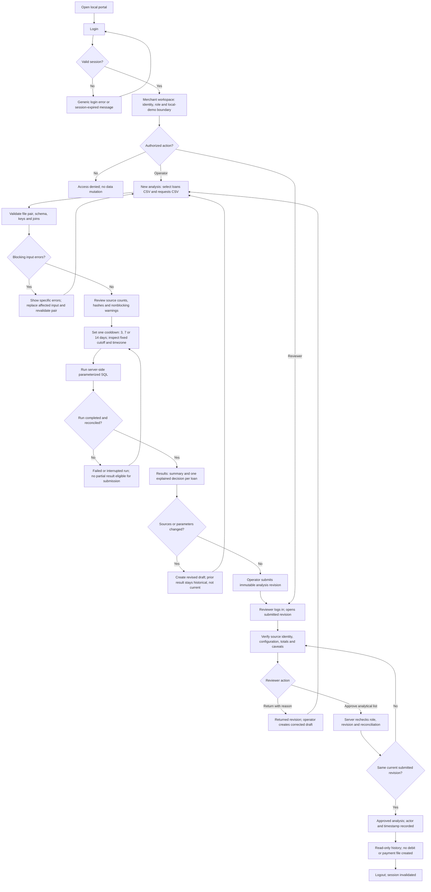
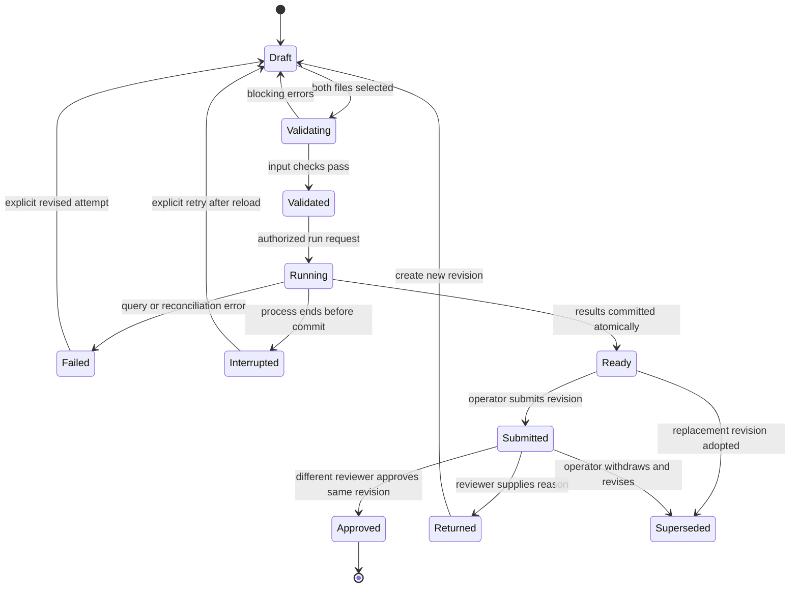

# Belvo Smart Retry: Decision Log and Historical Evidence

Status: historical reference, not an implementation specification.

Canonical source: [Belvo_Payments_Data_Analysis.md](Belvo_Payments_Data_Analysis.md).

This log records decision evolution, historical research and superseded designs. The separately maintained [analytical diagnostic](Belvo_Smart_Retry_Analytical_Diagnostic.md) owns the current evidence report; this log retains the original foundations only as an immutable archive. Its archived content intentionally contains obsolete instructions and conflicting earlier proposals. Nothing here may override the canonical master. Do not feed this log directly into implementation, result exports or the current presentation.

## Documentation migration record

On 2026-11-02, the sponsor requested a single current-state source for the MVP, result/testing CSVs, a post-GTM demo CSV and a presentation including long-term vision. The sponsor explicitly selected `Belvo_Payments_Data_Analysis.md` as the canonical path. The complete pre-cleanup master is preserved below, including its original metadata and all analytical tables/SQL. `Belvo_Smart_Retry_Analysis_v2.md` was discovered as a separate pre-existing file and is left unmodified; it is noncanonical for this project.

The legacy presentation script depends on old analytical headings and multi-parameter proposals. It is guarded against rebuilding from the new master until mapped to the current presentation contract. The existing PPTX is historical, not a synchronized deliverable. No historical spreadsheet/data evidence was deleted and neither original CSV was edited.

## Decision evolution register

| ID | Topic | Historical exploration | Current disposition |
|---|---|---|---|
| D01 | Geography | Inferred Mexico from bank codes | Mexico is the selected market; source currency still inferred MXN |
| D02 | Operating baseline | Public Managed Collections automation versus challenge workflow | Sponsor-defined human-operated upload/run baseline; not a claim about Belvo's live product |
| D03 | Primary user | Merchant self-service versus internal operator | Belvo operator in a hypothetical merchant-scoped local portal |
| D04 | Population | Preferential age bands and legal-stage labels | No bank/age cutoff in initial classifier; entry-age choice remains later discovery |
| D05 | Collection optimization | Timing-first framing | Initial objective is consistent queue preparation; impact evaluated later |
| D06 | Outcomes | Eight-action shadow model and detailed live state handling | Exactly RETRY, WAIT, REVIEW_REMEDIATE in the CSV diagnostic |
| D07 | Parameters | 40-batch cap, 5% bounded amount and 30-day chargeback hold | Excluded from initial implementation; no recommended payment amount |
| D08 | Old shadow result | 258 shadow-eligible loans | Superseded, not a golden result or live eligibility count |
| D09 | Cooldown | Creation-time gaps and 3/7/14 comparison | Latest-batch completion-aware local calendar clock; one active value |
| D10 | Golden seven-day output | Multiple previous rule versions | 400 provisional RETRY, 1,949 WAIT, 713 REVIEW_REMEDIATE for specified source hashes/cutoff |
| D11 | Excel/macros | Candidate implementation format | Rejected; keep traceability, visible assumptions and reconciliation practices |
| D12 | Architecture | SQL script versus spreadsheet versus app | Local web portal with authoritative SQL decision layer |
| D13 | Specific stack | React/FastAPI/DuckDB and other components investigated | Not selected; stack closure interrupted for documentation cleanup |
| D14 | Access and review | Login initially excluded, then explicitly requested | Bounded local Operator/Reviewer, analytical approval only; no financial execution |
| D15 | Operator granularity | Three simulated profiles and detailed remediation workflows | Preserved research hypotheses, deferred post-MVP/post-GTM |
| D16 | Partial collection | Mexico amount control versus balance-aware collection | No amount selection in MVP; exact available-balance collection not assumed |
| D17 | API geography | Brazil Smart Collections versus Mexico Direct Debit | Do not transfer Brazilian capabilities to Mexican implementation |
| D18 | Validation | Analytical Python/SQLite checks | Prior diagnostic evidence only; actual app/SQL-engine/E2E sign-off remains pending |
| D19 | Deliverable phase | Earlier analysis-only/no-output statements | Future deliverables now include MVP, result/testing CSVs, post-GTM demo CSV and summary PPTX |
| D20 | Presentation sync | Legacy 21-slide build from accumulated analysis | Historical deck retained; generator requires re-mapping to canonical master |
| D21 | Documentation | Append corrections while retaining obsolete requirements | One current master; all historical rationale/evidence moved here |
| D22 | Analytical diagnostic | Validation evidence mixed into master and archive | Sponsor requested a dedicated diagnostic report; master retains normative acceptance expectations and links to observed evidence |
| D23 | Stack closure, 2026-11-02 | Stack and endpoints pending; DuckDB among researched options | Master ssot-v1.1 selects React/TypeScript/Vite, FastAPI/Python and one SQLite engine, exact-cent staging, two local roles, versioned API and Approved-only analytical CSV export. No dependencies/app installed; lock resolution and actual tests remain required |

Historical observations do not establish causal recovery lift, avoidable chargebacks, operator savings or a legal delinquency threshold. Source citations and qualifications remain in the archive for audit. Dates in archived sections retain their original context.

### D24 interface language, 2026-11-02

The sponsor selected English for the MVP interface instead of the conversational Spanish proposal. Navigation, labels, validation feedback, empty/error states and review actions will use English, consistent with the English deliverable documentation. Original CSV values and source failure messages remain unchanged for traceability, and API/CSV identifiers are not renamed. The accepted trade-off is a potentially bilingual evidence view when source messages are Spanish; translation/localization is not added to this MVP. This is a sponsor preference, not a finding from operator research. Visual direction remains undecided. Master section 7 and its remaining gates were updated; no screens were built.

### D25 E2E demonstration and edge-case coverage, 2026-11-02

Sponsor requested an E2E and edge-case definition to present a demo alongside the app. Master section 9 now defines eight original-data walkthrough steps, four representative exception demonstrations and fifteen edge-case groups mapped to the existing acceptance requirements. A pre-GTM app walkthrough using the original inputs is distinct from the deferred synthetic post-GTM demo CSV; the latter's schema and generation gate remain unchanged. The 8-10 minute walkthrough budget is a presentation target, not a processing SLA. All application scenarios remain NOT_RUN until implementation and actual execution. Synthetic fixtures are disposable test evidence, not new required business inputs or measured impact. Removed a redundant Submitted-to-Superseded diagram edge: withdrawal to Ready must precede replacement, consistent with the existing API contract. No new rule, app, fixture, CSV or recording was generated.

### D26 explicit backend retry flow, 2026-11-02

Sponsor identified that the high-level E2E hid the central retry logic behind an SQL execution step. Expanded master section 7 with backend authorization/evidence/classification/persistence stages and a nine-rule decision subflow matching section 5 exactly. Added demo guidance to expose the first matching rule and source evidence rather than only category totals. This is a documentation clarification, not a rule change: RETRY remains provisional, amount stays null, WAIT has no automatic scheduler, and approval never executes payment. Actual set-based SQL implementation and assertions remain pending.

### D27 visual direction and navigable wireframe, 2026-11-02

Sponsor approved Belvo as a visual reference with explicit unofficial product-challenge labeling, and sober, clear, operational, deliberately unpolished presentation. Built a standalone English HTML/CSS/JavaScript wireframe in wireframes/index.html, separate from the future app stack. PRODUCT.md is derived skill/design context, not a second source of truth. The impeccable skill informed semantic controls, evidence-first hierarchy, role/state visibility and non-color-only meaning; the sponsor's low-fidelity instruction overrides production-polish guidance. The public Belvo homepage (https://belvo.com/, consulted 2026-11-02) is a reference only, not an authenticated portal design or a copied official design system. A restrained provisional accent is not claimed as an official Belvo token.

Browser walkthrough observed Operator workspace, expected result preview, RETRY boundary evidence, submission, simulated role handoff, required return-comment validation, Reviewer approval and Approved-only export-contract preview. These are prototype interactions, not backend/security/SQL tests. File validation, job completion and error scenarios are simulated; raw source rows are not embedded; history and revisions are not durably persisted. The four surfaces are navigable but do not cover every E01-E15 acceptance condition. No application test status becomes PASS, no result CSV is fabricated, and no payment is created. Next gate is sponsor wireframe review, then implementation bootstrap and real-engine tests.

### D28 system history versus portfolio upload, 2026-11-02

Sponsor approved changing the portal from two manual uploads to one portfolio upload with payment history already in the system. Both original CSVs remain required analytical sources: explicit local setup imports the unchanged request CSV as immutable workspace history, while the Operator uploads the loan snapshot. This emulates integration without claiming live Belvo connectivity. Master source contract, flow, acceptance/demo cases and multipart API now reflect this separation. Each run pins history identity/provenance; missing or invalid history blocks validation and requires setup remediation. Portal requests_file is rejected, not accepted as a workaround. Source hashes, golden counts, ordered heuristic, null recommended amount and non-execution boundary are unchanged.

Serious scope limitation: an arbitrary subset portfolio could otherwise turn unrelated history into orphan errors. The current challenge retains its full original snapshot and strict checks; arbitrary merchant subset/incremental-history scoping is not silently introduced. A real integration would need its own scope/freshness contract. The wireframe now shows read-only history, one file selector and an unavailable-history scenario. No actual history importer, database or payment request was built. Public hosting/access choice remains unresolved; this update does not publish any source data.

### D29 explicit operational outputs, 2026-11-02

Sponsor requested updating upstream flow/rules as well as the wireframe so execution ends in a concrete operational result, not just analysis. Master now defines three persisted decision queues and deterministic next_action_code mapping: RETRY -> PREPARE_RETRY_HANDOFF, WAIT -> REASSESS_ON_OR_AFTER_DATE, REVIEW_REMEDIATE -> INVESTIGATE_BEFORE_RETRY. This is output annotation, not a new eligibility heuristic: original priority, code-04/cooldown logic, counts and null amount remain unchanged. The result-row/API/CSV contract now includes that field and requires real-engine/export consistency tests. Existing diagnostic evidence predates this new field and cannot certify it.

The E2E and demo now explicitly include queue-specific next actions, full-revision review, an Approved output summary and complete non-executable CSV handoff. Wireframe provides queue navigation, action text and a simulated approval-gated output summary; it still cannot create an actual result file or demonstrate backend correctness. Serious limitation remains: no live eligibility, amount choice, scheduler, payment creation or recovery result. Adding those requires separate scope/authority. Filtered views do not alter approval/export population. Source files and historical archive are unchanged.

### D30 operational wireframes versus business-rule documentation, 2026-11-02

Sponsor rejected rule-heavy results as unintuitive and requested formal rules live in product documentation rather than dominate lo-fi screens. Master section 5 remains authoritative for rules; section 7 now specifies progressive disclosure and operational names. Results leads with Retry candidates, Waiting and Needs attention, plain-language reasons, View details and one primary role/state action. Formal enums, SQL pipeline and export-contract tables were removed from the primary prototype experience; secondary evidence remains accessible. Demo controls are collapsed outside the product workflow. All visible example rows are now clearly synthetic, with missing amounts shown as unpopulated rather than invented. Reference totals remain separate and unchanged. No payment execution, classification changes or new backend acceptance PASS is claimed. JavaScript syntax was checked; this revision has not been browser-verified because the browser tool denied file-URL access. Public hosting remains pending audience choice.

### D31 lo-fi screen decisions, 2026-11-02

Sponsor reviewed the eight-screen lo-fi board (wireframes/lofi/smart-retry-lofi.html) and closed its three open questions: loan detail is a side panel over Results; Waiting is ordered by next_check_date ascending then loan_id (prior value: textual loan-ID ordering for every view); Needs attention stays one flat list with an optional reason filter rather than grouped subqueues. Master sections 7 and 13 updated in place. No rule, count or export ordering changes: the result CSV keeps textual loan-ID ordering. The sponsor then authorized implementation start.

### D32 implementation bootstrap, 2026-11-02

Built the first working slice in app/: FastAPI + SQLite backend, rules in sql/rules_minimal_v1.sql, React/Vite portal with the eight lo-fi screens, setup_local.py (history import, two accounts) and start.py. Runtime differs from the checked bundled runtime: Python 3.13.2 (spec cited 3.12.14), SQLite 3.53.4, Node 24.15.0; dependencies pinned in app/requirements.lock and web/package-lock.json. One interpretation recorded: uploading a replacement portfolio is allowed from Validated and returns the run to Draft (section 13 says replacing invalidates draft validation). Actual results: 32 pytest assertions executed and passing against the original CSVs, including 3/7/14 golden counts and Approved-only export; Playwright E2E remains NOT_RUN and the UI has not been verified in a real browser.

### D33 browser E2E suite, 2026-11-02

Added Playwright Test 1.48.2 with Chromium in app/web/e2e/: 14 tests covering E01-E15 (E02 at 3 and 14 days) through the real portal, FastAPI and SQLite with the original CSVs. The suite starts a disposable server on 127.0.0.1:8799 (port 8765 was taken by the wireframe http.server) via new SMART_RETRY_PORT support. Result: 14/14 PASS in two consecutive runs; rows written to app/tests/artifacts/Belvo_Smart_Retry_E2E_Testing.csv. Limits: E09 Interrupted-after-restart and E10 idle timeout are proven in pytest, not in the browser; E13 is a keyboard check, not an accessibility certification.

### D34 payment requests and closed loop, 2026-11-02

Sponsor decided to cross the previous hard boundary "no payment request / no amount / no bank-ready file" and close the loop. Prior value: the MVP ended at the Approved analytical CSV. New: after approval the operator can confirm a payment request file for RETRY candidates in the source nine-column format, amounts split 5/25/70 of the snapshot balance (sponsor choice, matching the dominant historical practice: 16,555 three-member batches; none of 166,747 single requests equalled the current balance), and later import responses in the same format, which become a new pinned history for a follow-up revision evaluated at the end of the latest response day. The MVP still sends nothing. Synthetic responses are allowed only as labeled `synthetic_demo` origin from an out-of-portal script, never as impact evidence. Serious risks accepted: amounts are observed practice, not validated policy; live checks remain unverified; follow-up results on synthetic data are illustrative. Master sections 3, 5, 6, 7, 8, 10 and 13 updated in place.

### D35 closed-loop implementation, 2026-11-02

Implemented D34: migration 002, sql/payment_requests_v1.sql, server/payments.py, four endpoints, follow-up revisions with use_latest_history, per-run evaluated_at in the engine, portal panel with a separate confirmation step, and tools/simulate_bank_responses.py. Defect found by the browser test and fixed: the request-id collision check scanned all history per request and hung the call; it now joins on (file_id, payment_request_id). Results: 37/37 pytest and 15/15 Playwright PASS. With seed 7 every simulated loan fails (historical three-member failure rate 99.4%); success and chargeback routing is covered by a constructed response file in pytest. Not done: four-eyes release of the request file, partial bank responses, a new portfolio snapshot after collections.

### D36 approval releases payment requests, 2026-11-02

Sponsor objected that approving did nothing for retry candidates: the operator still had to come back and prepare requests. Prior value (D34): requests were a separate operator action after approval. New: SQL drafts the run's request set in the same transaction that publishes Ready results; the operator submits results and draft requests together; the distinct reviewer sees the amounts and approving releases them. This gives the money file four-eyes control, which the D35 note listed as missing. Accepted cost: every executed run drafts requests even if never submitted; drafts are inert (no download, no response import). Legacy sets prepared under D34 migrate as Released by the run's reviewer. Implemented the same day: migration 003 (table rebuild with foreign keys off and a foreign_key_check), draft inside the execute transaction, release inside the approve transaction, prepare endpoint removed, portal shows drafts to both roles and per-loan tranches. Results: 38/38 pytest and 15/15 Playwright PASS. The local database was backed up to app/.local-data/backup-before-migration-003.sqlite3 before migrating; its three earlier approved runs have no payment requests and the portal says to create a new revision.

### D37 per-loan payment status in the result CSV, 2026-11-02

Sponsor pointed out that every row of the approved result CSV said `review_state=Approved`, including 1,945 WAIT and 713 REVIEW_REMEDIATE loans, which reads as "approved for collection". Prior value (section 8): revision-level `review_state`, `approved_by`, `approved_at` repeated per row. New: renamed to `analysis_review_state`, `analysis_approved_by`, `analysis_approved_at`, plus per-loan `payment_request_status` (RETRY: RELEASED or RESPONDED, NOT_GENERATED for pre-D36 runs; others NONE) and `payment_request_ids` (three ids in tranche order, matching the payment request CSV). The portal's approved summary now says approval covers the analysis and only retry candidates have released requests. `dataset_kind` values for response-derived histories are now defined in section 8. Breaking change for anyone parsing the old column names; result CSVs downloaded before this change keep the old header. Results: 38/38 pytest and 15/15 Playwright PASS.

### D38 fatigue rest rule, 2026-11-02

Sponsor approved adding a fatigue rule. Evidence: 273 of the 400 seven-day RETRY candidates (68%) never had a successful request; the median insufficient-funds streak is 12 and 143 have 20 or more. First design routed fatigued loans to REVIEW_REMEDIATE; measured impact at N=20 grew Needs attention from 713 to 2,477 loans (81% of the portfolio), unworkable as an investigation queue, so it was rejected before shipping. Adopted: once the streak reaches N (10/20/30, portal default 20), the loan waits 30 days from its anchor instead of the cooldown (new rule 8, FATIGUE_REST, WAIT). Today's RETRY list barely changes (400 to 398 at seven days) because current candidates already sat idle for weeks; the effect is cadence: 1,623 loans move from a weekly to a monthly retry. Rough estimate, assuming every eligible loan is retried on its check date: about 3.3 fewer attempts per rested loan per month. N and the 30 days are judgment calls, not optimized; history comes from surviving overdue loans. Rule version minimal-v2; fatigue off equals minimal-v1 per loan.

### D39 holdout experiment, 2026-11-02

Added a reproducible holdout (0/10/20%, portal default 10%) of RETRY candidates that receive no payment requests, plus a measurement endpoint and panel. Incremental recovery is measured only from a later portfolio snapshot, because held-out loans have no other observable outcome; with about 40 control loans at 10% the result is directional. Synthetic snapshots assume no self-cure.

### D40 retry queue ordering, 2026-11-02

RETRY is shown with previous payers first (most recent success first), then shortest streak. Display only; decisions, approval scope and exports are unaffected. Results for D38-D40: 42/42 pytest and 16/16 Playwright PASS; local database backed up before migration 004.

### D41 delivery package, 2026-11-02

Built the submission set: result, payment request and testing CSVs generated from a real approved run in a disposable database (`app/tools/generate_deliverables.py`, with a manifest of hashes); `app/bootstrap.sh` one-command setup, verified from a clean copy (fresh venv, npm ci, build, history import, start); a 60-second captioned walkthrough recorded by Playwright; a one-page summary (.md and .docx, verified at one letter page via a PDF render); and a new 12-slide deck built with pptxgenjs instead of the paused legacy generator. Defects found and fixed along the way: with the detail panel open at 1280 px the queue table squeezed loan IDs onto four lines (now nowrap, Bank column hidden, table scrolls); the approved summary claimed every retry candidate had released requests even with a holdout (now shows released and held-out counts). Deck visual review is pending: PowerPoint did not answer Apple events, so slides were checked for content and geometry only.

### D42 impact sizing and product strategy, 2026-11-02

Sponsor found the long-term strategy too thin and asked for potential impact and the strategy worth pursuing. Prior value: section 11 had release gates and a four-row directional vision. New: a retrospective replay of the current rules over the 22.3-month history (60.0% of requests and 35.5% of chargeback batches would have been stopped; those attempts held 17.4% of collected money, an upper bound on recovery at risk; MXN per 1,000 requests 4,719 to 9,734), four strategy options weighed, a recommended thesis (income-aware collections intelligence on Belvo's rails, proven by holdouts), a gated roadmap, business model and kill criteria. Belvo capabilities were checked against public sources the same day. No peso savings are claimed because attempt and chargeback costs are not in the data. Release gates kept unchanged. The one-page summary now carries the impact and strategy (still one letter page) and the deck grew from 12 to 17 slides (impact, waste by rule, options, why Belvo, gated roadmap, business model and kill criteria); every slide was reviewed from a PowerPoint PDF export and layout defects were fixed.

### D43 submission package aligned to the brief, 2026-11-02

Sponsor listed three primary deliverables (MVP, summary, presentation) with a required list of deck topics, plus demo videos, a user guide and a detailed PRD. The deck was rebuilt to 32 slides in five sections answering each topic explicitly: data analysis (failure codes: 04 is 84.7% of failures), hypotheses with supported, rejected or to-test status, scope and constraints, heuristics, end-to-end process with roles and states, operator interaction, screen elements, parameter configuration with measured effects, green-light metrics and decision rule, scalable architecture, expansion (Brazil's Pix Automático shifts value upstream because the payer's bank runs retries in a regulated window; public sources conflict on details, so marked to confirm), and GTM led by a waste-audit replay of each lender's history. Added an edge-case video (invalid file, needs-attention evidence, return with comment, stale approval, session expiry) recorded in one window, re-recorded the happy path, and wrote the PRD and user guide (.md and .docx). Every slide was reviewed from a PowerPoint export; table overflow, a too-small thumbnail and a two-line title were fixed.

### D44 short presentation, 2026-11-02

Sponsor was asked for a short deck. Made a separate copy with 14 slides (from 32) that still answers every required topic: dividers and agenda removed; scope merged with trade-offs, configuration with buttons and dashboard, results with impact, strategy options with GTM and why Belvo, roadmap with next steps and kill criteria. The full 32-slide deck is unchanged. Every slide was reviewed from a PowerPoint PDF export; a two-line title and a table overlapping a card were fixed.

### D45 public repository, 2026-11-02

Sponsor chose to share the MVP as a public GitHub repository including the two challenge CSVs, after being told the payment history is Belvo's data and would become publicly indexable. Published https://github.com/juanbustamanteg/belvo-smart-retry from a clean export (`scripts/export_repo.sh`): the app, both CSVs, master spec, diagnostic (local folder path redacted), decision log, challenge brief, wireframes, deliverables and deck scripts; never local data, credentials, environments or unrelated home-folder content. Verified by cloning from GitHub into an empty folder and running `./app/bootstrap.sh`: history imported with the original hash and the app served on a spare port. Updates require re-running the export into a clone and pushing.

## Future log entries

### D23 technical foundation, checked 2026-11-02

References supporting the selected components: [React with a build tool](https://react.dev/learn/build-a-react-app-from-scratch), [Vite requirements](https://vite.dev/guide/), [FastAPI file upload](https://fastapi.tiangolo.com/tutorial/request-files/), [FastAPI password hashing](https://fastapi.tiangolo.com/tutorial/security/oauth2-jwt/), [Python SQLite](https://docs.python.org/3.12/library/sqlite3.html), [SQLite local use](https://www.sqlite.org/whentouse.html), [WAL and patched SQLite versions](https://www.sqlite.org/wal.html), [React Router](https://reactrouter.com/start/declarative/installation), [FastAPI testing](https://fastapi.tiangolo.com/tutorial/testing/), [Playwright server tests](https://playwright.dev/docs/test-webserver).

One SQLite engine avoids duplicating persistence and decision runtimes for the local exercise. The principal limitation is single-writer contention, addressed by one bounded analysis worker, separate connections and explicit busy/conflict behavior; the MVP must still measure actual performance. The Python runtime observed SQLite 3.53.1 and Node 24.22.1/Python 3.12.14 were present. Framework packages were not installed or compatibility-certified. Monetary values move through Decimal into integer cents rather than SQLite REAL. WAL's patched-version requirement follows SQLite's documented WAL-reset issue; no production database guarantees are inferred.

The technical API is an application contract designed for this MVP, not Belvo's payment API. Approval only accepts an analytical revision. Two staged source files and one active cooldown remain the business inputs. Updating lifecycle diagrams to include withdrawal and appending review metadata to CSV exports do not change the classification rules or golden counts.

### D23 selection rationale and bounded trade-offs

Decision date: 2026-11-02. Sponsor accepted the selected stack and technical contract and requested explicit documentation of the reasons. These are design judgments for a local, consistency-first challenge, not measured performance or production-readiness claims. The canonical requirements remain in master sections 6 and 13; this register explains them without adding requirements.

| Choice | Why it fits this deliverable | Alternative not selected | Main trade-off and reconsideration trigger |
|---|---|---|---|
| Local web portal rather than Excel/macros or a standalone SQL script | Supports the requested merchant-portal experience, authenticated roles, evidence inspection and an end-to-end review flow while retaining SQL decisions | Excel/macros; SQL-only interface | Serious: more implementation and testing surface than a script. Justified by the explicit portal requirement, not by evidence that a web app improves recovery |
| React + TypeScript + Vite, with declarative React Router | Separates reusable UI, typed client models and navigation from the authoritative backend; a built client suits one local server without an SSR requirement | Full-stack/SSR framework; unstructured browser scripts | Minor: build tooling and client state still need maintenance; TypeScript cannot replace runtime API validation. Revisit if server rendering or a different hosting model becomes a real requirement |
| Python + FastAPI + Pydantic + Uvicorn | Keeps CSV parsing, Decimal handling, timezone staging, validation and API implementation in one backend language; allows reuse of diagnostic knowledge without treating the old scripts as the app | Node-only backend; a heavier server framework | Minor: frontend and backend use different languages and contracts can drift. API contract tests and generated OpenAPI must detect drift; exact compatible versions remain unverified until bootstrap |
| SQLite through sqlite3 as the only persistence and decision engine | Keeps transactional run state and SQL classification together without a database server or dual-engine synchronization; the diagnostic offers prior logic-comparison evidence | DuckDB plus a separate state store; PostgreSQL server | Serious: write contention and local-machine durability limits. One active analysis is a deliberate bound, not proof of capacity. Reconsider for concurrent merchants, multiple server processes or measured workload failure; benchmark the supplied files before acceptance |
| Versioned SQL for decisions; Python for ingestion and time normalization | Makes ordered rules inspectable and testable at one authoritative layer, rather than duplicating them in UI code | Browser decision engine; separate Python and SQL rule implementations | Serious: SQL can still encode the wrong business meaning. Independent Decimal-based oracles, boundary cases and real-engine tests remain necessary |
| Decimal parsing, integer cents and decimal-string boundaries | Preserves cent-level source values and makes monetary reconciliation explicit rather than relying on binary floating point | SQLite REAL / floating-point JSON calculations | Minor: explicit conversions, overflow checks and fixed two-decimal precision. Revisit the monetary contract if sub-cent amounts or other currency precision become in scope |
| Explicit UTC instants and Mexico City calendar-date staging | Implements the agreed completion-aware local-day cooldown reproducibly at a fixed evaluation cutoff | Server-local timezone; elapsed-hours approximation; current-clock scoring | Serious: timestamp parsing and calendar boundaries can change decisions. Preserve raw values and test offsets, ties and exact cooldown boundaries; do not infer a debit schedule from next_check_date |
| Same-origin local server and revocable cookie sessions with Argon2 password hashes | Supports real backend authorization and logout without an external identity provider or browser-stored JWT; one origin bounds deployment complexity | JWT/localStorage; hosted identity service; a role selector without login | Serious: loopback HTTP and seeded local users are not production identity/security. Revisit transport, identity, tenancy and threat model before any hosted deployment |
| Operator/Reviewer separation and Approved-only result export | Makes the acceptance of an exact analytical revision explicit and prevents an unreviewed final export | One unrestricted account; unrestricted draft export | Minor: adds a review step and two-account demo setup. Approval is analytical only, never payment authorization or a claim that missing production checks passed |
| Immutable revisions, source hashes, optimistic locking and idempotency | Preserve which files, configuration and rules produced a result; address stale actions and repeated submissions without overwriting evidence | Mutable latest-result record; blind request retries | Serious: additional state-machine and transaction complexity. Prove behavior with stale-version, duplicate-action, failure and restart tests; do not claim exactly-once bank execution |
| One bounded local worker, no queue service, ORM, Docker or cloud infrastructure | Keeps packaging aligned with one local operator workflow and makes SQL/transactions directly inspectable | Redis/Celery, managed services, multiworker execution and container-first delivery | Minor: less deployment portability and no distributed scheduling; interrupted jobs require explicit retry. Revisit only when operational scope or measured limits justify additional infrastructure |
| pytest + real SQLite integration + Playwright/Chromium E2E | Separates rule/API checks from a browser-to-database proof of the actual workflow | Mock-only tests; prior analytical assertions treated as app certification | Serious: test maintenance and execution time; Chromium alone is not cross-browser certification. Actual PASS/FAIL evidence must come from the implemented application |
| Resolve and lock exact dependencies at implementation bootstrap | Avoids inventing package versions or claiming compatibility before installation, while requiring reproducible builds | Floating dependencies; speculative version pins | Minor: bootstrap remains a release gate. Record resolved versions and runtime checks before claiming the stack runs |

The strongest case for a smaller SQL-only prototype is lower implementation cost. It was not selected because the agreed deliverable explicitly includes login, permissions, an operator workflow and review. The strongest case for PostgreSQL or an additional analytical engine is broader concurrency or specialized workloads; neither is an established requirement for this bounded local MVP. No selected component establishes incremental recovery, fewer chargebacks or lower operating cost by itself.

When changing a decision, add date, topic, previous value, new value, explicit approval/evidence, affected artifacts and migration/test requirements here. Replace the master's operative requirement in place; do not append contradictory instructions to it. Update generated artifact versions and source hashes after validation.

## Archived working document

---
title: Belvo Payments Data Analysis
language: en
portfolio_snapshot_date: 2025-11-11
source_timezone: UTC
business_timezone: America/Mexico_City
currency: MXN (inferred)
analysis_grains:
  - raw_request
  - collection_batch
  - suspected_duplicate_intent
source_files:
  - PaymentsPM_Challenge_loan_info.csv
  - PaymentsPM_Challenge_payment_requests.csv
---

# Belvo Payments Data Analysis

## 1. Executive summary

**Sponsor-defined challenge baseline:** assume the current collections workflow is 100% human-operated: a Belvo agent uploads transaction lists and manually initiates their execution. The proposed product automates much of this preparation, evaluation and scheduling work and routes exceptions for review. This is the explicit scenario for the challenge, not a verified description of Belvo's current commercial product. Section 19 is authoritative for this operating-model assumption; public API and product research remains capability evidence only.

**Accepted minimal analytical scope:** section 20 now specifies one provisional decision per loan using only the two supplied CSVs. It replaces the earlier multi-parameter shadow sketch as the first rule set for this exercise. The 3/7/14-day cooldown comparison is a sensitivity check, not an adopted production policy or an experiment result. No payment amounts are selected and no live collection file is authorized.

**Acceptance sequence:** first prove complete, deterministic and explainable classification; then test operational and recovery impact. Section 22 defines the consistency acceptance contract and distinguishes checked analytical logic from unbuilt application behavior. Neither passing these checks nor producing a candidate count establishes recovery lift or savings.

This analysis describes the current loan portfolio and its historical payment-request behavior. It does not modify the current portfolio with historical payments. That follows the challenge instruction that the loan portfolio is already updated.

Country and currency are not explicit source fields. All eleven entity codes start with `mx_`, the failure messages are in Spanish, and the entities are Mexican. The analysis therefore identifies the portfolio as Mexico and treats monetary values as MXN. This is an inference, not a source-system guarantee.

### Headline metrics

| Metric | Result | Grain or denominator |
|---|---:|---|
| Portfolio loans | 3,062 | Unique `loan_id` in the current loan snapshot |
| Original principal | MXN 3,608,439.00 | Sum of `loan_amount` |
| Current outstanding | MXN 10,952,619.00 | Sum of `total_amount_outstanding` |
| Loans overdue with positive outstanding | 3,062, 100.0% | Current portfolio snapshot |
| Historical payment requests | 253,006 | Unique `payment_request_id` |
| Loans with at least one request | 3,033, 99.1% | Current loans |
| Loans without a request | 29, 0.9% | Current loans |
| Collection batches | 193,629 | Unique `loan_id + created_at` |
| Suspected duplicate-intent groups | 7,437 | Repeated `loan_id + created_at + amount` |
| Failed requests | 246,932, 97.60% | Raw requests |
| Successful requests | 4,691, 1.85% | Raw requests |
| Chargeback requests | 1,383, 0.55% | Raw requests |
| Final successful amount | MXN 1,193,885.90, 0.85% | Requested amount |
| Chargeback amount | MXN 421,176.10, 0.30% | Requested amount |
| Loans with any historical success | 1,270, 41.5% | Current loans |
| Loans with any historical chargeback | 559, 18.3% | Current loans |
| Raw requests per loan, median | 79 | All 3,062 current loans, including zero-request loans |
| Collection batches per attempted loan, median | 61 | 3,033 attempted loans |
| Source request period | 2023-12-29 to 2025-11-07 | `created_at`, UTC |
| Inferred portfolio snapshot | 2025-11-11 | `overdue_at + overdue_days`, identical for all loans |

### Decision-relevant findings

**Problem scope for validation.** Improve the discretion of Belvo's existing collection process by deciding which loans warrant another instruction and when, within each B2B client's policy. Section 17 defines three operator outcomes: retry candidate, wait, and review/remediation. Code 04 accounts for 209,097 of 246,932 failed requests (84.68%), supporting a distinct timing path for insufficient funds rather than treating every failure alike. Entry-age segment selection remains a hypothesis in section 16. Neither the extract nor the challenge's problem statement proves which individual retries or chargebacks were avoidable.

#### Finding 1: the process retries far beyond the point of strong marginal yield

**Evidence.** The median attempted loan received 61 collection batches and 79 raw requests. The first batch had a 7.72% any-success rate. The rate fell to 1.58% for batches 41-60, 0.89% for batches 81-100, 0.42% for batches 101-125, and 0% across the 260 observed batches numbered 126-150.

**Product implication.** Add a configurable batch cap and require an explicit exception path after the cap. A 40-batch cap is a reasonable experiment starting point, with 20 and 60 as sensitivity arms. It is not an economically optimal threshold because request cost and expected recovery value are missing.

**Limitation.** Later attempts belong to harder, selected cases. The decay is descriptive and should not be treated as the causal effect of attempt number.

#### Finding 2: failure reason is the strongest available eligibility signal

**Evidence.** Insufficient funds produced 209,097 failures, 84.68% of all failures, and had a 1.87% next-batch success rate. Account cancelled, blocked, nonexistent, wrong receiving bank, and customer stop-payment reasons each had next-batch success at or below 0.15%. Code 11, service not authorized, was different: 3.41% succeeded in the next batch and 45.82% of affected loans eventually recorded a later success.

**Product implication.** Treat insufficient funds as a soft failure eligible for a cooled retry. Treat codes 1, 2, 3, 6, 8, and 10 as stop or remediation states. Treat code 11 as an authorization-remediation state, not a normal automatic retry.

**Limitation.** “Eventually succeeded” measures whether a loan ever succeeded after first showing that reason. It does not prove the same account condition remained unchanged.

#### Finding 3: longer spacing correlates with higher recovery, but selection prevents a causal conclusion

**Evidence.** At collection-batch grain, any-success was 1.74% after a gap of one day or less, 2.49% after 7-14 days, 4.47% after 14-30 days, and 8.07% after 30-60 days. The long-gap buckets are small and highly selected.

**Product implication.** Start a controlled cooldown experiment at 7 days, with 3-day and 14-day comparison arms. Measure incremental recovery per eligible loan, not raw success rate alone.

**Limitation.** Long gaps may reflect manual intervention, updated mandates, a different customer cohort, or pay-cycle timing. The source has none of those fields.

#### Finding 4: smaller requested amounts perform better in this historical mix

**Evidence.** Requests of MXN 50-100 had a 3.85% success rate. The rate fell to 1.52% at MXN 200-500, 0.53% at MXN 1,000-2,000, and 0.13% at MXN 2,000-4,000. Exact requests equal to 5% of current outstanding succeeded 1.73% of the time, compared with 0.70% at 25% and 0.56% at 70%.

**Product implication.** Test one low amount per batch, beginning around 5% of outstanding and bounded by merchant minimum and maximum amounts. Do not send low, medium, and high requests simultaneously without an explicit reason and idempotency protection.

**Limitation.** Request amount is confounded by customer, balance, policy version, bank, and delinquency. Historical requests are joined to the current outstanding snapshot, not an outstanding balance captured at request time.

#### Finding 5: the October policy change increased request volume without an observed yield improvement

**Evidence.** Requests per collection batch were approximately 1.00 through June 2025, 1.02 in September, 2.08 in October, and 2.20 in the partial November period. Batch any-success fell from 2.78% in September to 1.67% in October and 1.14% in November. Exact 5%/25%/70% outstanding-ratio triplets appear from 9 October 2025 onward.

**Product implication.** Treat the parallel amount strategy as an unproven experiment. Compare it with a single-request strategy using randomized or matched eligible loans and one primary outcome: final successful amount per eligible loan after chargeback maturation.

**Limitation.** October and November use different cohorts and policies. November is partial. This is not a causal before-and-after result.

#### Finding 6: a suspected duplicate-dispatch pattern needs an idempotency investigation

**Evidence.** There are 7,437 repeated `loan_id + created_at + amount` groups containing 15,000 rows. Retaining one row per group would leave 7,563 additional rows representing MXN 9,243,882.05 of repeated requested value. At exactly `2025-10-14 10:49:04 UTC`, there were 13,767 requests across 2,448 loans; 5,695 rows and MXN 6,042,771.05 are additional rows under the suspected duplicate-intent key.

**Product implication.** Add an idempotency key at least at `merchant + loan + scheduled_at + amount + policy_version`, block duplicate dispatches, and expose batch lineage to operators.

**Limitation.** The source does not contain rail, merchant, schedule, mandate, or idempotency identifiers. Simultaneous same-amount rows could represent legitimate independent instructions. The analysis therefore reports the pattern without deleting rows or calling it a confirmed defect.

#### Finding 7: bank-level performance differs enough to justify stratification, not enough to rank banks causally

**Evidence.** Raw request success ranges from 0% to 3.31% by entity. Among entities with at least 100 portfolio loans, Banco Coppel, Banorte, and HSBC show the highest request success rates, while Banco Azteca carries 34.8% of loans and 58.7% of all chargebacks. Chargebacks are 43.5% of Banco Azteca’s nonfailed outcomes, versus 5.9% at Citi Banamex.

**Product implication.** Configure and monitor retry policy by bank or rail. Use bank as a model feature and experiment stratum, not as a standalone exclusion rule.

**Limitation.** Bank results are confounded by amount, delinquency, customer mix, retry count, and policy history. The smallest entities have inadequate sample sizes.

#### Finding 8: current balance and delinquency age identify lower-yield segments

**Evidence.** Request success declines from 3.14% for outstanding balances up to MXN 1,000 to 0.75% for MXN 8,000-16,000. It declines from 2.93% at 61-90 overdue days to 0.89% after 730 days. Loans 366-730 days overdue have a median 129 raw requests.

**Product implication.** Use outstanding balance and overdue age in prioritization and expected-value ranking. Do not apply a binary cutoff until attempt cost, recovery margin, and fairness or compliance constraints are known.

**Limitation.** Older loans have more exposure time and more requests, so loan-level “ever succeeded” and request-level yield answer different questions.

## 2. Data scope and quality

### Source tables and grain

| Source | Rows | Primary key | Grain |
|---|---:|---|---|
| `PaymentsPM_Challenge_loan_info.csv` | 3,062 | `loan_id` | Current loan snapshot |
| `PaymentsPM_Challenge_payment_requests.csv` | 253,006 | `payment_request_id` | One historical payment-request record |

### Loan data dictionary

| Field | Parsed type | Use in this analysis |
|---|---|---|
| `loan_id` | BIGINT identifier | Join key; unique in the portfolio |
| `payment_method_bank` | Text | Entity code and inferred country prefix |
| `loan_amount` | Numeric | Original principal or source loan amount |
| `total_amount_outstanding` | Numeric | Current snapshot balance; never reduced with historical requests |
| `overdue_at` | Date | Delinquency start date |
| `overdue_days` | Integer | Days overdue at the portfolio snapshot |

### Payment-request data dictionary

| Field | Parsed type | Use in this analysis |
|---|---|---|
| `payment_request_id` | UUID-like text | Unique request identifier |
| `created_at` | UTC timestamp | Request creation and batch key |
| `completed_at` | UTC timestamp | Final processing completion |
| `chargeback_at` | UTC timestamp, nullable | Chargeback timing |
| `status` | Text | Final observed request outcome: `failed`, `successful`, or `chargeback` |
| `amount` | Numeric | Requested amount, assumed MXN |
| `failed_reason` | Nullable numeric code | Failure classification |
| `failed_message` | Nullable text | Source failure description |
| `loan_id` | BIGINT identifier | Join to the current portfolio |

### Analytical grains

| Grain | Key | Count | Purpose |
|---|---|---:|---|
| Raw request | `payment_request_id` | 253,006 | Source truth for outcome and amount |
| Collection batch | `loan_id + created_at` | 193,629 | One scheduling event for one loan |
| Suspected duplicate intent | `loan_id + created_at + amount` | 245,443 distinct keys; 7,437 repeated keys | Audit possible redundant dispatches without deleting data |

Attempt number and cooldown analysis use collection batches. Raw-row ordering inside an identical loan and timestamp has no valid business meaning.

### Join coverage and key integrity

| Check | Result |
|---|---:|
| Unique loan IDs | 3,062 of 3,062 rows |
| Unique payment request IDs | 253,006 of 253,006 rows |
| Payment-loan IDs found in portfolio | 3,033 of 3,033, 100.0% |
| Current loans with no payment request | 29 |
| Payment rows without matching loan | 0 |
| Exact duplicate rows excluding request ID | 0 |
| Repeated `loan_id + created_at` groups | 26,882 groups, 86,259 rows |
| Maximum requests in one collection batch | 6 |
| Repeated suspected-intent groups | 7,437 groups, 15,000 rows |
| Additional rows under suspected-intent key | 7,563 |

### Nulls and status-dependent fields

| Field | Null rows | Interpretation |
|---|---:|---|
| Loan fields | 0 | Complete current portfolio fields |
| `created_at` | 0 | All mixed ISO-8601 variants parse when fractional and nonfractional seconds are accepted |
| `completed_at` | 0 | Every request has a completion timestamp |
| `chargeback_at` | 251,623 | Populated for all 1,383 chargeback-status rows and absent otherwise |
| `failed_reason` | 6,074 | Exactly the 4,691 successful and 1,383 chargeback rows |
| `failed_message` | 6,074 | Same status-dependent pattern as `failed_reason` |

### Date coverage and anomalies

| Field | Minimum | Maximum |
|---|---|---|
| `overdue_at` | 2023-06-19 | 2025-11-09 |
| `created_at` | 2023-12-29 13:06:14 UTC | 2025-11-07 13:41:32 UTC |
| `completed_at` | 2024-01-02 08:40:30 UTC | 2025-11-11 09:31:30 UTC |
| `chargeback_at` | 2024-01-04 00:00:00 UTC | 2025-11-10 10:30:52 UTC |

For every loan, `overdue_at + overdue_days = 2025-11-11`. This makes 11 November 2025 the inferred portfolio snapshot date.

Four chargeback timestamps precede `completed_at`. Three are earlier on the same completion date and could be a date-only or timezone issue. One is 81.5 days earlier and is not plausible under the apparent event sequence. Chargeback-lag analysis retains all rows but reports this anomaly.

Failure codes 8 and 10 each map to more than one message:

| Code | Message | Requests |
|---:|---|---:|
| 8 | `Por orden del cliente: Orden de no pagar a ese Emisor` | 10,654 |
| 8 | `Baja por oficina` | 3 |
| 10 | `Por orden del cliente: Cancelación del servicio` | 235 |
| 10 | `Domiciliación dada de baja` | 1 |

The product should model a normalized reason category while retaining the raw code and message.

## 3. Portfolio and payment performance

### Country and entity composition

All entity codes begin with `mx_`; the inferred country is Mexico.

| Entity code | Loans | Portfolio share | Outstanding (MXN) | Outstanding share | Median overdue days |
|---|---:|---:|---:|---:|---:|
| `mx_azteca` | 1,065 | 34.78% | 3,660,714 | 33.42% | 266 |
| `mx_santander` | 647 | 21.13% | 2,144,225 | 19.58% | 252 |
| `mx_banorte` | 473 | 15.45% | 1,792,405 | 16.37% | 261 |
| `mx_citi_banamex` | 414 | 13.52% | 1,726,120 | 15.76% | 245 |
| `mx_hsbc` | 201 | 6.56% | 760,059 | 6.94% | 276 |
| `mx_bancoppel` | 141 | 4.60% | 284,936 | 2.60% | 86 |
| `mx_scotiabank` | 78 | 2.55% | 383,358 | 3.50% | 251 |
| `mx_inbursa` | 34 | 1.11% | 155,612 | 1.42% | 290 |
| `mx_prudential` | 5 | 0.16% | 28,640 | 0.26% | 516 |
| `mx_monterrey_regional` | 2 | 0.07% | 8,760 | 0.08% | 872 |
| `mx_multiva` | 2 | 0.07% | 7,790 | 0.07% | 209 |
| **Total** | **3,062** | **100.00%** | **10,952,619** | **100.00%** | **244 portfolio median** |

### Current portfolio distributions

| Metric | Minimum | P25 | Median | P75 | P90 | P95 | P99 | Maximum |
|---|---:|---:|---:|---:|---:|---:|---:|---:|
| Loan amount (MXN) | 10 | 400 | 700 | 1,600 | 2,600 | 3,500 | 6,939 | 8,000 |
| Outstanding (MXN) | 18 | 1,190 | 2,156 | 4,921.50 | 7,700 | 10,410 | 21,479.11 | 27,213 |
| Overdue days | 2 | 119 | 244 | 402 | 531.9 | 596 | 790.95 | 876 |

All 3,062 loans have positive outstanding balances greater than the recorded loan amount. Aggregate outstanding is 3.04 times aggregate original principal. The mean loan-level ratio is 3.06. The dataset does not identify whether this difference is interest, fees, penalties, refinancing, or another accounting component.

### Payment outcome by request count and amount

| Final request status | Requests | Request share | Requested amount (MXN) | Amount share | Unique loans |
|---|---:|---:|---:|---:|---:|
| Failed | 246,932 | 97.599% | 139,315,754.15 | 98.854% | 3,025 |
| Successful | 4,691 | 1.854% | 1,193,885.90 | 0.847% | 1,270 |
| Chargeback | 1,383 | 0.547% | 421,176.10 | 0.299% | 559 |
| **Total** | **253,006** | **100.000%** | **140,930,816.15** | **100.000%** | **3,033 attempted loans** |

Chargebacks are 22.77% of nonfailed outcomes by count and 26.08% by amount. These are final-status shares, not a causal chargeback rate for initially successful transactions because the dataset does not show status history.

### Requests and batches per loan

| Statistic | Raw requests per current loan | Collection batches per attempted loan |
|---|---:|---:|
| Count | 3,062 | 3,033 |
| Mean | 82.63 | 63.84 |
| P25 | 55 | 35 |
| Median | 79 | 61 |
| P75 | 116 | 94 |
| P90 | 133 | 108 |
| P95 | 143 | 118 |
| P99 | 154 | 128 |
| Maximum | 194 | 148 |

| Raw requests per current loan | Loans | Share |
|---|---:|---:|
| 0 | 29 | 0.95% |
| 1 | 10 | 0.33% |
| 2-5 | 42 | 1.37% |
| 6-10 | 46 | 1.50% |
| 11-25 | 128 | 4.18% |
| 26-50 | 306 | 9.99% |
| 51-100 | 1,424 | 46.51% |
| 101-200 | 1,077 | 35.17% |

### Derived loan collection-history segments

These are analytical segments, not contractual loan statuses.

| Derived segment | Definition | Loans | Share |
|---|---|---:|---:|
| `failures_only` | At least one request, no successful or chargeback final status | 1,424 | 46.51% |
| `has_success_no_chargeback` | At least one success, no chargeback | 1,050 | 34.29% |
| `chargeback_no_success` | At least one chargeback, no final success | 339 | 11.07% |
| `success_and_chargeback` | At least one success and one chargeback | 220 | 7.18% |
| `no_requests` | No matching payment request | 29 | 0.95% |
| **Total** |  | **3,062** | **100.00%** |

### Latest observed payment status

| Latest payment status | Attempted loans | Share of attempted loans |
|---|---:|---:|
| Failed | 2,971 | 97.96% |
| Chargeback | 35 | 1.15% |
| Successful | 27 | 0.89% |
| **Total** | **3,033** | **100.00%** |

Latest payment status is an event-history attribute. It must not be labeled as current loan status.

## 4. Retry dynamics and relationships

### Bank performance

| Entity code | Requests | Request success | Request chargeback | Loans with any success | Chargeback share of nonfailed outcomes |
|---|---:|---:|---:|---:|---:|
| `mx_azteca` | 86,547 | 1.22% | 0.94% | 32.96% | 43.54% |
| `mx_santander` | 56,833 | 1.72% | 0.44% | 43.28% | 20.50% |
| `mx_citi_banamex` | 38,001 | 1.55% | 0.10% | 36.71% | 5.91% |
| `mx_banorte` | 33,891 | 3.18% | 0.45% | 52.85% | 12.29% |
| `mx_hsbc` | 19,021 | 3.06% | 0.42% | 55.22% | 12.08% |
| `mx_bancoppel` | 7,697 | 3.31% | 0.32% | 51.77% | 8.93% |
| `mx_scotiabank` | 6,871 | 1.59% | 0.28% | 47.44% | 14.84% |
| `mx_inbursa` | 3,172 | 1.36% | 0.22% | 38.24% | 14.00% |
| `mx_prudential` | 554 | 0.54% | 0.00% | 40.00% | 0.00% |
| `mx_monterrey_regional` | 250 | 0.00% | 0.00% | 0.00% | Not applicable |
| `mx_multiva` | 169 | 1.18% | 0.00% | 50.00% | 0.00% |

Bank comparisons should be stratified by amount, delinquency, policy period, and attempt number before use in a production rule.

### Failure-reason behavior

`Next-batch success` means the next distinct `loan_id + created_at` batch contained at least one successful request. `Eventual success` is the share of loans that ever recorded a later successful request after first showing the reason.

| Code | Failure message | Raw failures | Share of failures | Loans | Next-batch success | Eventual success |
|---:|---|---:|---:|---:|---:|---:|
| 4 | Cuenta con insuficiencia de fondos | 209,097 | 84.68% | 2,948 | 1.87% | 39.76% |
| 3 | Cuenta cancelada | 14,385 | 5.83% | 230 | 0.08% | 2.61% |
| 8 | Por orden del cliente: Orden de no pagar a ese Emisor | 10,654 | 4.31% | 278 | 0.15% | 12.23% |
| 2 | Cuenta bloqueada | 7,454 | 3.02% | 151 | 0.06% | 9.27% |
| 1 | Cuenta inexistente | 3,250 | 1.32% | 45 | 0.09% | 6.67% |
| 6 | Cuenta no pertenece al banco receptor | 1,000 | 0.40% | 22 | 0.00% | 0.00% |
| 11 | Cliente no tiene autorizado el servicio | 853 | 0.35% | 275 | 3.41% | 45.82% |
| 10 | Por orden del cliente: Cancelación del servicio | 235 | 0.10% | 39 | 0.43% | 17.95% |
| 8 | Baja por oficina | 3 | <0.01% | 1 | 0.00% | 0.00% |
| 10 | Domiciliación dada de baja | 1 | <0.01% | 1 | 0.00% | 0.00% |

Code 11’s high eventual-success rate and low immediate-success rate support a remediation workflow: wait for a new authorization event, then retry. They do not support blind repeated requests.

### Diminishing success by collection-batch number

| Batch number | Batches | Loans exposed | Any-success rate | Any-chargeback rate |
|---|---:|---:|---:|---:|
| 1 | 3,033 | 3,033 | 7.72% | 3.10% |
| 2 | 3,023 | 3,023 | 6.65% | 2.45% |
| 3 | 3,014 | 3,014 | 6.10% | 2.09% |
| 4-5 | 5,994 | 3,003 | 5.06% | 1.65% |
| 6-10 | 14,785 | 2,980 | 3.59% | 1.34% |
| 11-20 | 28,855 | 2,922 | 2.56% | 0.77% |
| 21-40 | 49,781 | 2,837 | 1.99% | 0.53% |
| 41-60 | 35,679 | 2,044 | 1.58% | 0.48% |
| 61-80 | 25,929 | 1,522 | 1.45% | 0.22% |
| 81-100 | 16,652 | 1,039 | 0.89% | 0.13% |
| 101-125 | 6,624 | 583 | 0.42% | 0.06% |
| 126-150 | 260 | 67 | 0.00% | 0.00% |

### Outcome by elapsed time since prior collection batch

| Gap since prior batch | Batches | Loans | Any-success rate | Any-chargeback rate |
|---|---:|---:|---:|---:|
| Up to 1 day | 23,283 | 2,510 | 1.74% | 0.20% |
| More than 1 to 2 days | 21,257 | 2,754 | 1.53% | 0.32% |
| More than 2 to 3 days | 22,223 | 2,976 | 2.35% | 0.71% |
| More than 3 to 7 days | 105,964 | 3,011 | 2.18% | 0.67% |
| More than 7 to 14 days | 15,450 | 2,616 | 2.49% | 0.87% |
| More than 14 to 30 days | 1,835 | 955 | 4.47% | 2.45% |
| More than 30 to 60 days | 322 | 257 | 8.07% | 1.86% |
| More than 60 days | 262 | 242 | 7.25% | 3.44% |

The apparent improvement after long gaps should be used to design an experiment, not to estimate causal lift.

### Request amount and outcome

| Requested amount | Requests | Unique loans | Success rate | Chargeback rate | Final successful amount / requested amount |
|---|---:|---:|---:|---:|---:|
| Up to MXN 50 | 14,855 | 664 | 3.33% | 0.67% | 2.96% |
| MXN 50-100 | 35,710 | 1,390 | 3.85% | 0.82% | 3.84% |
| MXN 100-200 | 49,490 | 2,004 | 2.31% | 0.73% | 2.29% |
| MXN 200-500 | 71,353 | 2,594 | 1.52% | 0.54% | 1.46% |
| MXN 500-1,000 | 41,770 | 2,271 | 1.02% | 0.46% | 1.03% |
| MXN 1,000-2,000 | 28,716 | 1,652 | 0.53% | 0.17% | 0.52% |
| MXN 2,000-4,000 | 11,105 | 955 | 0.13% | 0.07% | 0.13% |
| Above MXN 4,000 | 7 | 6 | 0.00% | 0.00% | 0.00% |

### Requests as a percentage of current outstanding

| Amount / current outstanding | Requests | Loans | Success rate | Chargeback rate | Observed period |
|---:|---:|---:|---:|---:|---|
| 5% | 24,225 | 2,193 | 1.73% | 0.17% | 2025-02-24 to 2025-11-05 |
| 20% | 5,905 | 1,982 | 0.61% | 0.03% | 2025-10-09 to 2025-10-23 |
| 25% | 22,411 | 2,118 | 0.70% | 0.17% | 2025-03-28 to 2025-11-05 |
| 40% | 13,227 | 2,064 | 0.26% | 0.05% | 2025-10-16 to 2025-11-07 |
| 70% | 16,165 | 1,691 | 0.56% | 0.18% | 2025-10-09 to 2025-11-05 |

The current outstanding field is a snapshot value. Only recent exact-ratio patterns should be interpreted as evidence of policy design.

### Delinquency age

| Overdue days | Loans | Raw requests | Median requests per loan | Loan ever-success rate | Request success rate | Loan ever-chargeback rate |
|---|---:|---:|---:|---:|---:|---:|
| 0-30 | 5 | 105 | 22 | 60.00% | 2.86% | 40.00% |
| 31-60 | 184 | 7,681 | 50 | 34.24% | 2.76% | 14.13% |
| 61-90 | 304 | 14,217 | 55 | 40.79% | 2.93% | 10.86% |
| 91-180 | 648 | 34,807 | 62 | 39.04% | 2.18% | 15.74% |
| 181-365 | 1,009 | 87,078 | 92 | 45.89% | 2.13% | 18.24% |
| 366-730 | 858 | 102,506 | 129 | 40.68% | 1.35% | 23.43% |
| 731+ | 54 | 6,612 | 128.5 | 27.78% | 0.89% | 20.37% |

### Current outstanding balance

| Outstanding band | Loans | Raw requests | Median requests per loan | Loan ever-success rate | Request success rate |
|---|---:|---:|---:|---:|---:|
| Up to MXN 1,000 | 684 | 50,510 | 67 | 47.66% | 3.14% |
| MXN 1,000-2,000 | 762 | 62,006 | 81 | 48.03% | 2.26% |
| MXN 2,000-4,000 | 704 | 61,709 | 88 | 40.62% | 1.49% |
| MXN 4,000-8,000 | 625 | 54,729 | 87 | 32.32% | 1.10% |
| MXN 8,000-16,000 | 220 | 18,973 | 90 | 31.82% | 0.75% |
| Above MXN 16,000 | 67 | 5,079 | 76 | 29.85% | 0.83% |

### Monthly batch trend

November 2025 is partial. `Final success amount rate` divides the final-success amount by total requested amount in the month.

| Month | Batches | Loans | Raw requests | Requests / batch | Batch any-success | Batch any-chargeback | Final success amount rate |
|---|---:|---:|---:|---:|---:|---:|---:|
| 2023-12 | 3 | 3 | 3 | 1.00 | 0.00% | 0.00% | 0.00% |
| 2024-01 | 8 | 6 | 8 | 1.00 | 0.00% | 0.00% | 0.00% |
| 2024-02 | 30 | 24 | 30 | 1.00 | 0.00% | 6.67% | 0.00% |
| 2024-03 | 127 | 68 | 127 | 1.00 | 7.87% | 3.15% | 7.88% |
| 2024-04 | 261 | 142 | 261 | 1.00 | 4.60% | 3.83% | 5.52% |
| 2024-05 | 82 | 77 | 82 | 1.00 | 2.44% | 1.22% | 0.95% |
| 2024-06 | 209 | 127 | 209 | 1.00 | 6.22% | 5.74% | 3.71% |
| 2024-07 | 1,001 | 509 | 1,001 | 1.00 | 6.69% | 2.50% | 4.58% |
| 2024-08 | 1,818 | 627 | 1,818 | 1.00 | 3.14% | 2.75% | 2.73% |
| 2024-09 | 2,225 | 735 | 2,225 | 1.00 | 3.06% | 1.39% | 2.82% |
| 2024-10 | 4,665 | 879 | 4,665 | 1.00 | 2.10% | 1.11% | 1.68% |
| 2024-11 | 4,774 | 992 | 4,774 | 1.00 | 2.81% | 0.80% | 2.05% |
| 2024-12 | 6,704 | 1,138 | 6,704 | 1.00 | 2.63% | 1.10% | 1.75% |
| 2025-01 | 10,308 | 1,320 | 10,308 | 1.00 | 2.21% | 0.80% | 1.44% |
| 2025-02 | 7,904 | 1,461 | 7,904 | 1.00 | 2.18% | 0.63% | 1.74% |
| 2025-03 | 11,146 | 1,653 | 11,146 | 1.00 | 1.88% | 0.74% | 1.50% |
| 2025-04 | 10,739 | 1,814 | 10,739 | 1.00 | 2.32% | 0.76% | 1.80% |
| 2025-05 | 12,578 | 1,962 | 12,578 | 1.00 | 1.94% | 0.80% | 1.33% |
| 2025-06 | 14,905 | 2,181 | 14,905 | 1.00 | 2.47% | 0.81% | 1.69% |
| 2025-07 | 17,312 | 2,452 | 17,461 | 1.01 | 2.80% | 0.78% | 2.24% |
| 2025-08 | 14,840 | 2,736 | 15,062 | 1.02 | 2.43% | 0.71% | 1.67% |
| 2025-09 | 19,171 | 2,601 | 19,610 | 1.02 | 2.78% | 0.51% | 1.88% |
| 2025-10 | 40,864 | 2,512 | 85,083 | 2.08 | 1.67% | 0.26% | 0.49% |
| 2025-11 | 11,955 | 2,393 | 26,303 | 2.20 | 1.14% | 0.07% | 0.22% |

### Local weekday and hour

Source timestamps are UTC. The tables below use `America/Mexico_City`.

| Local weekday | Requests | Success rate | Chargeback rate |
|---|---:|---:|---:|
| Monday | 61,951 | 1.74% | 0.57% |
| Tuesday | 39,033 | 1.65% | 0.48% |
| Wednesday | 32,646 | 1.65% | 0.40% |
| Thursday | 73,714 | 2.16% | 0.62% |
| Friday | 40,784 | 1.68% | 0.53% |
| Saturday | 2,552 | 2.78% | 0.90% |
| Sunday | 2,326 | 3.57% | 0.90% |

| Local creation hour | Requests | Success rate | Chargeback rate |
|---|---:|---:|---:|
| 00:00-05:59 | 30,628 | 1.75% | 0.70% |
| 06:00-08:59 | 193,978 | 1.80% | 0.49% |
| 09:00-11:59 | 27,980 | 2.32% | 0.75% |
| 12:00-17:59 | 419 | 3.82% | 1.43% |
| 18:00-23:59 | 1 | 0.00% | 0.00% |

Weekend and afternoon rates use very different and much smaller samples. Creation time appears to reflect operational scheduling more than customer choice. It should not become a production timing rule without randomization.

### Processing and chargeback timing

| Final status | Median completion hours | P90 | P95 | Maximum |
|---|---:|---:|---:|---:|
| Failed | 66.90 | 95.27 | 114.71 | 266.41 |
| Successful | 70.70 | 95.34 | 114.93 | 163.87 |
| Chargeback | 69.92 | 95.38 | 115.27 | 140.80 |

For chargeback rows, the median time from completion to chargeback is 3.06 days, P90 is 12.96 days, P95 is 26.04 days, and P99 is 61.48 days. A 30-day experimental chargeback hold therefore covers slightly more than 95% of observed valid chargeback lags. Four negative lags are source anomalies.

## 5. Product implications

**Research update, 2026-11-01:** Sections 11-13 add current Belvo API documentation and Mexican market evidence. The rules and SQL below remain historical-data shadow heuristics. They do not include all live API prerequisites, and the new findings qualify the interpretation of duplicate requests, failure-code eligibility and chargeback maturity. No production payment request has been sent.

### Recommended MVP decision hierarchy

The MVP should be a rules engine with explicit, merchant-configurable parameters. The defaults below are experiment starting points, not production optima.

| Priority | Rule | Default decision | Evidence in this dataset | Required override or next event |
|---:|---|---|---|---|
| 1 | Suspected duplicate instruction in the active dispatch | `BLOCK_DUPLICATE_DISPATCH` | 7,437 repeated historical intent keys | New idempotency key or cancelled prior instruction |
| 2 | Chargeback within hold window | `HOLD_CHARGEBACK_REVIEW` | P95 chargeback lag is 26.04 days | 30 elapsed days and risk or merchant review |
| 3 | Latest failure code in 1, 2, 3, 6, 8, 10 | `STOP_NEEDS_ACCOUNT_UPDATE` | Next success is 0.00%-0.43% by reason-message pair | New verified bank account, mandate, or customer instruction |
| 4 | Latest failure code is 11 | `HOLD_AUTHORIZATION` | 3.41% next success but 45.82% eventual success | New authorization event |
| 5 | Batch count reaches cap | `HOLD_ATTEMPT_CAP` | Success is 1.58% at 41-60 and 0.42% at 101-125 | Manual exception or policy experiment |
| 6 | Cooldown has not elapsed | `HOLD_COOLDOWN` | Up-to-1-day success is 1.74%; 7-14-day success is 2.49% | Wait until `eligible_at` |
| 7 | No prior batch | `RETRY_FIRST_ATTEMPT` | First-batch success is 7.72% | Send one bounded request |
| 8 | Soft failure or refreshed positive outstanding | `RETRY_LOW_AMOUNT` | Small amounts outperform large amounts descriptively | Send one bounded request and await final outcome |

### Candidate configuration and sensitivity range

| Parameter | Experiment default | Sensitivity values | Reason for default |
|---|---:|---|---|
| `hard_failure_codes` | 1, 2, 3, 6, 8, 10 | Reason-specific remediation | Each has very low immediate recovery and represents an account or mandate problem |
| `authorization_failure_code` | 11 | Remediation only | High eventual recovery but low next-request recovery |
| `cooldown_days` | 7 | 3, 7, 14 | Balances operational cadence with the observed gap pattern |
| `max_batches` | 40 | 20, 40, 60 | Marginal success is below 2% after batch 40 |
| `chargeback_hold_days` | 30 | 14, 30, 60 | Covers more than 95% of observed chargeback lags |
| `amount_pct_outstanding` | 5% | 5%, 10%, 25% | 5% outperformed the larger exact ratios descriptively |
| `merchant_min_amount` | MXN 50 | Merchant-specific | Avoids uneconomic or rail-invalid micro-requests |
| `merchant_max_amount` | MXN 500 | Merchant-specific | Amounts above MXN 500 showed materially lower descriptive yield |
| `requests_per_batch` | 1 | 1 versus controlled multi-amount arm | Avoids uncontrolled parallel instructions |

The cap and amount limits cannot be optimized without cost per request, merchant recovery economics, rail constraints, and customer-harm cost.

### Shadow evaluation on the current snapshot

Applying the candidate defaults at `2025-11-11 00:00:00 UTC` produces the following shadow decisions. This is a policy-impact estimate, not a recommendation to execute the requests.

| Shadow decision | Loans | Portfolio share | Outstanding (MXN) | Recommended request amount (MXN) |
|---|---:|---:|---:|---:|
| `HOLD_ATTEMPT_CAP` | 1,605 | 52.42% | 5,834,637 | 0.00 |
| `STOP_NEEDS_ACCOUNT_UPDATE` | 573 | 18.71% | 2,498,252 | 0.00 |
| `HOLD_COOLDOWN` | 554 | 18.09% | 1,527,674 | 0.00 |
| `RETRY_LOW_AMOUNT` | 229 | 7.48% | 840,842 | 38,468.25 |
| `HOLD_CHARGEBACK_REVIEW` | 69 | 2.25% | 139,486 | 0.00 |
| `RETRY_FIRST_ATTEMPT` | 29 | 0.95% | 99,093 | 4,993.65 |
| `HOLD_AUTHORIZATION` | 3 | 0.10% | 12,635 | 0.00 |
| **Total** | **3,062** | **100.00%** | **10,952,619** | **43,461.90** |

The candidate policy would make 258 loans, 8.43% of the portfolio, immediately eligible for one request. The dominant hold is the experimental 40-batch cap. This large effect is a reason to deploy the cap in shadow mode and estimate foregone recovery before enforcement.

### Operator-facing decision output

Each evaluated loan should return one row with an auditable reason.

| Output field | Type | Meaning |
|---|---|---|
| `loan_id` | Identifier | Loan evaluated |
| `decision` | Enum | `RETRY_FIRST_ATTEMPT`, `RETRY_LOW_AMOUNT`, `HOLD_COOLDOWN`, `HOLD_ATTEMPT_CAP`, `HOLD_AUTHORIZATION`, `HOLD_CHARGEBACK_REVIEW`, `STOP_NEEDS_ACCOUNT_UPDATE`, or `BLOCK_DUPLICATE_DISPATCH` |
| `eligible_at` | Timestamp or null | Earliest automated retry time when applicable |
| `recommended_amount` | Numeric or null | One bounded request amount |
| `reason_code` | Text | Stable machine-readable explanation |
| `last_status` | Text or null | Latest request status |
| `last_failed_reason` | Integer or null | Latest failure code |
| `last_failure_reason_count` | Integer | Distinct failure reasons in the latest batch; values above one prevent an arbitrary reason selection |
| `batch_count` | Integer | Historical collection batches |
| `days_since_last_batch` | Numeric or null | Cooldown evidence |
| `last_chargeback_at` | Timestamp or null | Chargeback-hold evidence |
| `history_quality_flag` | Text or null | Suspected duplicate or timestamp anomaly |
| `policy_version` | Text | Version used to make the decision |

### Decision pseudocode

```text
INPUT:
  loan
  request_history
  active_dispatch_intents
  policy_config
  evaluation_timestamp

DERIVE:
  batches = group request_history by loan_id and created_at
  batch_count = count(batches)
  last_batch = latest batches by created_at
  last_batch_outcome = aggregate every request in last_batch
  last_failed_reason = the reason only when last_batch has one distinct failure reason
  last_batch_has_hard_failure = any failure reason in hard_failure_codes
  last_batch_has_authorization_failure = any failure reason = authorization_failure_code
  last_chargeback_at = maximum chargeback_at
  duplicate_active_intent = any active dispatch with the same
    loan_id, scheduled_at, amount, merchant_id, and policy_version

IF duplicate_active_intent:
  RETURN decision = BLOCK_DUPLICATE_DISPATCH
         reason_code = ACTIVE_IDEMPOTENCY_KEY_EXISTS

IF last_chargeback_at is not null
   AND evaluation_timestamp < last_chargeback_at + chargeback_hold_days:
  RETURN decision = HOLD_CHARGEBACK_REVIEW
         eligible_at = last_chargeback_at + chargeback_hold_days
         reason_code = RECENT_CHARGEBACK

IF last_batch_has_hard_failure:
  RETURN decision = STOP_NEEDS_ACCOUNT_UPDATE
         reason_code = HARD_ACCOUNT_OR_MANDATE_FAILURE

IF last_batch_has_authorization_failure:
  RETURN decision = HOLD_AUTHORIZATION
         reason_code = NEW_AUTHORIZATION_REQUIRED

IF batch_count >= max_batches:
  RETURN decision = HOLD_ATTEMPT_CAP
         reason_code = BATCH_CAP_REACHED

IF last_batch exists
   AND evaluation_timestamp < last_batch.created_at + cooldown_days:
  RETURN decision = HOLD_COOLDOWN
         eligible_at = last_batch.created_at + cooldown_days
         reason_code = COOLDOWN_NOT_ELAPSED

recommended_amount = minimum(
  loan.total_amount_outstanding,
  merchant_max_amount,
  maximum(
    merchant_min_amount,
    round(loan.total_amount_outstanding * amount_pct_outstanding, 2)
  )
)

IF batch_count = 0:
  RETURN decision = RETRY_FIRST_ATTEMPT
         recommended_amount = recommended_amount
         eligible_at = evaluation_timestamp
         reason_code = NO_PRIOR_REQUEST

RETURN decision = RETRY_LOW_AMOUNT
       recommended_amount = recommended_amount
       eligible_at = evaluation_timestamp
       reason_code = ELIGIBLE_AFTER_COOLDOWN
```

### Experiment design

**Interpretation update:** this historical shadow sketch does not establish production eligibility. Section 17 supersedes its operator decision vocabulary and automatic re-entry assumptions. A cooldown or chargeback-hold expiry alone cannot restore authorization or validate a method. Candidate caps and amounts below remain experiments, not approved client policy.

The MVP should enter shadow mode before it suppresses requests.

1. **Two-week shadow period.** Score every eligible loan but do not change operations. Reconcile decisions with operator actions and identify missing reason mappings.
2. **Idempotency protection.** Block only exact active-dispatch duplicates first. This is a safety control, not an optimization experiment.
3. **Randomized soft-failure test.** For insufficient-funds loans below the batch cap, randomize eligible loans across 3-, 7-, and 14-day cooldowns. Stratify by bank, overdue band, outstanding band, and prior batch count.
4. **Single-amount test.** Compare one 5% bounded request with the current policy. Do not use raw request success as the primary metric because multi-request batches inflate the denominator.
5. **Cap test.** Shadow-score 20-, 40-, and 60-batch caps. Move to enforcement only after incremental net recovery becomes negative or customer-harm thresholds are exceeded.

### Measurement framework

| Metric | Definition | Grain | Why it matters |
|---|---|---|---|
| Eligible loans | Loans meeting experiment entry rules | Loan per evaluation window | Denominator for lift |
| Batch any-success rate | Batches with at least one final success / batches | Collection batch | Avoids denominator inflation from parallel requests |
| Final successful amount per eligible loan | Sum of final-success amount / eligible loans | Experiment arm | Primary recovery outcome |
| Matured chargeback rate | Chargebacks after maturation window / nonfailed outcomes | Request and amount | Risk and customer impact |
| Request volume per eligible loan | Requests / eligible loans | Loan | Operational and rail load |
| Batch volume per eligible loan | Batches / eligible loans | Loan | True scheduling frequency |
| Recovery latency | Time from eligibility to final success | Loan | Speed versus restraint trade-off |
| Attempt cost | Rail and operations cost per request | Request | Required for expected-value optimization |
| Customer-harm proxy | Stop-payment, block, complaint, and mandate-cancellation events | Customer or mandate | Required safety guardrail |
| Incremental lift | Treatment outcome minus randomized control | Experiment arm | Separates policy effect from selection |
| Duplicate prevention | Blocked duplicate intents and avoided requested value | Dispatch intent | Reliability impact |

### Product evolution

1. **MVP:** deterministic eligibility rules, one recommended amount, operator reason codes, policy versioning, and shadow mode.
2. **Next release:** merchant-configurable caps, bank and rail segmentation, idempotency enforcement, experiment assignment, and matured chargeback reporting.
3. **Scalable product:** expected-value ranking using balance signals, pay-cycle features, customer consent and account updates, with rules remaining as safety constraints and fallbacks.
4. **Governance:** reason-level audit logs, override tracking, policy approvals, drift monitoring, and protections against repeated customer harm.

## 6. DuckDB SQL and reproducibility

The SQL below is written for DuckDB and uses ANSI-style aggregation and window functions where practical. Run it from the directory containing the two CSV files. The CSV-loading and timestamp functions are DuckDB-specific.

### 6.1 Typed source views

```sql
SET TimeZone = 'UTC';

CREATE OR REPLACE VIEW loan_info AS
SELECT
    TRY_CAST(loan_id AS BIGINT) AS loan_id,
    payment_method_bank,
    TRY_CAST(loan_amount AS DECIMAL(18, 2)) AS loan_amount,
    TRY_CAST(total_amount_outstanding AS DECIMAL(18, 2)) AS total_amount_outstanding,
    CAST(STRPTIME(overdue_at, '%m/%d/%Y') AS DATE) AS overdue_at,
    TRY_CAST(overdue_days AS INTEGER) AS overdue_days
FROM READ_CSV_AUTO(
    'PaymentsPM_Challenge_loan_info.csv',
    HEADER = TRUE,
    ALL_VARCHAR = TRUE
);

CREATE OR REPLACE VIEW payment_requests AS
SELECT
    payment_request_id,
    TRY_CAST(created_at AS TIMESTAMPTZ) AS created_at,
    TRY_CAST(completed_at AS TIMESTAMPTZ) AS completed_at,
    TRY_CAST(chargeback_at AS TIMESTAMPTZ) AS chargeback_at,
    status,
    TRY_CAST(amount AS DECIMAL(18, 2)) AS amount,
    TRY_CAST(TRY_CAST(failed_reason AS DOUBLE) AS INTEGER) AS failed_reason,
    failed_message,
    TRY_CAST(loan_id AS BIGINT) AS loan_id
FROM READ_CSV_AUTO(
    'PaymentsPM_Challenge_payment_requests.csv',
    HEADER = TRUE,
    ALL_VARCHAR = TRUE,
    NULLSTR = ''
);

CREATE OR REPLACE VIEW request_enriched AS
SELECT
    p.*,
    l.payment_method_bank,
    l.loan_amount,
    l.total_amount_outstanding,
    l.overdue_at,
    l.overdue_days,
    p.amount / NULLIF(l.total_amount_outstanding, 0) AS amount_pct_outstanding
FROM payment_requests p
LEFT JOIN loan_info l USING (loan_id);
```

### 6.2 Source controls and join coverage

```sql
SELECT
    (SELECT COUNT(*) FROM loan_info) AS loan_rows,
    (SELECT COUNT(DISTINCT loan_id) FROM loan_info) AS unique_loans,
    (SELECT COUNT(*) FROM payment_requests) AS request_rows,
    (SELECT COUNT(DISTINCT payment_request_id) FROM payment_requests) AS unique_requests,
    (SELECT COUNT(DISTINCT loan_id) FROM payment_requests) AS loans_with_requests,
    (
        SELECT COUNT(*)
        FROM loan_info l
        LEFT JOIN payment_requests p USING (loan_id)
        WHERE p.loan_id IS NULL
    ) AS loans_without_requests,
    (
        SELECT COUNT(*)
        FROM payment_requests p
        LEFT JOIN loan_info l USING (loan_id)
        WHERE l.loan_id IS NULL
    ) AS orphan_request_rows;

SELECT
    overdue_at + overdue_days * INTERVAL '1 day' AS inferred_snapshot_date,
    COUNT(*) AS loans
FROM loan_info
GROUP BY 1
ORDER BY 1;

SELECT
    SUM(CASE WHEN created_at IS NULL THEN 1 ELSE 0 END) AS null_created_at,
    SUM(CASE WHEN completed_at IS NULL THEN 1 ELSE 0 END) AS null_completed_at,
    SUM(CASE WHEN status = 'chargeback' AND chargeback_at IS NULL THEN 1 ELSE 0 END) AS chargeback_without_timestamp,
    SUM(CASE WHEN status <> 'chargeback' AND chargeback_at IS NOT NULL THEN 1 ELSE 0 END) AS nonchargeback_with_timestamp,
    SUM(CASE WHEN completed_at < created_at THEN 1 ELSE 0 END) AS completed_before_created,
    SUM(CASE WHEN chargeback_at < completed_at THEN 1 ELSE 0 END) AS chargeback_before_completed
FROM payment_requests;
```

Expected controls: 3,062 loan rows and unique loans; 253,006 request rows and unique request IDs; 3,033 loans with requests; 29 loans without requests; zero orphan request rows; one inferred snapshot date, `2025-11-11`.

### 6.3 Raw request, collection-batch, and suspected-duplicate views

```sql
CREATE OR REPLACE VIEW collection_batches AS
SELECT
    loan_id,
    created_at,
    COUNT(*) AS request_count,
    SUM(amount) AS requested_amount,
    SUM(CASE WHEN status = 'successful' THEN 1 ELSE 0 END) AS successful_requests,
    SUM(CASE WHEN status = 'chargeback' THEN 1 ELSE 0 END) AS chargeback_requests,
    SUM(CASE WHEN status = 'failed' THEN 1 ELSE 0 END) AS failed_requests,
    MAX(CASE WHEN status = 'successful' THEN 1 ELSE 0 END) AS any_success,
    MAX(CASE WHEN status = 'chargeback' THEN 1 ELSE 0 END) AS any_chargeback,
    SUM(CASE WHEN status = 'successful' THEN amount ELSE 0 END) AS successful_amount,
    SUM(CASE WHEN status = 'chargeback' THEN amount ELSE 0 END) AS chargeback_amount
FROM payment_requests
GROUP BY loan_id, created_at;

CREATE OR REPLACE VIEW suspected_duplicate_intents AS
SELECT
    loan_id,
    created_at,
    amount,
    COUNT(*) AS request_count,
    COUNT(*) - 1 AS additional_rows,
    (COUNT(*) - 1) * amount AS additional_requested_value,
    SUM(CASE WHEN status = 'successful' THEN 1 ELSE 0 END) AS successful_requests,
    SUM(CASE WHEN status = 'chargeback' THEN 1 ELSE 0 END) AS chargeback_requests,
    SUM(CASE WHEN status = 'failed' THEN 1 ELSE 0 END) AS failed_requests
FROM payment_requests
GROUP BY loan_id, created_at, amount
HAVING COUNT(*) > 1;

SELECT
    (SELECT COUNT(*) FROM payment_requests) AS raw_requests,
    (SELECT COUNT(*) FROM collection_batches) AS collection_batches,
    (SELECT COUNT(*) FROM suspected_duplicate_intents) AS repeated_intent_groups,
    (SELECT SUM(request_count) FROM suspected_duplicate_intents) AS rows_in_repeated_groups,
    (SELECT SUM(additional_rows) FROM suspected_duplicate_intents) AS additional_rows,
    (SELECT SUM(additional_requested_value) FROM suspected_duplicate_intents) AS additional_requested_value;

SELECT
    created_at,
    COUNT(*) AS requests,
    COUNT(DISTINCT loan_id) AS loans,
    SUM(amount) AS requested_amount,
    SUM(CASE WHEN status = 'successful' THEN 1 ELSE 0 END) AS successes,
    SUM(CASE WHEN status = 'chargeback' THEN 1 ELSE 0 END) AS chargebacks
FROM payment_requests
GROUP BY created_at
ORDER BY requests DESC
LIMIT 20;
```

### 6.4 Payment status and bank performance

```sql
SELECT
    status,
    COUNT(*) AS requests,
    COUNT(*) * 1.0 / SUM(COUNT(*)) OVER () AS request_share,
    COUNT(DISTINCT loan_id) AS unique_loans,
    SUM(amount) AS requested_amount,
    SUM(amount) * 1.0 / SUM(SUM(amount)) OVER () AS amount_share
FROM payment_requests
GROUP BY status
ORDER BY requests DESC;

SELECT
    payment_method_bank,
    COUNT(*) AS requests,
    COUNT(DISTINCT loan_id) AS unique_loans,
    SUM(CASE WHEN status = 'successful' THEN 1 ELSE 0 END) AS successes,
    SUM(CASE WHEN status = 'chargeback' THEN 1 ELSE 0 END) AS chargebacks,
    SUM(CASE WHEN status = 'successful' THEN 1 ELSE 0 END) * 1.0 / COUNT(*) AS success_rate,
    SUM(CASE WHEN status = 'chargeback' THEN 1 ELSE 0 END) * 1.0 / COUNT(*) AS chargeback_rate,
    SUM(CASE WHEN status = 'chargeback' THEN 1 ELSE 0 END) * 1.0
      / NULLIF(SUM(CASE WHEN status IN ('successful', 'chargeback') THEN 1 ELSE 0 END), 0)
      AS chargeback_share_nonfailed
FROM request_enriched
GROUP BY payment_method_bank
ORDER BY requests DESC;
```

### 6.5 Derived loan-history segments

```sql
CREATE OR REPLACE VIEW loan_history AS
WITH history AS (
    SELECT
        l.loan_id,
        COUNT(p.payment_request_id) AS request_count,
        SUM(CASE WHEN p.status = 'successful' THEN 1 ELSE 0 END) AS success_count,
        SUM(CASE WHEN p.status = 'chargeback' THEN 1 ELSE 0 END) AS chargeback_count,
        SUM(CASE WHEN p.status = 'failed' THEN 1 ELSE 0 END) AS failure_count
    FROM loan_info l
    LEFT JOIN payment_requests p USING (loan_id)
    GROUP BY l.loan_id
)
SELECT
    h.*,
    CASE
        WHEN request_count = 0 THEN 'no_requests'
        WHEN success_count = 0 AND chargeback_count = 0 THEN 'failures_only'
        WHEN success_count > 0 AND chargeback_count = 0 THEN 'has_success_no_chargeback'
        WHEN success_count = 0 AND chargeback_count > 0 THEN 'chargeback_no_success'
        WHEN success_count > 0 AND chargeback_count > 0 THEN 'success_and_chargeback'
        ELSE 'unclassified'
    END AS collection_history_segment
FROM history h;

SELECT
    collection_history_segment,
    COUNT(*) AS loans,
    COUNT(*) * 1.0 / SUM(COUNT(*)) OVER () AS loan_share
FROM loan_history
GROUP BY collection_history_segment
ORDER BY loans DESC;
```

### 6.6 Batch sequencing, attempt fatigue, and cooldowns

```sql
CREATE OR REPLACE VIEW sequenced_batches AS
WITH sequenced AS (
    SELECT
        b.*,
        ROW_NUMBER() OVER (
            PARTITION BY loan_id
            ORDER BY created_at
        ) AS batch_number,
        LAG(created_at) OVER (
            PARTITION BY loan_id
            ORDER BY created_at
        ) AS previous_batch_at
    FROM collection_batches b
)
SELECT
    *,
    EXTRACT(EPOCH FROM (created_at - previous_batch_at)) / 86400.0 AS days_since_previous_batch
FROM sequenced;

SELECT
    CASE
        WHEN batch_number = 1 THEN '1'
        WHEN batch_number = 2 THEN '2'
        WHEN batch_number = 3 THEN '3'
        WHEN batch_number BETWEEN 4 AND 5 THEN '4-5'
        WHEN batch_number BETWEEN 6 AND 10 THEN '6-10'
        WHEN batch_number BETWEEN 11 AND 20 THEN '11-20'
        WHEN batch_number BETWEEN 21 AND 40 THEN '21-40'
        WHEN batch_number BETWEEN 41 AND 60 THEN '41-60'
        WHEN batch_number BETWEEN 61 AND 80 THEN '61-80'
        WHEN batch_number BETWEEN 81 AND 100 THEN '81-100'
        WHEN batch_number BETWEEN 101 AND 125 THEN '101-125'
        ELSE '126-150'
    END AS batch_band,
    COUNT(*) AS batches,
    COUNT(DISTINCT loan_id) AS loans,
    SUM(any_success) * 1.0 / COUNT(*) AS batch_success_rate,
    SUM(any_chargeback) * 1.0 / COUNT(*) AS batch_chargeback_rate
FROM sequenced_batches
GROUP BY 1
ORDER BY MIN(batch_number);

SELECT
    CASE
        WHEN days_since_previous_batch <= 1 THEN '<=1d'
        WHEN days_since_previous_batch <= 2 THEN '>1-2d'
        WHEN days_since_previous_batch <= 3 THEN '>2-3d'
        WHEN days_since_previous_batch <= 7 THEN '>3-7d'
        WHEN days_since_previous_batch <= 14 THEN '>7-14d'
        WHEN days_since_previous_batch <= 30 THEN '>14-30d'
        WHEN days_since_previous_batch <= 60 THEN '>30-60d'
        ELSE '>60d'
    END AS gap_band,
    COUNT(*) AS batches,
    COUNT(DISTINCT loan_id) AS loans,
    SUM(any_success) * 1.0 / COUNT(*) AS batch_success_rate,
    SUM(any_chargeback) * 1.0 / COUNT(*) AS batch_chargeback_rate
FROM sequenced_batches
WHERE previous_batch_at IS NOT NULL
GROUP BY 1
ORDER BY MIN(days_since_previous_batch);
```

### 6.7 Failure reason and subsequent recovery

```sql
WITH failure_batches AS (
    SELECT
        p.loan_id,
        p.created_at,
        p.failed_reason,
        p.failed_message
    FROM payment_requests p
    WHERE p.status = 'failed'
    GROUP BY p.loan_id, p.created_at, p.failed_reason, p.failed_message
),
numbered_batches AS (
    SELECT
        loan_id,
        created_at,
        any_success,
        any_chargeback,
        ROW_NUMBER() OVER (
            PARTITION BY loan_id
            ORDER BY created_at
        ) AS batch_number
    FROM collection_batches
),
failure_batch_numbers AS (
    SELECT
        f.*,
        b.batch_number
    FROM failure_batches f
    JOIN numbered_batches b
      ON f.loan_id = b.loan_id
     AND f.created_at = b.created_at
),
next_batch_outcome AS (
    SELECT
        f.*,
        n.any_success AS next_batch_success,
        n.any_chargeback AS next_batch_chargeback
    FROM failure_batch_numbers f
    LEFT JOIN numbered_batches n
      ON f.loan_id = n.loan_id
     AND f.batch_number + 1 = n.batch_number
)
SELECT
    failed_reason,
    failed_message,
    COUNT(*) AS failure_batches,
    COUNT(DISTINCT loan_id) AS loans,
    SUM(CASE WHEN next_batch_success IS NOT NULL THEN 1 ELSE 0 END) AS failures_with_next_batch,
    SUM(CASE WHEN next_batch_success = 1 THEN 1 ELSE 0 END) AS next_batch_successes,
    SUM(CASE WHEN next_batch_success = 1 THEN 1 ELSE 0 END) * 1.0
      / NULLIF(SUM(CASE WHEN next_batch_success IS NOT NULL THEN 1 ELSE 0 END), 0)
      AS next_batch_success_rate
FROM next_batch_outcome
GROUP BY failed_reason, failed_message
ORDER BY failure_batches DESC;

WITH first_reason AS (
    SELECT
        loan_id,
        failed_reason,
        failed_message,
        MIN(created_at) AS first_reason_at
    FROM payment_requests
    WHERE status = 'failed'
    GROUP BY loan_id, failed_reason, failed_message
),
reason_recovery AS (
    SELECT
        f.loan_id,
        f.failed_reason,
        f.failed_message,
        MAX(
            CASE
                WHEN p.status = 'successful' AND p.created_at > f.first_reason_at THEN 1
                ELSE 0
            END
        ) AS eventual_success
    FROM first_reason f
    LEFT JOIN payment_requests p USING (loan_id)
    GROUP BY f.loan_id, f.failed_reason, f.failed_message
)
SELECT
    failed_reason,
    failed_message,
    COUNT(*) AS affected_loans,
    SUM(eventual_success) AS loans_with_later_success,
    SUM(eventual_success) * 1.0 / COUNT(*) AS eventual_success_rate
FROM reason_recovery
GROUP BY failed_reason, failed_message
ORDER BY affected_loans DESC;
```

### 6.8 Amount and outstanding-ratio analysis

```sql
SELECT
    CASE
        WHEN amount <= 50 THEN '<=50'
        WHEN amount <= 100 THEN '>50-100'
        WHEN amount <= 200 THEN '>100-200'
        WHEN amount <= 500 THEN '>200-500'
        WHEN amount <= 1000 THEN '>500-1000'
        WHEN amount <= 2000 THEN '>1000-2000'
        WHEN amount <= 4000 THEN '>2000-4000'
        ELSE '>4000'
    END AS amount_band,
    COUNT(*) AS requests,
    COUNT(DISTINCT loan_id) AS loans,
    SUM(CASE WHEN status = 'successful' THEN 1 ELSE 0 END) * 1.0 / COUNT(*) AS success_rate,
    SUM(CASE WHEN status = 'chargeback' THEN 1 ELSE 0 END) * 1.0 / COUNT(*) AS chargeback_rate,
    SUM(CASE WHEN status = 'successful' THEN amount ELSE 0 END) * 1.0 / SUM(amount)
      AS final_success_amount_rate
FROM payment_requests
GROUP BY 1
ORDER BY MIN(amount);

SELECT
    ROUND(amount_pct_outstanding, 4) AS amount_pct_outstanding,
    COUNT(*) AS requests,
    COUNT(DISTINCT loan_id) AS loans,
    SUM(CASE WHEN status = 'successful' THEN 1 ELSE 0 END) * 1.0 / COUNT(*) AS success_rate,
    SUM(CASE WHEN status = 'chargeback' THEN 1 ELSE 0 END) * 1.0 / COUNT(*) AS chargeback_rate,
    MIN(created_at) AS first_observed_at,
    MAX(created_at) AS last_observed_at
FROM request_enriched
WHERE ROUND(amount_pct_outstanding, 4) IN (0.05, 0.20, 0.25, 0.40, 0.70)
GROUP BY 1
ORDER BY 1;
```

### 6.9 Smart Retry v0 decision query

This query uses the inferred snapshot date as the evaluation timestamp so the output is reproducible. Production must use an explicit evaluation timestamp supplied by the orchestration service.

```sql
WITH policy_config AS (
    SELECT
        TIMESTAMPTZ '2025-11-11 00:00:00+00' AS evaluation_at,
        7 AS cooldown_days,
        40 AS max_batches,
        30 AS chargeback_hold_days,
        0.05 AS amount_pct_outstanding,
        50.00 AS merchant_min_amount,
        500.00 AS merchant_max_amount,
        'smart-retry-v0-shadow' AS policy_version
),
latest_batch_time AS (
    SELECT
        loan_id,
        MAX(created_at) AS last_batch_at
    FROM payment_requests
    GROUP BY loan_id
),
latest_batch_outcome AS (
    SELECT
        p.loan_id,
        t.last_batch_at,
        CASE
            WHEN MAX(CASE WHEN p.status = 'chargeback' THEN 1 ELSE 0 END) = 1 THEN 'chargeback'
            WHEN MAX(CASE WHEN p.status = 'successful' THEN 1 ELSE 0 END) = 1 THEN 'successful'
            ELSE 'failed'
        END AS last_status,
        CASE
            WHEN COUNT(DISTINCT p.failed_reason) = 1 THEN MIN(p.failed_reason)
            ELSE NULL
        END AS last_failed_reason,
        COUNT(DISTINCT p.failed_reason) AS last_failure_reason_count,
        MAX(CASE WHEN p.failed_reason IN (1, 2, 3, 6, 8, 10) THEN 1 ELSE 0 END)
            AS last_batch_has_hard_failure,
        MAX(CASE WHEN p.failed_reason = 11 THEN 1 ELSE 0 END)
            AS last_batch_has_authorization_failure
    FROM payment_requests p
    JOIN latest_batch_time t
      ON p.loan_id = t.loan_id
     AND p.created_at = t.last_batch_at
    GROUP BY p.loan_id, t.last_batch_at
),
batch_history AS (
    SELECT
        loan_id,
        COUNT(*) AS batch_count,
        MAX(created_at) AS last_batch_at
    FROM collection_batches
    GROUP BY loan_id
),
chargeback_history AS (
    SELECT
        loan_id,
        MAX(chargeback_at) AS last_chargeback_at
    FROM payment_requests
    GROUP BY loan_id
),
duplicate_history AS (
    SELECT
        loan_id,
        1 AS has_suspected_duplicate_history
    FROM suspected_duplicate_intents
    GROUP BY loan_id
),
history AS (
    SELECT
        l.loan_id,
        COALESCE(b.batch_count, 0) AS batch_count,
        b.last_batch_at,
        c.last_chargeback_at,
        COALESCE(d.has_suspected_duplicate_history, 0) AS has_suspected_duplicate_history
    FROM loan_info l
    LEFT JOIN batch_history b USING (loan_id)
    LEFT JOIN chargeback_history c USING (loan_id)
    LEFT JOIN duplicate_history d USING (loan_id)
),
features AS (
    SELECT
        l.*,
        h.batch_count,
        h.last_batch_at,
        h.last_chargeback_at,
        h.has_suspected_duplicate_history,
        r.last_status,
        r.last_failed_reason,
        r.last_failure_reason_count,
        COALESCE(r.last_batch_has_hard_failure, 0) AS last_batch_has_hard_failure,
        COALESCE(r.last_batch_has_authorization_failure, 0)
            AS last_batch_has_authorization_failure,
        c.* EXCLUDE (evaluation_at),
        c.evaluation_at,
        EXTRACT(EPOCH FROM (c.evaluation_at - h.last_batch_at)) / 86400.0 AS days_since_last_batch
    FROM loan_info l
    CROSS JOIN policy_config c
    LEFT JOIN history h USING (loan_id)
    LEFT JOIN latest_batch_outcome r USING (loan_id)
),
decisions AS (
    SELECT
        *,
        CASE
            WHEN last_chargeback_at IS NOT NULL
             AND evaluation_at < last_chargeback_at + chargeback_hold_days * INTERVAL '1 day'
                THEN 'HOLD_CHARGEBACK_REVIEW'
            WHEN last_batch_has_hard_failure = 1
                THEN 'STOP_NEEDS_ACCOUNT_UPDATE'
            WHEN last_batch_has_authorization_failure = 1
                THEN 'HOLD_AUTHORIZATION'
            WHEN batch_count >= max_batches
                THEN 'HOLD_ATTEMPT_CAP'
            WHEN last_batch_at IS NOT NULL
             AND evaluation_at < last_batch_at + cooldown_days * INTERVAL '1 day'
                THEN 'HOLD_COOLDOWN'
            WHEN batch_count = 0
                THEN 'RETRY_FIRST_ATTEMPT'
            ELSE 'RETRY_LOW_AMOUNT'
        END AS decision
    FROM features
)
SELECT
    loan_id,
    decision,
    CASE
        WHEN decision = 'HOLD_CHARGEBACK_REVIEW'
            THEN last_chargeback_at + chargeback_hold_days * INTERVAL '1 day'
        WHEN decision = 'HOLD_COOLDOWN'
            THEN last_batch_at + cooldown_days * INTERVAL '1 day'
        WHEN decision IN ('RETRY_FIRST_ATTEMPT', 'RETRY_LOW_AMOUNT')
            THEN evaluation_at
        ELSE NULL
    END AS eligible_at,
    CASE
        WHEN decision IN ('RETRY_FIRST_ATTEMPT', 'RETRY_LOW_AMOUNT')
            THEN LEAST(
                total_amount_outstanding,
                merchant_max_amount,
                GREATEST(
                    merchant_min_amount,
                    ROUND(total_amount_outstanding * amount_pct_outstanding, 2)
                )
            )
        ELSE NULL
    END AS recommended_amount,
    CASE
        WHEN decision = 'HOLD_CHARGEBACK_REVIEW' THEN 'RECENT_CHARGEBACK'
        WHEN decision = 'STOP_NEEDS_ACCOUNT_UPDATE' THEN 'HARD_ACCOUNT_OR_MANDATE_FAILURE'
        WHEN decision = 'HOLD_AUTHORIZATION' THEN 'NEW_AUTHORIZATION_REQUIRED'
        WHEN decision = 'HOLD_ATTEMPT_CAP' THEN 'BATCH_CAP_REACHED'
        WHEN decision = 'HOLD_COOLDOWN' THEN 'COOLDOWN_NOT_ELAPSED'
        WHEN decision = 'RETRY_FIRST_ATTEMPT' THEN 'NO_PRIOR_REQUEST'
        ELSE 'ELIGIBLE_AFTER_COOLDOWN'
    END AS reason_code,
    last_status,
    last_failed_reason,
    last_failure_reason_count,
    batch_count,
    days_since_last_batch,
    last_chargeback_at,
    CASE
        WHEN has_suspected_duplicate_history = 1 THEN 'SUSPECTED_DUPLICATE_HISTORY'
        ELSE NULL
    END AS history_quality_flag,
    policy_version
FROM decisions
ORDER BY
    CASE WHEN decision IN ('RETRY_FIRST_ATTEMPT', 'RETRY_LOW_AMOUNT') THEN 0 ELSE 1 END,
    overdue_days,
    loan_id;
```

The historical duplicate flag is diagnostic. Production duplicate blocking requires an active-dispatch table and a true idempotency key; historical repetition alone must not block a future request.

## 7. Verification and acceptance checks

### Reconciled controls

| Control | Expected result |
|---|---:|
| Loan rows and unique loan IDs | 3,062 |
| Payment rows and unique payment request IDs | 253,006 |
| Failed + successful + chargeback requests | 246,932 + 4,691 + 1,383 = 253,006 |
| Total requested amount | MXN 140,930,816.15 |
| Failed amount | MXN 139,315,754.15 |
| Successful amount | MXN 1,193,885.90 |
| Chargeback amount | MXN 421,176.10 |
| Status amount reconciliation | MXN 140,930,816.15 |
| Loans with requests + without requests | 3,033 + 29 = 3,062 |
| Collection-history segments | 1,424 + 1,050 + 339 + 220 + 29 = 3,062 |
| Collection batches | 193,629 |
| Repeated suspected-intent groups | 7,437 |
| Additional suspected-intent rows | 7,563 |
| Shadow-decision loans | 3,062 |
| Shadow-eligible loans and recommended amount | 258 and MXN 43,461.90 |

### Validation approach

- Parsed both ISO timestamp variants: fractional seconds and whole seconds ending in `Z`.
- Verified zero orphan payment rows and unique source primary keys.
- Reconciled status, bank, month, failure-reason, and derived loan-segment subtotals to their parent populations.
- Calculated attempt fatigue and cooldowns at batch grain, not arbitrary within-timestamp row order.
- Kept raw requests intact and reported suspected duplicates as a separate diagnostic view.
- Independently calculated all reported figures with bundled Python.
- Executed source counts, status totals, amount totals, and join controls against a temporary in-memory SQLite mirror to validate the ANSI-compatible query logic.
- Restricted SQL engine-specific behavior to CSV ingestion, timezone conversion, interval arithmetic, and timestamp epoch extraction. Analytical counts and rates use explicit `CASE` expressions and denominators.
- The bundled runtime did not include DuckDB, so DuckDB-specific ingestion and interval syntax received static review rather than execution in the target engine.
- Did not subtract historical successful amounts from the current outstanding balance.

## 8. Assumptions and limitations

1. **Mexico and MXN are inferred.** There is no explicit country or currency field.
2. **The portfolio is a current snapshot.** Historical payments do not alter its fields in this analysis.
3. **Loan status is unavailable.** Every loan is overdue with positive outstanding; collection-history segments are analytical labels only.
4. **Request status is treated as final observed status.** The source does not provide status transitions.
5. **Collection batch is an analytical construct.** It groups one loan’s requests with an identical `created_at` timestamp.
6. **Suspected duplicate intent is not confirmed duplication.** The source lacks merchant, rail, mandate, schedule, and idempotency identifiers.
7. **Current outstanding is not historical outstanding.** Amount-to-outstanding ratios can describe the current join and recent exact policy patterns, but not the historical balance at every request.
8. **Bank, date, amount, and attempt results are observational.** Policy and cohort changes prevent causal attribution.
9. **Unit economics are missing.** No rule can maximize profit or net recovery without request cost, servicing cost, expected margin, and customer-harm cost.
10. **Consent and customer context are missing.** A production system needs mandate status, complaints, stop-payment history, and account-update events.
11. **Chargeback maturation matters.** Recent success should not be evaluated before the selected chargeback window matures.
12. **November 2025 is partial.** Monthly comparisons must not treat it as a complete month.

## 9. PPTX-ready section map

| Suggested slide | Source section | Primary visual |
|---:|---|---|
| 1 | Executive summary | Headline metric strip and three priority findings |
| 2 | Data scope and quality | Three-grain diagram and join controls |
| 3 | Portfolio composition | Bank share and overdue distribution |
| 4 | Payment performance | Status count versus amount shares |
| 5 | Retry fatigue | Batch success by batch-number band |
| 6 | Failure reasons | Soft versus hard failure matrix |
| 7 | Amount strategy | Success by amount band and 5%/25%/70% comparison |
| 8 | October policy pattern | Requests per batch and batch success by month |
| 9 | Duplicate-dispatch risk | 14 October case and suspected-intent controls |
| 10 | Smart Retry v0 | Decision hierarchy and operator output |
| 11 | Experiment and metrics | Test arms, primary outcome, and guardrails |
| 12 | Limitations and next steps | Missing data and rollout sequence |

## 10. Presentation refresh workflow

The companion `Belvo_Payments_Data_Analysis.pptx` contains twenty-one English slides with native, editable charts and tables. The first twelve cover portfolio analysis, five cover the API and Mexican market, and four frame principles, hypotheses, edge cases and trade-offs. The Markdown owns the analytical content. The generator reads its tables directly and copies the relevant analytical sections into slide speaker notes. Slide layouts and concise presentation framing live in `scripts/build_presentation.mjs`.

### Refresh commands

- Open `Actualizar_Presentacion.command` to rebuild the presentation once, including previews.
- Open `Sincronizar_Presentacion.command` to watch this Markdown and rebuild after a saved change. Keep that terminal process running. Restart it after a computer restart or after closing the terminal.
- The watcher checks every two seconds and waits for the file to stop changing before rebuilding. It skips revisions that already have a matching source SHA-256.
- The successful build records its source SHA-256 in `.presentation-build/state.json` and in every slide's notes so the deck's source revision can be checked.
- An invalid or incomplete Markdown table stops the build and preserves the last validated PPTX. Correct the table and save the Markdown again to retry.
- Rendering and package validation happen before the generator replaces the stable PPTX filename. Temporary builds, previews, the source hash and the watcher PID live in `.presentation-build/`.

Changing a table updates the corresponding slide's values. Changing a mapped analytical section updates its speaker notes. The slide layouts and condensed framing stay fixed until the builder changes. Maintain the existing table headings and column order, because they are the generator's input contract. Markdown edits do not rerun CSV analysis. Recalculate analytical values before editing the source tables when the CSV inputs change.

The refresh replaces the generated PPTX. Put durable content edits in the Markdown or builder, because manual edits made directly in PowerPoint will be replaced by the next generation. Close and reopen the PPTX in PowerPoint after regeneration to see the current file.

### Deliverable boundary

This deliverable covers analysis, API and market research, and a regenerating presentation. A working retry product, live integration, deployment and payment execution are outside this deliverable. The broader challenge brief is background context, not an instruction to implement those items here.

## 11. Belvo Mexico API assessment

Research date: **1 November 2026**. Portfolio observations remain tied to **11 November 2025**. Current documentation cannot establish which capabilities or policies existed when those historical requests were created. Sources are public vendor documentation and official institutional material. Availability is documented, not contractually confirmed for this merchant.

### Product positioning already exists

Belvo currently markets Managed Collections as a service that selects whether, when and how much to collect from overdue accounts. It accepts portfolio information by API or file and advertises payment tied to recovered value. This is external product context, not the challenge baseline: the sponsor explicitly selects a 100% human-operated current workflow in section 19. The proposal therefore automates that assumed manual workflow while improving decision quality. Treat marketing statements about intelligence or lift as vendor claims, not independent performance evidence or proof that every internal decision is already automated. [Belvo Automated Collections](https://belvo.com/es/productos/cobranza-automatizada/).

### API operating modes

| Mode | Who controls the debit | Documented behavior | Product implication |
|---|---|---|---|
| Direct payment API | Merchant supplies amount | Creates one payment request | Own the retry scheduler |
| Managed Collections | Belvo applies strategy | Loan snapshot triggers collection | Agree who owns each decision |
| Portal and file workflows | Operations submits imports | Bulk collection without custom UI | Useful operational baseline |

The Direct Debit overview describes API, portal imports and consent links. A portal workflow is an adoption option, not proof that a merchant can configure every strategy parameter. [Belvo Direct Debit overview](https://developers.belvo.com/products/payments_mexico/direct-debit-overview).

### Documented resource map

| Resource | Verified operations | Relevance to this analysis |
|---|---|---|
| Institutions | `GET /institutions` | Resolve bank codes and coverage |
| Customers | `POST /customers`, `GET /customers/{customerId}` | Identify the payer |
| Payment methods | `POST /payment_methods/bank_accounts`, `GET /payment_methods/{paymentMethodId}` | Track the debit account and eligibility |
| Payment requests | `POST /payment_requests`, `GET /payment_requests/{paymentRequestId}`, `POST /payment_requests/{paymentRequestId}/cancel` | Dispatch, reconcile and cancel |
| Consents | `POST /consents`, `GET /consents/{consentId}`, `POST /consents/{consentId}/files` | Maintain authorization evidence |
| Loan snapshots | `POST /loans`, `GET /loans`, `GET /loans/{id}` | Submit current debt to managed collection |
| Movements | `GET /account_movements` | Reconcile cash movements |

These resources belong to the Mexico Direct Debit product. Do not assume an Open Finance data endpoint, a Brazil payment initiation endpoint or a customer bank-balance feed has the same contract. [Mexico API reference](https://developers.belvo.com/es/apis/belvopaymentsmexico).

### Environment and authentication

The documented base URLs are `https://api.sandbox.directdebit.belvo.com` and `https://api.directdebit.belvo.com`. Protected API calls use `api-key-id` and `api-key-secret` headers. Production access requires onboarding and integration certification. Sandbox supports simulated success, failure and chargeback using documented `reference` values. Simulation validates integration behavior, not recovery probability or bank coverage. [Environments and authentication](https://developers.belvo.com/products/payments_mexico/direct-debit-authentication-and-environments).

### Explicit amount control through payment requests

`POST /payment_requests` requires `amount`, `currency`, `reference` and `paymentMethodId`. The documented currency value is `mxn`; `reference` is 1-50 characters. The success response supplies `paymentRequestId`. A new financial retry needs a new request, whereas repeating an uncertain HTTP delivery needs the same idempotency key. The following is a documentation example only. [Create a payment request](https://developers.belvo.com/apis/belvopaymentsmexico/payment-requests-%28direct-debit-mexico%29/createdirectdebitpaymentrequest).

```json
{
  "amount": 100,
  "currency": "mxn",
  "reference": "loan-123-policy-v1-attempt-2",
  "paymentMethodId": "0d1a377b-b4c5-4a94-9e2e-83e59d1f6a9c"
}
```

### Loan snapshots have payment side effects

`POST /loans` requires Managed Collections enablement and triggers collection, rather than merely storing data. The guide lists `paymentMethodId`, `merchantCustomerId`, `daysOverdue`, `totalBalance`, `principalAmount`, `defaultDate` and `issueDate`. Belvo assigns `targetCollectionDate` to today or the next Mexican business day. The guide describes uniqueness by customer and collection date, with `409` on a duplicate. It also notes that `defaultDate` is not returned by GET. Save submitted snapshots locally and confirm edge cases around nonbusiness days. [Loan API guide](https://developers.belvo.com/es/products/payments_mexico/direct-debit-loans-api).

The OpenAPI description explicitly allows multiple collection attempts from one loan instruction and says Belvo calculates collection amounts from its strategy and `totalBalance`. Its conflict example refers to customer plus `defaultDate`, while the guide uses customer plus collection date. This discrepancy needs confirmation. Most importantly, simultaneous historical rows can be compatible with managed strategy execution. [Mexico OpenAPI schema](https://developers.belvo.com/_bundle/@l10n/es/apis/BelvoPaymentsMexico.json?download=).

### Idempotency and documentation discrepancies

The idempotency guide documents `Idempotency-Key` for creating payment requests, recommends UUIDs and describes a 24-hour cache after a successful response. It describes concurrent same-key requests as `400`, whereas the current create-operation description uses `409`. Treat the documented error payload as authoritative only after a contract test and confirmation of the deployed version. Maintain an internal instruction ledger beyond the vendor cache. [Idempotency guide](https://developers.belvo.com/es/products/payments_mexico/direct-debit-idempotency-and-whitelisting), [current create-operation description in OpenAPI](https://developers.belvo.com/_bundle/@l10n/es/apis/BelvoPaymentsMexico.json?download=).

### Live state and payment timing

The live lifecycle contains more states than the CSV: requests can be `initial`, `processing`, `successful`, `failed`, `canceled` and `chargeback`. Payment methods must be usable, and consents must be confirmed. `successful` can later become `chargeback`. A failed or inactive method cannot simply be reused because a cooldown elapsed. Use those live conditions as eligibility gates before the historical heuristics. [Entity lifecycle](https://developers.belvo.com/products/payments_mexico/direct-debit-entity-states).

The overview describes a 15:00 Mexico City cutoff: requests before it may debit the same business day, while later requests move to the next business day. Business-day processing and final-status notification are distinct from creation time. This is consistent with the CSV's multiday completion times but does not explain each historical delay. [Processing timing](https://developers.belvo.com/products/payments_mexico/direct-debit-overview).

### Webhooks and reconciliation

The payments webhook guide supports an optional per-webhook bearer token. Payloads contain `eventType`, `eventCode`, `datetime` and `details`, including resource ID and status. Delivery retries occur for connectivity failures, timeouts and `5xx`, hourly for three total delivery attempts. `4xx` responses are not retried. A redelivered notification is not another financial collection. Persist received events before acknowledging them, handle repeats, and reconcile missed events through GET queries. These handling recommendations are engineering implications of the delivery contract. [Mexico payment webhooks](https://developers.belvo.com/developer_resources/resources-webhooks-payments-mexico).

### Bank codes resolved against official coverage

All eleven dataset bank codes appear in Belvo's published Mexico institution list. Two codes have names that should not be inferred literally: `mx_prudential` maps to **Banco Actinver**, and `mx_monterrey_regional` maps to **Banregio**. BBVA also appears in current coverage but has no loans in this dataset. Portfolio bank share is therefore not a measurement of national bank share or complete product coverage. Availability for the merchant still needs verification. [Belvo institution directory](https://developers.belvo.com/es/products/payments_mexico/direct-debit-institutions).

### Failure-code policy requires revision before live use

The official error guide marks 01, 03 and 06 as retry not recommended, 04 as possible, and 02, 08, 10 and 11 as possible. It also includes string-valued validation reasons, including `consent_not_confirmed`, `high_risk` and `transaction_limits_exceeded`, absent from this CSV. Preserve codes as text in a live ingestion model. Our conservative stop or remediation decisions for 02, 08 and 10 are product choices, not Belvo prohibitions. “Possible” does not establish that a blocked account or withdrawn mandate is currently eligible. [Belvo failure reasons](https://developers.belvo.com/es/products/payments_mexico/direct-debit-bank-errors).

### Chargeback maturity is longer than the observed P95

Belvo documents a dispute window of up to 90 calendar days and a reversal that debits the merchant balance. Its guide says resolution requires contacting the customer and issuing a new payment request. The historical 30-day hold is therefore only an experimental operational cooldown. It does not prove that revenue is irrevocable after 30 days. Use 30-, 60- and 90-day outcome vintages and confirm the applicable regulatory clock and contract. [Belvo chargeback guide](https://developers.belvo.com/products/payments_mexico/direct-debit-chargebacks).

### API findings that change the product discussion

| Finding | Earlier interpretation | Research implication |
|---|---|---|
| Managed strategy exists | Retry selection is a new capability | Improve an existing decision process |
| Multiple attempts per instruction | Parallel rows suggest duplication | Verify instruction and strategy lineage |
| Live states exceed CSV states | Completed outcomes drive eligibility | Gate on consent, method and in-flight status |
| Code 02/08/10 can be possible | Conservative stop or remediation | Separate vendor rules from product policy |
| Idempotency cache is limited | Identical key protects dispatch | Keep a durable instruction ledger |
| Dispute horizon exceeds P95 | 30 days looks mature | Measure outcomes over longer vintages |

These are the most consequential corrections to Sections 5-6. Their shadow output remains reproducible, but it is not a complete live API decision model.

## 12. Mexico market and current alternatives

### Market framing and evidence quality

Mexico is now the explicit geographic scope of this research. The loan dataset alone did not establish the national addressable market. ENIF 2024 measures financial inclusion and channel use, but it is not a count of consumers with active debit mandates, eligible overdue loans or willing lender buyers. A bottom-up market estimate must start with lender portfolios, valid mandates, recoverable balances and expected net recovery. [INEGI ENIF 2024](https://www.inegi.org.mx/programas/enif/2024/).

Belvo's 2025 market report cites 53.8 million direct debits annually and MXN 1.2 trillion of value. These are **vendor-reported market figures**, not independently reproduced here; the underlying period and series need verification before inclusion in a formal market-size calculation. Its platform lift claims should not become assumptions for this portfolio. [Belvo 2025 direct-debit report](https://belvo.com/es/blog/estado-de-la-domiciliacion-bancaria-en-mexico-2025-el-nuevo-reporte-de-belvo-2/).

### Three collection mechanisms

| Mechanism | Who initiates payment | Recurring collection | Main product trade-off |
|---|---|---|---|
| Bank direct debit | Merchant under authorization | Automatic bank debit | Mandate and asynchronous bank outcomes |
| Stored-card recurring charge | Merchant under card authorization | Subscription or subsequent charge | Card rules, issuer declines and disputes |
| SPEI collection | Customer or customer bank instruction | Reusable destination or scheduled transfer | Customer action unless separately arranged |

A reusable SPEI CLABE simplifies payment identification. It does not by itself authorize a merchant to pull money from the payer's account. Bank of Mexico distinguishes real-time SPEI settlement from deferred TEF settlement. Compare each provider within its actual payment mechanism. [Banco de Mexico payment-system explanation](https://www.banxico.org.mx/footer-es/preguntas-frecuentes-dudas-ba.html).

### Direct collection alternatives

| Provider or product | Documented option | Retry capability evidenced | Fit for loan collection |
|---|---|---|---|
| Belvo Managed Collections | Managed bank debit | Selects whether, when and amount | Existing product baseline |
| Conekta Direct Debit | CLABE debit with authorization | On-demand debit API | Direct API comparator |
| BBVA Domiciliacion | Bank debit across participating banks | Extra insufficient-funds attempts | Bank service comparator |
| Banorte collection | Direct debit plus specialist monitoring | Repeated attempts on Banorte accounts | Bank-specific comparator |

**Conekta.** Its on-demand debit guide creates a customer payment source with CLABE and contract, then charges it through an order. If KYC applies, approval is required before use. It documents an alternative bank-debit integration, not evidence of the same optimization strategy or recovery lift as Belvo. Confirm merchant activation, bank coverage and retry control. [Conekta on-demand Direct Debit](https://developers.conekta.com/docs/direct-debit-cargo-demanda).

**BBVA.** Its service requires a collection account, agreement and an enabled corporate channel such as Net Cash or Host to Host. The merchant specifies when and how much to charge. BBVA explicitly offers additional insufficient-funds attempts and result reporting. This competes with a provider API through a bank operations relationship. Obtain the actual retry schedule and supported-bank contract. [BBVA Domiciliacion](https://www.bbva.mx/empresas/productos/cobros-y-pagos/domiciliacion.html).

**Banorte.** The published service supports interbank direct debit and separately describes specialist monitoring of Banorte accounts rejected for insufficient funds, including four daily attempts. That specialist behavior must not be generalized to accounts at every bank. It demonstrates that repeated collection is already a bank product feature. [Banorte collection product sheet](https://www.banorte.com/dam/jcr%3A0c227c3e-5555-41f7-8461-a5b624867b77/cobranza-domiciliada.pdf).

### Adjacent alternatives and recovery channels

| Provider or product | Verified mechanism | Relevant capability | Comparison boundary |
|---|---|---|---|
| Stripe Billing | Recurring payments and recovery | Smart Retries and dunning | Mexican bank pull not established |
| Openpay Mexico | Stored-card subscriptions | Configurable retry count | Card recurrence, not CLABE debit |
| Mercado Pago | Subscription API | Automatic collection and retries | Verify instrument and lender approval |
| STP | SPEI collection infrastructure | Unique CLABEs and reconciliation | Push payment, not bank debit |
| Conekta recurring CLABE | Reusable SPEI destination | Same CLABE across payments | Customer still sends the transfer |

**Stripe.** Billing offers dynamic Smart Retries and hard-decline handling. Mexico support lists MXN bank transfers; this does not establish Mexican CLABE pull-debit support. Use it as a recovery and configuration benchmark, and verify method eligibility before treating it as a direct substitute. [Smart Retries](https://docs.stripe.com/billing/revenue-recovery/smart-retries), [Mexico payment methods](https://support.stripe.com/questions/supported-payment-methods-in-mexico?locale=en-GB).

**Openpay.** The Mexico API describes subscription plans with `retry_times` and `status_after_retry`. Subscription funding uses cards or saved card sources. This supports configurable recurrence, not a verified equivalent of managed loan collection from Mexican bank accounts. [Openpay Mexico API](https://documents-mx-dev.opdevhm.com/docs/api.html).

**Mercado Pago.** The Mexico subscription reference provides `/preapproval`, plans and authorized-payment records, with automatic recurring collection and rejected-payment retries. Confirm payment-instrument support and acceptance of the specific lending use case before selecting it. [Mercado Pago subscriptions](https://www.mercadopago.com.mx/developers/es/reference/online-payments/subscriptions/overview).

**STP.** Public product documentation supports SPEI APIs, individual CLABEs and automated identification and reconciliation. This is a useful customer-initiated repayment channel when automatic debit is unavailable. It does not remove the need for the customer to initiate or arrange the transfer. [STP products](https://stp.mx/es/productos).

**Conekta reusable CLABE.** Its recurring-CLABE checkout flow retains the same destination across orders. This is distinct from its direct-debit product and must be tracked as a separate repayment mechanism. [Conekta recurring CLABE](https://developers.conekta.com/docs/cargo-recurrente).

### Pricing and unit economics

No equivalent, contract-confirmed price comparison is available from these public pages. Belvo describes recovered-value pricing for Managed Collections. Its generic Open Finance pricing page should not be substituted for a Mexico Direct Debit quote. [Belvo collection offering](https://belvo.com/es/productos/cobranza-automatizada/), [generic Belvo pricing](https://belvo.com/es/planes-precios/).

Conekta's help page publishes MXN 4 plus a volume-dependent transaction component, ranging from MXN 2 to MXN 1 before custom pricing. The page does not resolve every basis needed here, including failed-attempt billing, VAT, refunds, chargebacks and minimum commitments. Treat it as a public indication requiring clarification, not as a confirmed all-in cost of MXN 5-6 per failed attempt. [Conekta direct-debit pricing](https://help.conekta.com/hc/es-419/articles/45261802936083-Domiciliaciones).

From this portfolio, final-success value divided by all requests is `1,193,885.90 / 253,006 = MXN 4.72 per raw request`. This is an observed historical yield, not profit or incremental recovery. It shows why the fee basis matters. A provider charging per attempted instruction has different economics from one charging on successful or recovered value.

```text
incremental_net_recovery_per_eligible_loan =
    (treatment_final_success_value - control_final_success_value)
      / eligible_loans
    - incremental_provider_cost_per_eligible_loan
    - incremental_operations_cost_per_eligible_loan

Cost inputs must specify:
    attempted versus successful transaction fees
    recovery commission and its denominator
    chargeback and validation fees
    taxes and minimum commitments

If final_success_value already excludes chargeback-status rows,
do not subtract the same chargeback principal a second time.
```

## 13. Strategy implications and open decisions

### Recommended position for the Mexican market

The strongest product proposition is **measurable incremental net recovery for Mexican lenders using authorized accounts**. Basic automatic retries already exist in vendor and bank products. Differentiation should come from observable decision quality, stable instruction lineage, consent recovery, and randomized evidence that fewer or better-targeted attempts recover more value after fees and chargebacks.

The dataset supports starting discovery with lenders that have high request volume, many insufficient-funds failures and valid mandates. It does not establish willingness to pay, market share, transferable consent between providers or generalization to current loans. The severe delinquency mix also differs from Belvo's current emphasis on early arrears. Validate that segment choice explicitly.

### Prioritized research decisions

| Priority | Decision | Evidence | Next confirmation |
|---|---|---|---|
| 1 | Improve existing Managed Collections | Belvo already markets optimization | Product owner and current policy scope |
| 2 | Assign one retry owner | Direct API and managed routes differ | Merchant versus Belvo decision authority |
| 3 | Preserve authorization gates | Live method and consent states matter | State recovery and mandate requirements |
| 4 | Investigate request lineage | One instruction may create several attempts | Snapshot, request and strategy linkage |
| 5 | Compare like-for-like fees | Attempt pricing differs from recovery pricing | Written merchant-specific cost schedules |
| 6 | Measure incremental value | Historical yield is observational | Randomized baseline and mature outcomes |

### Questions to resolve before an integration design

| Question | Why public evidence is insufficient | Owner |
|---|---|---|
| Is this internal product work or a merchant-controlled integration? | Determines who chooses amount and timing | Product sponsor |
| Is Managed Collections enabled for the target merchant? | `/loans` access is account-specific | Belvo account team |
| What is the deployed snapshot uniqueness rule? | Guide and schema examples differ | Belvo engineering |
| Which HTTP code signals in-flight idempotency conflict? | Public documentation differs on 400 versus 409 | Belvo engineering |
| Can managed policy parameters be configured or only contractually agreed? | No verified public strategy-configuration endpoint | Belvo product team |
| How does one snapshot link to all its payment requests? | Required to identify intended parallel dispatch | Belvo engineering |
| How does a stopped, disputed or invalid method become eligible again? | Source CSV lacks authorization events | Belvo operations and merchant |
| What fees apply to failures, validation and chargebacks? | Public price pages do not give a comparable contract | Provider sales |
| Which merchants and lending products can onboard? | Public technical support does not guarantee underwriting acceptance | Provider onboarding |
| What is the appropriate chargeback measurement window? | Operational P95 differs from dispute rights | Merchant finance and legal |

These questions have no reliable greater-than-90% answer from the supplied portfolio and public documentation. They do not block the present research deliverable. They must remain open before recommending a live integration or claiming a commercial winner.

### Additional presentation coverage

| Slide | Topic | Source section |
|---:|---|---|
| 13 | Belvo API operating modes | API operating modes |
| 14 | API constraints that change the heuristics | API findings that change the product discussion |
| 15 | Direct Mexican collection alternatives | Direct collection alternatives |
| 16 | Adjacent payment and recovery options | Adjacent alternatives and recovery channels |
| 17 | Product position and validation priorities | Prioritized research decisions |

### Research boundaries

Only public documentation and product pages were used. No credentials, sandbox resources, production API calls, vendor communications or payment instructions were created. Documentation establishes exposed capabilities, not uptime, contractual availability or independently proven recovery lift. Source dates are the research access date, not evidence that a product launched on that date. The provider shortlist is purposeful and nonexhaustive.

## 14. Bounded decision framework

This section narrows the product discussion. It refines the interpretation of the historical shadow policy without changing the CSVs or its reported numerical output. In particular, the 258 shadow-eligible loans are a retrospective classification using available extract data. They are not a point-in-time guarantee that all live eligibility conditions were satisfied.

### Terms and decision status

| Term | Meaning here | Decision status |
|---|---|---|
| Paradigm | Principle used to resolve competing choices | Recommended product position |
| Assumption | Condition required for an analysis or design to hold | Explicitly provisional unless evidenced |
| Hypothesis | Claim that a measurement or experiment can refute | Unvalidated |
| Edge case | Specific trigger that changes the normal decision path | Defined handling proposal |
| Trade-off | Benefit obtained at the cost of another outcome | Choice with a review condition |

The working product perspective is improvement of Belvo's existing Mexican lender collections product. This is a planning premise inferred from the challenge. Merchant-controlled orchestration remains an alternative architecture whose decision authority needs confirmation. Implementing either architecture is outside this analysis deliverable.

### Product paradigms

| ID | Paradigm | Decision consequence |
|---|---|---|
| P1 | Optimize incremental net recovery | Compare value per eligible loan after costs |
| P2 | Eligibility precedes optimization | Check authorization and current state first |
| P3 | One owner per collection instruction | Prevent overlapping retry schedulers |
| P4 | An attempted debit is not an HTTP retry | Preserve instruction identity on delivery retry |
| P5 | Historical associations guide experiments | Require prospective evidence before scaling |

**P1. Incremental net recovery.** Smaller payments can improve success rate while collecting less money. More attempts can collect more gross value while costing more. Neither success rate nor request count is sufficient as the objective. Compare treatment and control at the same eligibility horizon, including fees and later reversals.

**P2. Eligibility first.** The state of the mandate, customer, payment method and unresolved instructions takes precedence over a good historical recovery score. A missing eligibility field produces a hold for validation. Risk acceptance and authorization requirements are prerequisites, not randomized experiment arms.

**P3. One decision owner.** Choose either managed strategy execution or merchant-controlled retry scheduling for a particular instruction. The choice can vary by merchant configuration, but two engines must not independently issue collections for the same obligation. This follows from the distinct operating modes documented in Section 11.

**P4. Separate delivery from collection.** A network timeout leaves the outcome unknown. Reconcile the original instruction and preserve its idempotency identity. Create a new financial attempt only after the prior result and policy eligibility are known. An expired provider cache does not prove that a debit never happened.

**P5. Evidence before generalization.** The late-arrears portfolio, small bank samples, changing amount policy and current-balance joins limit causal conclusions. Use findings to prioritize tests. Do not extrapolate the observed 1.85% request success rate to the Mexican market or early-arrears merchants.

### Assumption register

| ID | Assumption | Current basis | Severity if false | Validation or fallback |
|---|---|---|---|---|
| A1 | Mexican bank-debit collection is the target | User-selected geographic scope and API | Serious for interpretation | Keep card and SPEI alternatives separate |
| A2 | Current outstanding already reflects prior payments | Challenge's explicit snapshot instruction | Serious for balance calculations | Do not subtract historical successes |
| A3 | Belvo product team owns the proposed improvement | Working premise from challenge | Serious for architecture | Confirm authority before integration design |
| A4 | Live mandate and method state can be obtained | Public API exposes related resources | Fatal for live dispatch if unavailable | Hold until validated current state exists |
| A5 | Rows sharing a timestamp form one analytical batch | Useful grouping, no instruction ID supplied | Serious for attempt-cap interpretation | Retain raw requests and verify lineage |
| A6 | Comparable fees and recovery value can be measured | Required inputs, absent from CSV | Serious for an economic winner | Keep profitability and cap optimum unresolved |
| A7 | Cohorts can be compared at equal outcome maturity | Proposed experiment design | Serious for measured lift | Align observation windows and retain reversals |
| A8 | The historical portfolio resembles the initial buyer segment | Not established | Serious for generalization | Validate early versus late arrears separately |

“Fatal” means a proposed live debit cannot be justified under that missing prerequisite. It does not block completion of this analytical report. No numerical confidence score is assigned to assumptions that lack supporting evidence.

### Four priority hypotheses

| ID | Testable hypothesis | Primary test | Rejection condition |
|---|---|---|---|
| H1 | Reason-aware remediation reduces futile attempts | Shadow baseline plus verified eligible recovery | Material recovery loss outweighs avoided cost |
| H2 | A longer cooldown improves net recovery | Three versus seven days on eligible loans | Lower value or unacceptable recovery delay |
| H3 | One bounded low amount beats parallel requests | Single amount versus documented current strategy | Lower mature net value per eligible loan |
| H4 | Late attempts have weak marginal economics | Estimate value and cost beyond candidate caps | Late attempts still add positive net value |

**H1, eligibility and reason handling.** First compare the reason-aware shadow policy with current decisions. For valid, authorized accounts, measure avoided requests, later recovery and remediation success. Do not test charging accounts with withdrawn authorization. Code 02, 08 or 10 should trigger a state and remediation check, not an automatic conclusion that the condition is either permanent or resolved.

**H2, timing.** The first experiment compares 3-day and 7-day schedules, holding amount and other eligibility rules constant. Keep 14 days for a subsequent test if the first result justifies it. Measure a common follow-up period from eligibility so the slower schedule is not mechanically penalized by an earlier reporting cutoff.

**H3, amount and parallelism.** First compare one bounded amount against the merchant's documented existing strategy. The 5% ratio and MXN 50-500 range are candidate settings, subject to valid balance, mandate and rail limits. This is a bundled policy test: a positive result does not isolate amount from parallelism. A later experiment can separate them. Do not claim that a higher low-amount success rate alone proves higher recovery.

**H4, caps.** Analyze candidate boundaries at 20, 40 and 60 batches in shadow mode before suppressing late attempts. Estimate both avoided cost and foregone recovery. A 40-batch limit is a candidate review boundary, not a validated optimum. The current analytical batch must be reconciled with actual instruction history before enforcing any cap.

Do not run all parameter combinations initially. H1 establishes eligibility and the baseline. H2 and H3 follow sequentially or in separate, nonoverlapping cohorts. H4 remains shadow analysis until costs and lineage are available. Bank-specific tuning, payroll-date prediction, machine learning and changing providers are deferred hypotheses.

### Experimental acceptance contract

Use persistent assignment at customer or shared payment-method level whenever multiple loans can debit the same account. This is a design recommendation: the CSV contains only loan IDs, so it cannot support that assignment safely. Request-level randomization could contaminate both arms through the same payer's funds.

```text
net_value_arm =
    (mature_recovered_value_arm - provider_cost_arm - operations_cost_arm)
    / eligible_loans_arm

incremental_net_value = net_value_treatment - net_value_control

For a final-status ledger:
    recovered_value excludes chargeback-status principal
For a cash-movement ledger:
    recovered_value is credits minus reversals
Never combine both approaches and subtract the same reversal twice.
```

Before enrollment, specify the eligibility rules, primary follow-up horizon, chargeback vintages, experiment duration, assignment unit and cost schedule. Choose the minimum detectable effect, sample size and noninferiority limits from business economics and the observed variance. Those thresholds are open decisions, not numbers inferable from request success alone. Report uncertainty clustered by the assignment unit. A shorter recovery window and a longer chargeback view should remain separate outputs.

Adopt a treatment only when the predeclared net-value criterion passes and guardrails remain within their agreed limits. Continue gathering data when evidence is inconclusive. Reject or redesign it when recovery loss, customer complaints, reversals or operational cost breaches a predeclared boundary. Shadow replay alone cannot establish counterfactual recovery lift.

### Priority edge-case overview

| Case group | Trigger | Proposed handling |
|---|---|---|
| Authorization and state | Missing, revoked or unusable method | Hold and verify eligibility |
| Unknown outcome | Timeout or pending processing | Reconcile original instruction |
| Concurrent collections | Parallel engines or shared funds | Serialize and reserve exposure |
| Amount and balance | Stale debt or partial repayment | Refresh collectible value |
| Reversals and events | Chargeback or late webhook | Reconcile and retain audit trail |
| Time and cohort validity | Cutoff or future information | Align time and evidence windows |

### Edge-case handling matrix

| ID | Concrete trigger | Decision consequence | Re-entry condition or required evidence |
|---|---|---|---|
| E1 | Consent is absent, revoked, disputed or unconfirmed | Hold collection regardless of score | Verified applicable authorization |
| E2 | Latest payment method is inactive or invalid | Do not retry the same unusable method | New or verified eligible method |
| E3 | Timeout after creating a request | Outcome unknown, no new financial attempt | Same-key reconciliation and original result |
| E4 | Prior request is initial or processing | Reserve its collectible exposure | Terminal result or confirmed cancellation |
| E5 | Managed and merchant schedulers both target one obligation | Stop the competing dispatch | Named owner and one instruction ledger |
| E6 | Several loans share a payer or payment method | Review aggregate exposure and experiment assignment | Customer and method linkage, account-level reservation |
| E7 | Partial payment or external repayment updates the debt | Refresh balance before dispatch | Latest portfolio snapshot and settled or reserved exposure |
| E8 | Outstanding is below minimum or zero | Never raise the debit above collectible debt | Merchant-approved small-balance handling or close eligibility |
| E9 | Same loan, timestamp and amount appear repeatedly | Investigate, retain source rows | Snapshot and strategy lineage proving intent |
| E10 | Webhook is duplicated or arrives out of order | Avoid a duplicate debit or state regression | Persisted event history and authoritative reconciliation |
| E11 | Successful payment later becomes chargeback | Reverse recovery once and review eligibility | Reconciled reversal and renewed authorization where needed |
| E12 | Completion or update occurs after evaluation time | Exclude future information from a backtest | Historical availability timestamps or explicit retrospective label |
| E13 | Weekend, holiday or cutoff shifts execution | Calculate eligible execution by business calendar | Calendar and documented cutoff for the deployed service |
| E14 | Unknown or string failure code appears | Hold or route to mapped review | Versioned reason mapping and current method state |
| E15 | New bank has few observations | Use the approved general policy with monitoring | Adequate evidence before bank-specific tuning |
| E16 | Snapshot is stale or identifiers do not join | Hold the affected record and flag input quality | Fresh validated snapshot and a unique mapping |

This matrix describes product handling, not new API endpoints. A current snapshot alone cannot supply past event availability or customer-level account exposure. Live prerequisites and missing evidence must be visible in the operator explanation.

### Explicit trade-offs

For implementation-scope trade-offs concerning login, two roles, analytical approval and local history, see section 24's **Bounded workflow trade-offs**. Those choices are distinct from collection-policy economics in this table.

| Choice | Potential benefit | Cost or risk | Initial position |
|---|---|---|---|
| Longer cooldown | Fewer low-yield attempts | Slower cash and missed funding windows | Test three versus seven days |
| Smaller single amount | Higher payment probability | Less value and possibly more collection events | Compare mature net recovery |
| Earlier attempt cap | Lower processing and servicing cost | Foregone late recovery | Shadow only until costs are known |
| Conservative remediation hold | Fewer invalid or disputed requests | Lower short-term recovery | Require a verified re-entry event |
| General versus bank-specific policy | Simpler rules versus tailored behavior | Less tailoring versus sparse-sample error | General policy with bank monitoring |
| Managed versus merchant control | Less integration work versus more control | Less parameter control versus scheduler complexity | Assign one owner per instruction |

The strongest objection to a broad cap is serious: the dataset shows declining yield but does not show that marginal economics are negative. The strongest objection to a smaller amount is also serious: it may optimize success count while reducing recovered value. These are the reasons to test rather than adopt the proposed thresholds immediately.

The case for conservative remediation is strongest when account or authorization state is unknown. Its serious cost is that recoverable loans can remain on hold if the remediation workflow is ineffective. Measure hold age, updated methods, verified authorizations and subsequent recovery, rather than evaluating the hold solely by fewer requests.

### Proposed decision boundary

**Adopt as analytical principles:** Mexico scope, incremental net recovery as the objective, explicit instruction ownership, authorization and method-state gating, and separation of technical delivery retries from new financial attempts.

**Keep open for evidence:** cooldown length, amount fraction and bounds, attempt cap, chargeback reporting horizon, bank-specific policies and choice of orchestration mode. The documented 7 days, 5%, MXN 50-500, 40 batches and 30-day hold remain candidate settings. Their appearance in an existing table does not make them accepted product policy.

**Defer from the first validation:** predictive models, bank blacklists, payroll inference and provider migration. These require evidence or inputs that the present extract does not supply.

**Questions that materially change the design:** who owns live retry execution, whether authorization and shared-account exposure are observable, how attempts are billed, and how much recovery delay or foregone value the merchant will tolerate. These remain explicit decisions for the product sponsor and merchant, not silent assumptions.

### Decision-framework presentation coverage

| Slide | Topic | Source section |
|---:|---|---|
| 18 | Narrow problem and first test | First validation scope |
| 19 | Hypothesis backlog and sequencing | Four priority hypotheses |
| 20 | Three operator decisions | Three decision outcomes |
| 21 | Explicit trade-offs | Explicit trade-offs |

## 15. Problem definition grounded in the sample

### Narrow problem statement

For the collections operator managing the sampled overdue Mexican loan portfolio, the first problem to investigate is **how long to wait before issuing the next collection instruction after an insufficient-funds failure, among loans with verified permission and a usable payment method**. The desired outcome is higher mature net recovery per eligible loan, subject to an agreed recovery-delay guardrail. Timing is the first experimental variable. Amount, bank-specific rules and attempt caps remain separate questions.

**Serious limitation:** the sample establishes a large concentration of insufficient-funds failures and low subsequent yield. It does not establish the cause, avoidable cost, optimal waiting period or economic loss. Customer demand for a new tool is also unvalidated. This is a bounded product discovery and experiment problem, not a proven business case for a new retry platform.

### Evidence supporting this boundary

| Observation | Numerator and denominator | What it supports | What it cannot establish |
|---|---|---|---|
| Insufficient funds dominates observed failures | 209,097 / 246,932 failed raw requests, 84.68% | Prioritize one high-volume failure reason | 209,097 distinct customers or eligible retries |
| Next-batch success after insufficient funds is low | 1.87% under the failure-transition definition in section 4 | Investigate the next decision after this reason | The causal benefit of waiting longer |
| Retry exposure is substantial | Median 61 batches across 3,033 attempted loans | Measure repeated exposure and control it in assignment | A justified universal attempt cap |
| Outcomes differ by observed spacing | 1.74% at gaps up to one day versus 2.49% at 7-14 days, at batch grain | Timing deserves a controlled test | These all-reason groups are code-04 treatment effects |

The spacing comparison covers all qualifying batches in that analysis, not just code 04. It motivates the question without estimating a treatment effect for the proposed population. The 209,097 rows include repeated failures on the same loans. Do not use this number as an experiment sample size or a savings forecast.

### First validation scope

| Dimension | Initial boundary |
|---|---|
| Population | Entry-age segment under evaluation after insufficient funds |
| Live entry gate | Verified authorization, usable method and fresh debt |
| Decision | Timing of the next collection instruction |
| First comparison | Three versus seven days, fixed amount policy |
| Primary outcome | Retained recovery per eligible loan over 90 days |
| Guardrail | Recovery delay and unauthorized or excess debits |

These rows summarize a proposed experiment, not a rule executable from the CSV alone. The live population is a subset whose size remains unknown. Exclude unknown outcomes, unresolved processing, disputed or revoked authorization, invalid methods, stale balances and unresolved concurrent exposure. Route these cases to reconciliation or remediation rather than allocating them to a financial retry test.

### Unit, baseline and evaluation boundary

Use the first qualifying insufficient-funds event per loan during enrollment as the index event. Keep assignment persistent for the follow-up period. If a customer or payment method serves multiple loans, assign at that shared level and report loan-level outcomes with clustered uncertainty. The extract lacks the linkage needed to do that safely.

Establish a reason-specific baseline before allocation: distinct qualifying loans, their prior batch counts, next-instruction gaps, amount distribution and mature recovery over the same follow-up horizon. Distinguish an observed batch from a verified source instruction. Do not count repeated code-04 requests as independent experimental subjects. Stratify or adjust for prior exposure and bank only where sample size supports it.

Both arms require the same eligibility checks, amount policy, execution calendar and follow-up window. Freeze other retry-policy changes during the test. Record the actual dispatch time and any merchant override. The first comparison measures a timing policy, not the standalone effect of one delayed request if the policy also changes subsequent exposure. Specify that subsequent retry schedule before launch.

Choose the recovery horizon, chargeback maturity, acceptable delay, minimum meaningful lift and sample size with the merchant once costs and variance are available. No numerical success threshold is supported yet. The historical extract can describe candidates and simulate scheduling volume, but it cannot supply a valid causal control group or reconstruct historical eligibility from current state.

### Explicit exclusions and sequence

1. **Prerequisite:** verify instruction lineage, live eligibility and costs. Unknown outcomes and suspected duplicate intents are safety and data-quality investigations, not the primary optimization target.
2. **First test:** compare timing after code 04, holding amount policy fixed. Evaluate net value and delay together.
3. **Second test only if warranted:** compare amount strategies after understanding timing. The current 5%/25%/70% association uses the current outstanding snapshot and does not establish historical policy intent.
4. **Shadow analysis:** estimate late-attempt economics before considering caps. Lower yield alone does not justify stopping collection.

Exclude provider migration, all-failure automation, bank blacklists, predictive balance models, payroll targeting, early delinquency expansion and building the working MVP from this deliverable. Market and API research test feasibility and ownership constraints. They do not broaden the transaction-supported problem.

### Decision record

The four hypotheses in section 14 are a sequenced backlog, not four simultaneous launch requirements. H1 supplies the eligibility and remediation prerequisite, H2 is the first controlled optimization question, H3 is a later amount experiment, and H4 remains shadow analysis. Earlier references to a 40-batch cap or configurable bank rules describe candidate directions only and are superseded by this narrower validation sequence.

The sponsor must confirm execution ownership and tolerance for recovery delay. Until live state, event lineage and pricing are available, the defensible deliverable is this bounded problem definition plus an experiment specification. No claim of achievable recovery lift, avoidable fees or production readiness follows from the sample.

## 16. Delinquency segment selection hypothesis

### Confirmed business objective and revised decision order

The sponsor has selected Belvo as the product team and lenders serving users with low banking inclusion as the target B2B customer profile. Low banking inclusion is a business premise, not a field measured by these CSVs. Clients can have different collection-policy constraints. Belvo proposes decisions within those constraints and non-negotiable authorization and debt-validity gates.

The primary objective is to maximize recovered value retained after reversals per eligible loan over **90 days from enrollment**. Chargeback maturation can extend beyond that collection horizon. Belvo's important secondary objective is to reduce retry and chargeback-processing costs without an unapproved sacrifice of client recovery. Measure retained recovery and internal costs separately, then compare economics under the actual fee contract. A chargeback's principal reduces retained recovery once; its processing fee is a separate cost.

**Selection of delinquency age remains a hypothesis.** Section 15's timing question is conditional on that choice. First establish which entry-age segment offers useful incremental recovery under client constraints. Then optimize timing within that segment. The hypothesis backlog is sequential and cannot justify launching all parameters together.

### Segment definitions and legal boundary

Use mutually exclusive analytical bands: **1-30, 31-60, 61-90, 91-120 and 121+ days**. Keep day zero and pre-overdue events separate. The proposed 61-99 and 91-120 ranges overlap at 91-99 and would double-count observations. Early, middle and late are working business labels, not universal regulatory definitions.

Do not label every 91-120-day loan as legally extrajudicial or every 121+-day loan as judicial. CONDUSEF defines extrajudicial collection by the nature of the activity and describes judicial involvement for an ordered seizure. The extract has no litigation, collection-agency assignment or settlement state. An educational CONDUSEF publication describes administrative 1-90, extrajudicial from 91 and judicial after 120, but that description does not establish an automatic legal transition for every agreement. No universal 116-day rule was verified. Legal and client-policy review must define live routing. [CONDUSEF REDECO](https://eduweb.condusef.gob.mx/redeco/redeco.aspx), [CONDUSEF educational publication, April 2023](https://revista.condusef.gob.mx/wp-content/uploads/2023/04/psd_277.pdf). Sources checked 2026-11-01; the educational PDF was indexed but direct retrieval returned 403 on the latest check.

### Event-time reconstruction and its limitations

For each joined request derive `event_dpd = Mexico_City_calendar_date(created_at) - overdue_at`. This treats `overdue_at` as day zero and follows the snapshot's elapsed-day convention. This is an **age relative to the supplied overdue date**, not a verified reconstruction of historical contractual arrears. Cure, re-aging, refinancing, installment changes or repeated delinquency episodes are not observable. Confirm that the supplied date identifies the same continuous episode before using these bands in a prospective design.

Rows with `event_dpd <= 0` are retained separately rather than silently discarded. There are 1,281 such rows across 402 loans. Their existence reinforces the need to validate episode lineage. A loan can contribute historical events to several age bands. Distinct-loan counts by event band must not be summed.

**Serious survivorship limitation:** all loans belong to a current overdue, positive-balance portfolio. Loans paid off and absent from this extract are not represented. Historical early-stage results describe the early events of these surviving loans, not all loans entering early delinquency. Neither request success nor observed retained amount per request measures incremental lift from Belvo.

### Event-age payment evidence

The age is measured at request creation, not at the snapshot. Amounts assume MXN. Successful amounts use final extract status and already exclude chargeback-status rows. These are observed outcomes, not fully matured causal or economic results.

| Event DPD | Distinct loans, nonadditive | Raw requests | Successful requests | Request success | Chargeback requests | Chargeback / requests | Final successful amount, MXN | Successful amount / request, MXN |
|---|---:|---:|---:|---:|---:|---:|---:|---:|
| Day zero or earlier | 402 | 1,281 | 103 | 8.04% | 31 | 2.42% | 42,884.00 | 33.48 |
| 1-30 | 2,940 | 20,858 | 1,028 | 4.93% | 364 | 1.75% | 240,845.55 | 11.55 |
| 31-60 | 2,667 | 24,630 | 654 | 2.66% | 166 | 0.67% | 151,728.50 | 6.16 |
| 61-90 | 2,418 | 23,487 | 482 | 2.05% | 142 | 0.60% | 118,624.95 | 5.05 |
| 91-120 | 2,203 | 20,352 | 373 | 1.83% | 107 | 0.53% | 99,802.00 | 4.90 |
| 121+ | 2,131 | 162,398 | 2,051 | 1.26% | 573 | 0.35% | 540,000.90 | 3.33 |
| Total | 3,033 unique overall | 253,006 | 4,691 | 1.85% | 1,383 | 0.55% | 1,193,885.90 | 4.72 |

Every request-level rate uses that row's raw requests as denominator. A lower chargeback/request rate can follow mechanically from fewer successful collection opportunities. It is not proof of safer customers or a superior policy. Compare mature reversal value relative to collected value and assignment-level retained recovery in a controlled evaluation.

### Insufficient-funds transition evidence by event age

At batch grain, mark a batch if any member request has final status failed and reason 4. For each such batch with an observed next batch, measure whether that next batch contains any final-success request. The next batch may occur in a later age band and after any gap. Mixed-outcome batches are retained. This is a descriptive retrospective transition, not an eligible live decision or independent loan observation.

| Index-event DPD | Failed code-04 raw requests | Code-04 batches with observed next batch | Next batches with any success | Next-batch success |
|---|---:|---:|---:|---:|
| Day zero or earlier | 1,117 | 1,117 | 62 | 5.55% |
| 1-30 | 18,379 | 16,780 | 599 | 3.57% |
| 31-60 | 22,162 | 16,648 | 420 | 2.52% |
| 61-90 | 21,169 | 15,503 | 303 | 1.95% |
| 91-120 | 18,284 | 13,896 | 242 | 1.74% |
| 121+ | 127,986 | 94,010 | 1,323 | 1.41% |

The 209,097 code-04 request total reconciles to the earlier failure summary. These batch-transition denominators differ deliberately from raw failure counts and from other request-weighted transition analyses. The table conditions on observing a next batch and excludes final batches without one. That introduces follow-up and policy-selection bias. Do not interpret the missing next batch as a failed retry or zero recovery.

### Snapshot exposure is a separate question

| Snapshot DPD | Loans | Current outstanding, MXN |
|---|---:|---:|
| 1-30 | 5 | 17,875.00 |
| 31-60 | 184 | 485,398.00 |
| 61-90 | 304 | 843,503.00 |
| 91-120 | 292 | 866,716.00 |
| 121+ | 2,277 | 8,739,127.00 |
| Total | 3,062 | 10,952,619.00 |

There are only five early-stage loans available at this snapshot, despite substantial historical early events. A historical comparison and a pilot recruiting from this current snapshot therefore have different candidate populations. These counts precede authorization and method-state gates and are not live-eligible sample sizes. The concentration in 121+ also means we cannot simply exclude older debt without assessing the customer's actual portfolio and economics.

### Advantages and disadvantages of each focus

These are product hypotheses informed by the descriptive evidence, not measured customer preferences or proven causal mechanisms.

| Focus | Potential advantage | Main disadvantage or confounder | What must be established |
|---|---|---|---|
| 1-30 days | Highest observed request and code-04 next-batch success in positive-age bands | Baseline collection may already recover much of this value. Highest observed chargeback/request rate. Only five current loans | Incremental lift beyond normal collection, mature reversals and fresh entrant coverage |
| 31-60 days | Meaningful historical volume and higher observed yield than later stages. Candidate for intervening after initial failure | Cannot tell whether borrowers would pay without changed retries. Competing reminders or arrangements are missing | Positive incremental retained recovery and acceptable 90-day delay |
| 61-90 days | Addresses more persistent arrears with substantial code-04 history and 304 current loans | Lower observed yield. Prior attempt exposure and borrower selection differ | Whether lift and cost savings compensate for lower baseline yield |
| 91-120 days | Tests value in older arrears and has 292 current loans. May fit a client's escalation workflow | Lower observed yield and possible overlap with agency, negotiated or legal processes | Explicit client routing, current arrangements and positive incremental value |
| 121+ days | Most current loans and outstanding value. Largest historical request volume offers a cost-control investigation | Lowest observed yield, long selected histories and unknown legal state. Volume alone is not opportunity | Valid authority, marginal economics and measured value rather than a blanket stop |

### Proposed segment-selection decision

**No winning age band is established.** Use 31-60 and 61-90 as separate primary discovery candidates, with 91-120 retained as an explicit comparison candidate. This prioritization balances observed history with the question of improving recovery after initial failures. It does not establish 31-90 as optimal. Early mora remains a benchmark and requires fresh cohorts; 121+ remains a separate economics and routing investigation because it dominates the current portfolio.

If the customer primarily supplies older debt, reprioritize 91-120 or 121+ rather than forcing the proposed discovery order. Confirm that mix before enrolling a pilot. Select the initial segment using incremental retained recovery over 90 days versus the client's baseline, alongside Belvo's cost per eligible loan and per retained peso. Agree how much, if any, recovery loss is acceptable for cost savings. Do not invent a combined weighted score before the merchant approves the economic trade-off.

Assign each loan to its **entry-age cohort once**, at its first qualifying code-04 enrollment event. Keep that cohort fixed during 90-day follow-up even as the loan ages. Within each candidate cohort compare the proposed timing policy against the client's baseline under common eligibility, amount and routing rules. Cross-cohort differences are observational, while within-cohort randomized policy differences can estimate lift. Use persistent customer/payment-method assignment where loans share exposure. The same loan cannot enter independent experiments repeatedly as it crosses age boundaries.

### Reproduction SQL for the age comparison

DuckDB-specific timezone conversion is isolated in `event_dated`; the CASE and explicit denominators are ANSI-style. This query uses the typed `loan_info` and `payment_requests` views from section 6.1 and retains every joined request. Calendar boundaries use America/Mexico_City and the supplied date as day zero.

```sql
WITH event_dated AS (
  SELECT p.*, l.overdue_at,
    CAST(timezone('America/Mexico_City',
      CAST(p.created_at AS TIMESTAMPTZ)) AS DATE) - l.overdue_at AS event_dpd
  FROM payment_requests p
  JOIN loan_info l ON p.loan_id = l.loan_id
), banded AS (
  SELECT *, CASE
    WHEN event_dpd <= 0 THEN 'day_zero_or_earlier'
    WHEN event_dpd <= 30 THEN '1-30'
    WHEN event_dpd <= 60 THEN '31-60'
    WHEN event_dpd <= 90 THEN '61-90'
    WHEN event_dpd <= 120 THEN '91-120'
    ELSE '121+' END AS event_band
  FROM event_dated
)
SELECT event_band, COUNT(*) AS raw_requests,
  COUNT(DISTINCT loan_id) AS distinct_loans_nonadditive,
  SUM(CASE WHEN status = 'successful' THEN 1 ELSE 0 END) AS successes,
  SUM(CASE WHEN status = 'chargeback' THEN 1 ELSE 0 END) AS chargebacks,
  SUM(CASE WHEN status = 'failed' AND CAST(failed_reason AS VARCHAR) = '4'
    THEN 1 ELSE 0 END) AS code04_failures,
  SUM(CASE WHEN status = 'successful' THEN amount ELSE 0 END) AS retained_observed,
  1.0 * SUM(CASE WHEN status = 'successful' THEN 1 ELSE 0 END)
    / COUNT(*) AS request_success_rate,
  SUM(CASE WHEN status = 'successful' THEN amount ELSE 0 END)
    / COUNT(*) AS retained_observed_per_request
FROM banded
GROUP BY event_band;
```

For the batch transition, group `banded` by `loan_id, created_at, event_band`, derive `has_code04` and `has_success` using `MAX(CASE...)`, then use `LEAD(has_success) OVER (PARTITION BY loan_id ORDER BY created_at)`. Restrict the transition denominator to `has_code04 = 1 AND next_has_success IS NOT NULL`. Do not remove simultaneous rows before creating these flags.

Validation used bundled Python CSV parsing, Decimal amounts and zoneinfo business dates. All 253,006 requests, 4,691 successful requests, 1,383 chargebacks, 209,097 code-04 failures, successful amount MXN 1,193,885.90 and 3,062 snapshot loans reconcile. These new event-age results are distinct from section 4's snapshot-age summaries and must not replace their labels silently.

## 17. Three-outcome collection decision framework

### Problem and responsibility

The challenge describes indiscriminate retries, unnecessary chargebacks and bandwidth wasted on unfunded or blocked accounts. This is a supplied problem premise, not a causal finding reproduced by the CSV. The first responsibility is deciding **whether another collection instruction is justified**, followed by when to send it. Delinquency age is a candidate segment and policy input, not a substitute for eligibility. This section supersedes the earlier timing-only framing while retaining its experiments as conditional follow-up work. [Challenge scenario](Belvo_Challenge_Payments_Product.md).

The initial population is existing Belvo clients and their current collection policies. A new client's previously attempted portfolio is a separate evaluation population. The B2B client sets acceptable collection boundaries and approves recovery/cost trade-offs. Belvo maintains non-negotiable safety gates and proposes decisions within that envelope. Policy aggressiveness cannot override missing authorization, uncertain exposure or collectible-debt limits.

### Three decision outcomes

| Outcome | Meaning | Next action |
|---|---|---|
| RETRY | Candidate passes verified gates and timing rules | Revalidate and create one instruction |
| WAIT | Temporary condition has a defined resolution path | Reconcile or reassess at a stated time |
| REVIEW_REMEDIATE | Missing evidence or a condition needs resolution | Route to an owner with re-entry evidence |

`RETRY` is a recommendation, not an executed debit or a guarantee of funds. A first collection can use the same eligibility path with subtype `FIRST_ATTEMPT`, while repeat collections use `RETRY`. Do not call a technical resend a new financial retry. `WAIT` and `REVIEW_REMEDIATE` both prohibit a new instruction for the affected exposure until re-evaluation passes.

An evaluation applies to a **loan plus proposed instruction and payment method**, under a merchant policy version at a specific time. A failed method does not permanently disqualify the whole borrower. Shared customer/account exposure requires coordination across loans, which the CSV cannot supply.

### Scope before evaluation

Do not force every portfolio record into a retry queue. Exclude loans already settled, cancelled, transferred out or explicitly excluded by the client. Confirm actual collectible debt and route contested or inconsistent records to review. Closed/out-of-scope is a lifecycle state, not a fourth retry recommendation. If settlement is discovered while a record is already in the queue, cancel its recommendation and remove it after reconciliation. The supplied snapshot has positive outstanding for all loans but cannot establish these live states.

### Evaluation order and primary reason

Evaluate every gate and preserve all findings, but display one primary reason using the order below. A higher-priority unresolved condition overrides a favorable timing signal. When blocking conditions coexist, review/remediation takes precedence over a scheduled wait. This keeps elapsed time from silently clearing an authorization problem.

| Priority | Condition | Outcome | Evidence required to change the decision |
|---:|---|---|---|
| 1 | Missing or stale debt, ambiguous identifiers, unverified authorization or unknown method state | REVIEW_REMEDIATE | Valid joined identifiers, fresh debt and verified usable authorization/method |
| 2 | Revoked/disputed authorization, invalid or blocked method, unresolved chargeback or inconsistent outcomes | REVIEW_REMEDIATE | Approved resolution, account update or verified re-entry event as applicable |
| 3 | Known pending instruction or matching active intent, with no higher-priority blocker | WAIT | Reconcile the original instruction and release exposure only on a confirmed resolution |
| 4 | Timeout/unknown result within a documented reconciliation window | WAIT | Authoritative original-instruction result; escalate on unresolved deadline |
| 5 | Unknown result exceeds reconciliation deadline, unknown failure code or no defined safe resolution path | REVIEW_REMEDIATE | Reconciled result or approved reason mapping and verified eligibility |
| 6 | Insufficient funds, but client-approved cooldown/calendar window has not elapsed | WAIT | Scheduled re-evaluation plus unchanged verified eligibility |
| 7 | Client-approved limit, routing rule or escalation boundary requires an exception | REVIEW_REMEDIATE | Authorized exception or updated client policy and all gates rechecked |
| 8 | Otherwise eligible, policy-approved amount, elapsed timing and reserved capacity | RETRY | Final atomic dispatch check and instruction identity |
| 9 | Eligible but capacity is unavailable | WAIT | Next scheduled capacity review, without losing accumulated wait age |

For timeouts, the known reconciliation workflow must be available before selecting WAIT. Without it, route directly to REVIEW_REMEDIATE. A deadline is an escalation trigger, never permission to assume the old payment failed. Pending processing and a duplicate active intent do not justify a new payment. If all checks pass but expected-value evidence is absent, label the recommendation `POLICY_BASELINE_ELIGIBLE`, not `POSITIVE_EXPECTED_VALUE_PROVEN`.

### Failure-specific interpretation

**Insufficient funds (04):** evidence about a past attempt, not a current balance reading. A cooldown can justify reassessment, never a claim that new funds arrived. Do not require live balance access that the product has not established.

**Account and authorization failures:** map to a versioned remediation path, with verified re-entry criteria. Distinguish Belvo's documented retry possibilities from the more conservative client/product policy. Codes 02, 08, 10 and 11 must not become permanent borrower bans solely from this extract. See the official guide discussed in section 11.

**Chargebacks:** route unresolved events to review. Reconcile the reversal and its cause, current authorization, debt and any customer dispute. A 30-day timer does not establish renewed permission or eliminate subsequent reversal risk. After approved resolution, evaluate the entire decision flow again.

**Mixed or simultaneous outcomes:** reconcile every member instruction before acting on one failure. A successful partial payment can coexist with a failed request. Refresh debt and reserved exposure, then apply reason-specific method gates. Repeated `loan_id + created_at + amount` remains evidence to investigate, not proof of a dispatch defect.

### Operator contract and state transitions

Each record should expose: `decision`, `primary_reason`, all gate findings, `evidence_available_at`, evaluation time, merchant/policy version, loan/method/instruction identity, observed debt freshness, reserved exposure, proposed amount if valid, `next_check_at`, owner, required re-entry evidence and recommendation expiry. Missing values must remain explicit. These are proposed product fields, not claims about existing API response attributes.

WAIT requires a defined next action and reassessment time. For cooldowns show `next_check_at`, not a guaranteed execution timestamp. REVIEW_REMEDIATE requires a named operational queue and escalation deadline appropriate to the reason. No fixed numeric SLA is proven by the sample. A review finding cannot expire into RETRY automatically. Track review age and recovery foregone while on hold so that reducing retry volume cannot hide operational abandonment.

At dispatch, atomically recheck collectible debt, live authorization/method, policy, outstanding instructions and shared exposure. Reserve exposure and assign durable instruction identity before submission. If conditions changed, invalidate the recommendation and reevaluate. A technical delivery retry preserves the original instruction identity under the provider contract. A later approved financial attempt creates a new instruction linked to its predecessor.

```text
evaluate(candidate, authoritative_state, client_policy, now):
    findings = evaluate_all_gates_using_only_evidence_available_at(now)
    if authoritative_scope_confirms_closed_or_excluded:
        remove_from_retry_queue_with_audit_record()
        return no_retry_recommendation
    if findings contain missing_critical_evidence or unresolved_safety_block:
        return REVIEW_REMEDIATE(owner, required_evidence, escalation_at)
    if findings contain known_pending_or_unknown_with_reconciliation_path:
        if reconciliation_deadline_exceeded:
            return REVIEW_REMEDIATE(reconciliation_owner, required_result)
        return WAIT(next_check_at, reconcile_original_instruction)
    if client_policy requires exception or reason_mapping_is_unknown:
        return REVIEW_REMEDIATE(policy_owner, required_approval)
    if cooldown_not_elapsed or business_window_closed or capacity_unavailable:
        return WAIT(next_check_at, temporary_reason)
    return RETRY(proposed_instruction, evidence_version, expiry)

dispatch(RETRY_recommendation):
    atomically_revalidate_state_policy_and_shared_exposure()
    if revalidation_fails:
        invalidate_and_reevaluate()  # no payment is sent
    else:
        reserve_exposure_and_persist_unique_instruction()
        submit_under_the_confirmed_provider_contract()
```

No numerical threshold is adopted by this flow. Cooldown, amount, exposure, capacity, recommendation expiry and reconciliation deadlines need verified implementation constraints and client policy. Historical completion times cannot reconstruct what was known at a past decision time.

### Worked decision examples

| Situation | Output | Why |
|---|---|---|
| Reason 04, fresh debt and valid authorization, still within cooldown | WAIT | Temporary timing condition only |
| Reason 04, elapsed cooldown, but authorization is unknown | REVIEW_REMEDIATE | Time cannot replace authorization evidence |
| Method blocked, elapsed cooldown | REVIEW_REMEDIATE | Verify method resolution before another debit |
| API timeout, original instruction still being reconciled | WAIT | Prevent overlapping financial instructions |
| Same timeout unresolved after escalation deadline | REVIEW_REMEDIATE | Human or specialist resolution required |
| Recent success plus simultaneous failure | WAIT or REVIEW_REMEDIATE | WAIT during known reconciliation; REVIEW if inconsistent or unresolved |
| Gates and amount pass, time is due and capacity is reserved | RETRY | Candidate qualifies, subject to final dispatch checks |
| Another payment settles the debt before dispatch | Remove from queue | Invalidate stale recommendation and do not collect |

### Measurement and validation boundary

Primary client outcome: retained recovery per eligible enrolled loan during 90 days, with reversal maturity reported separately. Secondary Belvo outcomes: cost per eligible loan, cost per retained peso, retry volume, chargeback-processing cost and operator effort. Monitor mature reversal amount relative to collected value, recovery delay, unauthorized/excess debits, pending exposure and WAIT/REVIEW queue age. Report definitions and denominators explicitly.

Fewer instructions are not success if recoverable loans remain indefinitely on hold. A reduced chargeback count is not proof of safer decisions if total recovery also falls. Compare against the same client's existing policy, and pre-agree allowable recovery loss, if any, before using savings to justify a change. Missing cost and capacity data prevent quantified savings claims.

This framework cannot produce credible live counts of RETRY, WAIT and REVIEW_REMEDIATE from the two CSVs. They lack current authorization/method state, pending instructions, shared exposure, client policy and resolution events. Offline labels may be demonstrated only as provisional reason-based classifications with missing gates visible. Do not reinterpret the earlier 258-loan shadow output as approved dispatches or put the entire extract on operational hold because an analytical file lacks live fields.

### Decision record and deliverable scope

The three outcomes are the agreed analytical framework. The initial target is existing Belvo clients, with the client's recovery objective protected and internal efficiency evaluated explicitly. Segment age, timing and amount remain hypotheses within the framework. This section defines product behavior and operator requirements only. It does not build or activate the MVP, contact customers, call payment APIs or override client policies.

## 18. Observed failure-to-decision mapping

### Mapping contract

This is a **proposed reason-level routing policy**, not a classification of currently eligible loans. Map the failure event to a resolution path, then apply the section 17 gates to the proposed next instruction. Do not turn every historical event into a current task or let an old account failure override a later verified resolution. Resolution must refer to the affected method and instruction. Those identifiers and events are missing from the extract.

Belvo's current guide labels 04, 02, 08, 10 and 11 as retry possible, and 01, 03 and 06 as retry not recommended. It reports failed method state for the observed account/mandate reasons, while 04 has no method-state change specified. **Possible is not permission to debit a failed method or override a customer's cancellation.** Our REVIEW_REMEDIATE routing is a conservative product proposal requiring current-state evidence; it is not a claim that Belvo permanently prohibits those codes. [Belvo failure-code guide](https://developers.belvo.com/es/products/payments_mexico/direct-debit-bank-errors), verified 2026-11-01.

### All observed codes and proposed resolution paths

Codes below are normalized to two-character strings for display. Preserve the original message and code in the audit record. Count all failed raw requests, including repeated instructions and alternate messages.

| Code | Observed failure | Raw failures | Share of failed requests | Provisional output | Required path before a new instruction |
|---|---|---:|---:|---|---|
| 04 | Insufficient funds | 209,097 | 84.68% | WAIT, conditional on no higher-priority blocker | Reassess after the client-approved cooldown and calendar window. RETRY only if all live gates pass |
| 03 | Account cancelled | 14,385 | 5.83% | REVIEW_REMEDIATE | Confirm a usable corrected or replacement method and applicable authorization. Do not keep charging the cancelled method |
| 08 | Customer stop-payment to issuer, or office deactivation | 10,657 | 4.32% | REVIEW_REMEDIATE | Clarify the specific message, customer instruction and mandate state. Require verified eligible re-entry, not merely elapsed time |
| 02 | Account blocked | 7,454 | 3.02% | REVIEW_REMEDIATE | Verify that the method is usable after resolution, or obtain an authorized alternative |
| 01 | Account nonexistent | 3,250 | 1.32% | REVIEW_REMEDIATE | Correct/replace and validate the account; confirm applicable authorization before reassessment |
| 06 | Account does not belong to receiving bank | 1,000 | 0.40% | REVIEW_REMEDIATE | Resolve account/institution mapping and validate the method rather than retry unchanged details |
| 11 | Customer has not authorized the service | 853 | 0.35% | REVIEW_REMEDIATE | Establish confirmed applicable authorization and usable method state. Historical later success does not establish current permission |
| 10 | Customer cancellation of service, or direct debit deactivated | 236 | 0.10% | REVIEW_REMEDIATE | Respect the cancellation and resolve the permitted future collection route. No automatic reinstatement |
| Total | Eight distinct codes | 246,932 | 100.00% before rounding | Reason routing only | Not a live-loan decision count |

Rounding individual percentages can produce a sum different from 100%. The exact counts reconcile to 246,932. Code 08 includes 10,654 stop-payment rows plus 3 office-deactivation rows. Code 10 includes 235 cancellation rows plus 1 deactivation row. Message variants remain separate in the underlying evidence even when the policy family is shared.

### Routing summary for the sample

| Reason family | Failed raw requests | Share of all failures | Interpretation |
|---|---:|---:|---|
| Temporary liquidity, code 04 | 209,097 | 84.68% | Candidate for a timed reassessment path, not evidence of current funds |
| Account, mandate or routing remediation, other seven observed codes | 37,835 | 15.32% | Candidate for event-based resolution rather than unchanged automatic retries |
| Total | 246,932 | 100.00% | Historical events, with repeated loans and requests |

No reason alone maps directly to RETRY. That output follows verified resolution/eligibility plus timing and client-policy checks. The 37,835 rows are neither proven avoidable attempts nor estimated savings: some may reflect separate methods, intended independent instructions or attempts before new information became available. The 209,097 rows are not automatically the current WAIT queue.

### Status and conflict overrides

| Observation outside the failure-code table | Proposed handling |
|---|---|
| A chargeback is unresolved | REVIEW_REMEDIATE with reconciliation and cause review. Do not invent its cause from a different failed request |
| A successful payment appears | Reconcile current debt and exposure. Success alone neither closes the loan nor authorizes another instruction |
| A known instruction is pending | WAIT with reconciliation and a defined next check. Escalate unresolved deadlines |
| A timeout leaves the original result unknown | WAIT only with a defined reconciliation path, otherwise REVIEW_REMEDIATE. Do not create another financial instruction |
| Different failures or success/failure coexist in a batch | Resolve member instructions and method identities. Apply unresolved safety findings before liquidity timing |
| Code is absent, unknown or incompatible with message/state | REVIEW_REMEDIATE with versioned reason-mapping investigation |
| The method has a later verified resolution | Reevaluate all gates using evidence available at decision time. Do not permanently blacklist the loan |

Chargebacks are a separate status, not a failure-code bucket in this count. The challenge calls some chargebacks unnecessary, but the extract does not identify which were preventable or establish that one particular failure code caused them.

### Operational ownership and re-entry

WAIT owns a scheduled check under the collections policy. Account/routing issues go to payments operations; authorization and customer-instruction issues require the approved consent/merchant workflow; disputed transactions and chargebacks require the designated dispute/reconciliation owner. These are proposed responsibilities to confirm with Belvo, not verified current team structures.

An operator cannot clear a block merely by clicking approval without attaching the required evidence. Re-entry means a fresh evaluation, not an unconditional dispatch. Log policy version, resolved event, evidence availability time, actor and affected method/instruction. Measure remediation completion, queue age and recovery following resolution so that fewer requests cannot hide unresolved cases.

### Deterministic mapping pseudocode

```text
normalize_reason(raw_reason):
    if raw_reason is an integer-like numeric string:
        return zero_pad_integer_to_two_digits(raw_reason)
    return raw_reason  # preserve documented string reasons and unknown values

reason_route(event):
    code = normalize_reason(event.failed_reason)
    if event.status != 'failed':
        return STATUS_SPECIFIC_RECONCILIATION  # not a fourth operator output
    if code == '04':
        return TIMED_REASSESSMENT_PATH
    if code in ['01', '02', '03', '06', '08', '10', '11']:
        return EVENT_BASED_REMEDIATION_PATH
    return UNMAPPED_REASON_REVIEW

decide_next_instruction(current_candidate):
    # Resolve applicable failures by method/instruction and evidence time.
    # Run section 17 gates first, including safety and pending exposure.
    if unresolved_remediation_or_unknown_critical_state:
        return REVIEW_REMEDIATE
    if pending_reconciliation_or_temporary_policy_condition:
        return WAIT
    if all_verified_gates_pass_and_instruction_is_due:
        return RETRY
```

### SQL audit of observed code families

This query uses section 6.1's typed `payment_requests` view, where numeric reasons are integers. It groups without deduplication and makes the failed-request denominator explicit. The full live ingestion must preserve documented nonnumeric reasons instead of casting them to null.

```sql
WITH failed AS (
  SELECT failed_reason, failed_message
  FROM payment_requests
  WHERE status = 'failed'
), reason_counts AS (
  SELECT failed_reason, COUNT(*) AS raw_failures,
    CASE
      WHEN failed_reason = 4 THEN 'timed_reassessment'
      WHEN failed_reason IN (1, 2, 3, 6, 8, 10, 11)
        THEN 'event_based_remediation'
      ELSE 'unmapped_review'
    END AS reason_path
  FROM failed
  GROUP BY failed_reason
)
SELECT failed_reason, reason_path, raw_failures,
  1.0 * raw_failures / (SELECT COUNT(*) FROM failed) AS share_of_failures
FROM reason_counts
ORDER BY raw_failures DESC;

-- Preserve message variants as a separate diagnostic.
SELECT failed_reason, failed_message, COUNT(*) AS raw_failures
FROM payment_requests
WHERE status = 'failed'
GROUP BY failed_reason, failed_message
ORDER BY failed_reason, raw_failures DESC;
```

### Boundary tests and open parameters

| Test | Required result |
|---|---|
| Code 04 plus unknown authorization, even after cooldown | REVIEW_REMEDIATE |
| Code 04 plus active pending instruction and no safety blocker | WAIT |
| Code 04, verified gates, elapsed window and policy-approved amount | RETRY candidate |
| Code 02 with no verified resolution | REVIEW_REMEDIATE regardless of age or cooldown |
| Code 11 followed by a success on an unidentified method | No inference of authorization. REVIEW_REMEDIATE until verified |
| Resolved code 03 on an old method, valid replacement method | Fresh full evaluation, not permanent loan exclusion |
| Unknown string code or mismatch between reason and message | REVIEW_REMEDIATE |
| Revocation arrives after recommendation but before dispatch | Invalidate recommendation and do not debit |

Still open: cooldown duration, reconciliation deadlines, approved re-entry evidence, amount policy, client escalation rules, operational capacity and allowable recovery/cost trade-offs. Historical code counts do not set those parameters. This mapping is a product specification for discussion; it does not execute or suppress any actual payment.

## 19. Sponsor-defined manual baseline and automation scope

### Authoritative challenge assumption

For this challenge, the sponsor explicitly assumes that today's process is **100% human-operated**: a Belvo agent uploads transaction lists and runs them manually. Adopt that premise for the proposed product, baseline comparison and operator workflow. This is a chosen scenario, not a finding from the CSVs or a claim about Belvo's actual current deployment. It supersedes any earlier wording implying that the challenge starts with a fully autonomous strategy engine.

Manual operation does not mean a person physically moves bank funds. Existing payment infrastructure can process an instruction after the agent initiates it. Nor does this premise prove that the agent chooses each amount individually, uses no spreadsheets or follows no existing rules. The confirmed assumption concerns human ownership of loading and running the collection lists. The specific current preparation steps and time spent need observation.

### Product problem under the manual baseline

**Help Belvo's collections agent turn an updated client portfolio and payment history into a consistent, explainable collection queue, automatically separating retry candidates, timed waits and remediation cases, while reducing repetitive preparation and manual execution work without an unapproved loss of client recovery.**

The primary customer outcome remains retained recovery per eligible loan over 90 days. Operational efficiency is now an explicit product benefit: agent effort per portfolio cycle, time to prepare an executable list, rework and manual actions. Retry costs and mature chargeback outcomes remain important efficiency and risk measures. No time or headcount savings are quantified because the extract contains no operator telemetry.

### Proposed operator workflow

| Stage | Assumed current workflow | Proposed product responsibility |
|---|---|---|
| Intake | Agent uploads collection lists | Validate files, joins, freshness and completeness |
| Evaluation | Human-operated collection workflow | Apply approved policy and evidence gates consistently |
| Queue preparation | Agent prepares the list to run | Produce RETRY, WAIT and REVIEW_REMEDIATE queues with explanations |
| Scheduling | Agent manually starts collection runs | Calculate reassessment dates and prepare due candidates |
| Execution | Agent initiates the run | Approval-led release initially; guarded automatic release only as an explicitly approved later mode |
| Follow-up | Human-operated status follow-up | Reconcile events, refresh debt/exposure and route exceptions |

The intake and execution baseline are sponsor assumptions. Detailed evaluation, preparation and follow-up practices in the current operation are not independently observed and need workflow discovery. Proposed automated follow-up requires live events and authoritative balances, not just the historical CSVs.

### Automation boundaries and rollout hypothesis

**Proposed first mode:** automate input validation, policy evaluation, queue preparation and scheduled reassessment. An agent reviews an execution summary and approves release of due RETRY candidates. The operator can inspect excluded records and remediation reasons. Approval does not bypass failed authorization or exposure gates. This is a rollout proposal, not a sponsor-approved constraint or an implemented feature.

**Proposed later mode:** allow scheduled execution of verified low-risk cases within the client-approved policy, with durable instruction identity, atomic pre-dispatch revalidation, exposure reservation, limits, audit, alerts and a pause mechanism. Keep unresolved authorization, conflicting outcomes, unknown exposure and remediation outside autonomous release. The product need not require a human decision on every routine record, but automation coverage must depend on available verified evidence.

Do not assume automatic recurring ingestion, balance-aware exact partial collection or indefinite autonomous scheduling are already available in the Mexican API. Verify each integration contract separately. For partial amounts, direct requests can specify an amount, but that does not establish current account-balance visibility or automatic bank-side partial settlement.

### Baseline and success measurement

Compare the proposed assisted workflow with **the existing agent-operated workflow for the same client and policy**, not a hypothetical autonomous Belvo engine. Separate workflow-only automation, where policy is unchanged, from a change to retry timing or amount. Otherwise an improvement in speed cannot be distinguished from a changed collection strategy.

Measure preparation time per cycle, handling time per evaluated record, manual interventions, corrected input errors, execution/reconciliation incidents, operator overrides and queue age. Measure retained recovery and reversal maturity alongside provider/operations cost. Record the reason for overrides, and inspect whether automation simply shifts work into an unresolved review backlog. Agree thresholds using observed operations rather than inventing SLA or labor-savings percentages.

This decision changes the proposed product framing, not the transaction counts. The deliverable remains analysis and presentation; building or activating a working retry system stays outside this phase.

## 20. Accepted minimal CSV-only decision specification

### Inputs, grain and analytical boundary

Use only `PaymentsPM_Challenge_loan_info.csv` and `PaymentsPM_Challenge_payment_requests.csv`. Preserve every source row and join by `loan_id`. Produce one analytical recommendation per portfolio loan, including the 29 without requests. Group simultaneous requests into `loan_id + created_at`; evaluate all rows of the latest batch together. Bank and snapshot-age bands are reporting attributes, not automatic exclusion rules in this version.

No third input, application, replacement source CSV or execution-ready payment file is introduced. The query and compact results live in this Markdown. RETRY means a **provisional candidate under observable historical rules**, not verified live eligibility. The absence of consent, method state, pending exposure and resolution events is displayed as missing production evidence, not treated as proof that all accounts are blocked.

### Evaluation date and single experimental parameter

Use **2025-11-11 at 23:59:59 America/Mexico_City**, the end of the inferred portfolio snapshot date. This is an explicit analytical convention, not a source extraction timestamp. Do not use today's date to score this historical portfolio.

The single policy parameter is `cooldown_days`, evaluated at 3, 7 and 14 for sensitivity. For the demonstration table, 7 days is a reference scenario only. Do not import the earlier 40-batch cap, 5% amount or 30-day chargeback timer into this minimal version.

**Clock convention:** after a terminal insufficient-funds batch, anchor the wait to the latest of its creation and completion timestamps, then convert to a Mexico City calendar date. This conservative design choice avoids counting days during the previous batch's processing as post-result waiting. It differs intentionally from the historical section 4 gap analysis, which measures creation-to-creation spacing. Require full calendar-date difference `>= cooldown_days`; equality qualifies as elapsed. Calendar days do not establish bank execution windows. Missing, reversed or post-cutoff terminal timestamps route the affected latest batch to review.

The diagnostic is retrospective, using final extract statuses and a current portfolio snapshot. It is not a point-in-time backtest. A later historical evaluation would require the debt and event availability known at that time, which these files do not reconstruct.

### Five ordered minimal rules

| Order | Observable condition | Analytical output | Primary reason |
|---:|---|---|---|
| 1 | Invalid current balance, invalid latest timestamps, latest chargeback, mixed outcomes/reasons or repeated same-amount rows in the latest batch | REVIEW_REMEDIATE | Data, reversal or batch reconciliation required |
| 2 | Latest failed batch is not exclusively reason 04 | REVIEW_REMEDIATE | Account/authorization/routing failure or unknown reason |
| 3 | Latest batch is entirely failed for reason 04 and cooldown has not elapsed | WAIT | Cooldown pending |
| 4 | Latest batch is entirely failed for reason 04, cooldown elapsed and no observable blocker | RETRY | Provisional soft-failure candidate |
| 5 | No history or latest batch successful | REVIEW_REMEDIATE | Verify first obligation or reconcile post-success debt |

Implement terminal cases for no history and successful batches before inspecting a failed-batch reason. Preserve all findings while returning one primary reason. Unknown statuses and null/unknown failure codes go to review. A repeated amount is a reconciliation signal only; records are not deleted and no idempotency defect is declared. Multiple distinct amounts with the same code-04 failed outcome are retained as one batch and are not automatically called inconsistent.

Only the latest batch drives this compact diagnostic. Historical chargebacks and account failures remain visible as context but are not assumed unresolved forever. Conversely, a later success on an unidentified method does not prove old authorization issues were resolved. Method/instruction lineage is a stated limitation of the candidate list. No arbitrary risk score is invented to fill that gap.

### Proposed row contract

| Column | Definition |
|---|---|
| `loan_id` | One unique portfolio identifier per row |
| `decision` | RETRY, WAIT or REVIEW_REMEDIATE |
| `reason` | Deterministic primary explanation |
| `last_batch_created_at`, `last_batch_rows` | Latest distinct collection timestamp and all its member rows |
| `last_batch_statuses`, `last_batch_reasons` | Full member evidence, not one arbitrarily selected request |
| `cooldown_anchor_date`, `days_since_anchor` | Completion-aware clock in Mexico City |
| `next_check_date` | Anchor plus selected cooldown for homogeneous code-04 batches, including past dates for overdue reassessment |
| `total_amount_outstanding` | Unmodified portfolio snapshot value |
| `cooldown_days`, `evaluated_at` | Reproducible configuration and cut |
| `production_checks` | Authorization, method usability, fresh debt, pending/shared exposure and client policy unverified |
| `recommended_amount` | Unavailable in this version; do not infer a charge amount from outstanding debt |

An elapsed next-check date is not a scheduled bank debit date. REVIEW_REMEDIATE has no invented resolution deadline or automatic release date. The reference scenario is a demonstration of queue preparation, not an executable approval list.

### Checked snapshot results

Counts are loans, with **3,062** as the denominator in each scenario. These are not request counts, capacity savings or estimated recovered value.

| Cooldown, calendar days | Provisional RETRY | WAIT | REVIEW_REMEDIATE | Total loans |
|---:|---:|---:|---:|---:|
| 3 | 404 | 1,945 | 713 | 3,062 |
| 7 | 400 | 1,949 | 713 | 3,062 |
| 14 | 396 | 1,953 | 713 | 3,062 |

At 7 days, the 713 primary review reasons reconcile as follows:

| Primary reason | Loans |
|---|---:|
| Account, authorization, routing or unknown failure reason | 605 |
| Latest batch contains chargeback | 37 |
| No payment history | 29 |
| Latest batch successful, debt/obligation reconciliation | 27 |
| Latest batch ambiguous outcomes/reasons or repeated amount | 15 |
| Latest-batch invalid timestamps/current balance | 0 |
| Total reviewed | 713 |

Zero invalid latest-batch timestamps does not negate the historical ordering anomalies already documented elsewhere. The rules evaluate different populations. Across these scenarios, 2,349 loans have a homogeneous latest code-04 batch without the listed observable blockers; the cooldown partitions those candidates into WAIT and RETRY. Changing 3 to 14 days moves only eight loans here. This is weak differentiation of the snapshot queue, not evidence that the cooldown has little effect on recovery. Completion-date clustering, elapsed history and the selected portfolio can drive this result.

### Source-backed row spot checks

| Loan ID | Latest batch completion-aware anchor | 7-day decision | Explanation |
|---|---|---|---|
| 7762351674 | 2025-08-26 | RETRY, provisional | Code-04 wait elapsed, but long inactivity does not prove a mandate remains usable |
| 7762307148 | 2025-11-11 | WAIT | Post-result cooldown has not elapsed |
| 7762309510 | 2025-11-11 | REVIEW_REMEDIATE | Latest account/authorization/routing failure needs resolution |

These examples are diagnostic record identifiers, not payment instructions. In particular, an old candidate needs live freshness checks before any actual release.

### Reproducible SQL

Run after section 6.1 typed views with UTC source timestamps. The date/time staging is DuckDB-specific; the grouping, CASE order and explicit aggregates are ANSI-style. No deduplication occurs. The result contains one row per loan and per sensitivity scenario, not three competing instructions for dispatch.

```sql
WITH parameters AS (
  SELECT TIMESTAMPTZ '2025-11-11 23:59:59-06:00' AS evaluated_at
), cooldowns AS (
  SELECT 3 AS cooldown_days UNION ALL SELECT 7 UNION ALL SELECT 14
), latest AS (
  SELECT loan_id, MAX(created_at) AS last_created_at
  FROM payment_requests GROUP BY loan_id
), members AS (
  SELECT p.*,
    CAST(timezone('America/Mexico_City',
      GREATEST(p.created_at, p.completed_at)) AS DATE) AS anchor_date,
    CASE WHEN p.created_at IS NULL OR p.completed_at IS NULL
      OR p.completed_at < p.created_at
      OR p.created_at > x.evaluated_at OR p.completed_at > x.evaluated_at
      OR (p.chargeback_at IS NOT NULL AND
        (p.chargeback_at < p.created_at OR p.chargeback_at < p.completed_at
          OR p.chargeback_at > x.evaluated_at))
      THEN 1 ELSE 0 END AS invalid_time
  FROM payment_requests p JOIN latest l
    ON p.loan_id=l.loan_id AND p.created_at=l.last_created_at
  CROSS JOIN parameters x
), batch AS (
  SELECT loan_id, MAX(created_at) AS last_batch_created_at,
    COUNT(*) AS last_batch_rows, MAX(anchor_date) AS cooldown_anchor_date,
    MAX(invalid_time) AS invalid_time,
    MAX(CASE WHEN status='chargeback' THEN 1 ELSE 0 END) AS has_chargeback,
    MAX(CASE WHEN status='successful' THEN 1 ELSE 0 END) AS has_success,
    CASE WHEN COUNT(DISTINCT status)>1
      OR COUNT(DISTINCT CASE WHEN status='failed' THEN failed_reason END)>1
      OR COUNT(DISTINCT amount)<COUNT(*) THEN 1 ELSE 0 END AS ambiguous,
    MIN(CASE WHEN status='failed' AND failed_reason=4
      THEN 1 ELSE 0 END) AS all_failed_04
  FROM members GROUP BY loan_id
), scored AS (
  SELECT l.loan_id, l.total_amount_outstanding, b.* EXCLUDE (loan_id),
    x.evaluated_at, c.cooldown_days,
    CAST(timezone('America/Mexico_City',x.evaluated_at) AS DATE)
      - b.cooldown_anchor_date AS days_since_anchor,
    CASE
      WHEN l.total_amount_outstanding IS NULL OR l.total_amount_outstanding<=0
        THEN 'INVALID_BALANCE'
      WHEN b.last_batch_rows IS NULL THEN 'NO_HISTORY'
      WHEN b.invalid_time=1 THEN 'INVALID_TIMESTAMP'
      WHEN b.has_chargeback=1 THEN 'LATEST_CHARGEBACK'
      WHEN b.ambiguous=1 THEN 'AMBIGUOUS_LATEST_BATCH'
      WHEN b.has_success=1 THEN 'LATEST_SUCCESS_RECONCILE'
      WHEN b.all_failed_04<>1 THEN 'ACCOUNT_AUTH_OR_UNKNOWN_REASON'
      WHEN CAST(timezone('America/Mexico_City',x.evaluated_at) AS DATE)
        < b.cooldown_anchor_date+c.cooldown_days THEN 'COOLDOWN'
      ELSE 'SOFT_FAILURE_WINDOW_ELAPSED' END AS reason
  FROM loan_info l LEFT JOIN batch b ON l.loan_id=b.loan_id
  CROSS JOIN parameters x CROSS JOIN cooldowns c
)
SELECT *, CASE
  WHEN reason='SOFT_FAILURE_WINDOW_ELAPSED' THEN 'RETRY'
  WHEN reason='COOLDOWN' THEN 'WAIT'
  ELSE 'REVIEW_REMEDIATE' END AS decision,
  CASE WHEN reason IN ('COOLDOWN','SOFT_FAILURE_WINDOW_ELAPSED')
    THEN cooldown_anchor_date+cooldown_days ELSE NULL END AS next_check_date,
  'UNVERIFIED_LIVE_AUTH_METHOD_DEBT_EXPOSURE_POLICY' AS production_checks,
  CAST(NULL AS DECIMAL(18,2)) AS recommended_amount
FROM scored;
```

`EXCLUDE` is DuckDB projection syntax; enumerate batch columns when porting to ANSI/SQLite. Drill into `members` for every batch status and failure reason. Before this query, reject null/unparseable primary keys and creation times, duplicate source IDs and orphan joins rather than silently letting invalid keys disappear from latest-batch aggregation. The supplied-file audit found no such key/join blockers. Historical timing anomalies are retained, and affected latest batches route to review.

### Validation and scope record

Independent Python CSV aggregation and a temporary in-memory SQLite query agreed on every loan's decision for all three scenarios. Counts reconcile to 3,062 loans in each scenario. Boundary checks confirmed that an exactly seven-calendar-day gap qualifies while a six-day gap waits in the seven-day scenario. Representative RETRY, WAIT and REVIEW records were inspected. Timezone conversion was isolated before the SQLite comparison; it is not a claim that SQLite natively implements DuckDB's timezone syntax. DuckDB is not installed in the bundled Python runtime, so its engine-specific query was not executed here. This check validates deterministic classifications, not recovery lift, provider execution or economic optimality.

Input SHA-256 values:

```text
PaymentsPM_Challenge_loan_info.csv
667ce705f2e9c89c3ac2f5965ff3492601684c979cf3d55f7ceed1218cb7fc86
PaymentsPM_Challenge_payment_requests.csv
27b608789d22c87703dd8bb4d70bd0283e468d91dde47adafe5dc2b4738f4b82
```

The source files were read, not edited. This minimal specification is the accepted next analytical step. It supersedes the old 258-loan, multi-parameter shadow scenario for initial queue design; the old result remains documented as a separate historical hypothesis with different rules. No amounts, new bank rules or age cutoffs are silently added. Building the application or authorizing collection remains outside this documentation phase.

## 21. Simulated operator walkthrough with three role profiles

**Scope decision, sponsor-approved:** retain this walkthrough as a **post-MVP, post-GTM research opportunity**, not an initial acceptance gate. The supplied files support failure-code detail, but not actual operator responsibilities, permissions, handling effort, resolution workflows or re-entry evidence. The imagined profiles and detailed workflow proposals must not be presented as validated requirements. The initial scope remains section 20's three outcomes, deterministic reasons, timing explanation and explicit analytical limitations using the two CSVs.

### Method and evidence boundary

This is a structured cognitive walkthrough, using **three imagined operator role profiles** and actual records from the supplied CSVs. It is not three human interviews, a statistically representative employee sample or evidence of observed usability. The profiles deliberately cover execution, exception handling and supervision; Belvo's real staffing, skill distribution, processes and permissions remain unverified. No subagents, customers or employees were contacted.

Use the section 20 seven-day reference scenario: 400 provisional RETRY, 1,949 WAIT and 713 REVIEW_REMEDIATE loans at the stated 2025-11-11 cutoff. Replay the same cases from each role's perspective. Select one real record per observed failed-code review subgroup and one each for no history, latest success, latest chargeback, ambiguous latest batch, WAIT and RETRY: **13 purposively selected cases**. Within each subgroup choose the middle identifier after sorting `loan_id`; this is a reproducible selection convention, not random or distribution-weighted sampling. The protocol covers each distinct path, not its frequency or every edge case.

The test questions are: can this role understand the recommendation, identify its supporting source rows, identify a permitted next action and distinguish what cannot be resolved from these files? Findings below are analyst predictions of likely friction. Do not present them as participant quotes, task success rates, measured handling time or validated user preference.

### Three simulated role profiles

| Role profile | Task in this exercise | Main question | Proposed authority, not verified current permission |
|---|---|---|---|
| A. Daily batch preparation agent | Prepare a consistent list without reconstructing every loan history | What can I place in the proposed batch, and why is everything else excluded? | Inspect and prepare candidates. No override of safety gates |
| B. Exceptions and reconciliation agent | Turn review labels into specific resolution work | What is wrong, which evidence resolves it and who must provide it? | Route and document cases. No unsupported account or consent reinstatement |
| C. Operations supervisor | Review completeness, risk and operational load | Does this summary reconcile, and what exactly would approval authorize? | Review analytical output and escalation. Live release remains outside this CSV exercise |

These roles may coexist in one employee. Their separation helps inspect different tasks without assuming Belvo employs three specialized teams.

### Decomposing the 713 review cases

The generic `ACCOUNT_AUTH_OR_UNKNOWN_REASON` bucket contains 605 loans. For these actual latest batches there are seven known codes and **zero unknown-code cases within that bucket**. Unknown remains a supported fallback, not an observed explanation here. Preserve the original aggregate for reconciliation and expose a more specific subreason in the operator view.

| Specific review subreason | Loans | Example loan | Proposed next action | Required evidence before re-entry |
|---|---:|---|---|---|
| 08: order not to pay / office-deactivation family | 232 | 7764680111 | Route to approved merchant/authorization workflow; preserve exact message | Current customer instruction, applicable authorization and usable method |
| 03: account cancelled | 199 | 7763959299 | Request verification of a corrected or replacement method | Valid method and applicable authorization |
| 02: account blocked | 109 | 7763724188 | Obtain method-resolution evidence, without assuming a cooldown fixes the block | Current usable method status and authority to debit |
| 01: account nonexistent | 43 | 7763656090 | Resolve account identity/details | Validated corrected/replacement method and authorization |
| 06: wrong receiving bank/account mapping | 16 | 7765986971 | Route account/institution mapping issue to payments operations | Validated routing and method |
| 10: customer cancellation / deactivation family | 3 | 7765428970 | Preserve cancellation; resolve the permitted future payment route | Verified permitted re-entry, not an operator's unsupported approval |
| 11: service not authorized | 3 | 7765185713 | Route to authorization remediation | Confirmed applicable authorization and usable method |
| Latest batch contains chargeback | 37 | 7765692305 | Reconcile reversal, dispute state and affected debt | Resolution of the cause, current debt and eligibility |
| No request history | 29 | 7766172972 | Verify whether a first collection is due | Actual obligation and initial method/authorization eligibility |
| Latest batch successful | 27 | 7765852743 | Verify next collectible obligation; do not subtract history again | Current obligation and execution eligibility |
| Ambiguous latest batch | 15 | 7764852545 | Inspect all member requests and source instruction lineage | Reconciled member instructions and exposure |
| Total | 713 | Nonadditive examples, one per subgroup | No new charges initiated | No cases resolved by the simulation |

The first seven rows reconcile to 605. The three largest specific-code rows total **540 / 713 = 75.74%** of the review population. This is a concentration by record count, not a Pareto proof of labor savings. Complexity, resolution time, overlap in real-world owner and recovery value are unmeasured. Prioritize clear routing for these three reasons before inventing a broad exception-management system.

All 15 ambiguity cases have repeated amounts in their latest batch; five also have mixed statuses or failure reasons. These flags overlap and must not be added as 20 loans. Repeated amounts alone are not evidence of an idempotency bug or duplicate successful recovery.

### Actual case evidence used in the walkthrough

Amounts below are source request amounts, **not recommended future amounts**. Snapshot outstanding remains unchanged. Dates are Mexico City calendar dates for the completion-aware anchor.

| Loan | Source evidence | Output at seven days | What the operator must understand |
|---|---|---|---|
| 7764791065 | Latest request failed for 04; amount 60; anchor 2025-08-26; snapshot outstanding 1,194 | RETRY, provisional | The wait elapsed, but neither the old amount nor live eligibility is approved |
| 7764910231 | Latest request created 2025-11-07, completed 2025-11-11; failed for 04; amount 2,800 | WAIT; next check 2025-11-18 | Post-result waiting starts at completion in this specification, not creation |
| 7763724188 | Latest request failed for 02; amount 342; anchor 2025-11-11 | REVIEW_REMEDIATE | Need method-resolution evidence, not merely another date |
| 7764680111 | Latest request failed for 08 with an order not to pay the issuer; amount 1,000 | REVIEW_REMEDIATE | A supervisor cannot infer renewed consent from a positive debt balance |
| 7765692305 | Latest request has chargeback status; amount 150; snapshot outstanding 1,520 | REVIEW_REMEDIATE | Cause is not supplied; do not invent an authorization complaint or double-count the reversal |
| 7765852743 | Latest request successful for 150; snapshot outstanding 1,520 | REVIEW_REMEDIATE | Do not calculate 1,370 by subtracting the historical 150 from the updated snapshot |
| 7766172972 | No requests; snapshot outstanding 1,100; snapshot age 45 days | REVIEW_REMEDIATE | Absence of history is not evidence of failure, permission or a due first debit |
| 7764852545 | Six simultaneous failed code-04 rows: 3,395 twice, 1,212.50 twice and 242.50 twice | REVIEW_REMEDIATE | Preserve six request IDs and inspect lineage. Do not arbitrarily choose one row or delete three |

The remaining selected examples for codes 01, 03, 06, 10 and 11 are identified in the preceding table. Their latest request and failure message were inspected in the source. The case set deliberately includes different outcomes, institutions, delinquency ages and history lengths, but does not establish statistical representativeness.

### Walkthrough A: preparing the daily batch

**Task:** inspect the 400/1,949/713 summary, understand a RETRY and a WAIT row, and determine whether the recommendation can become a collection file.

Predicted friction is serious: RETRY can be mistaken for authorization to charge, and the source amount can be mistaken for a recommended future amount. The 7764791065 example has an old anchor and a prior amount of 60, neither of which establishes an appropriate new debit. Present `Candidate for review` as the explanatory label alongside RETRY, `amount not selected`, and the missing live validations. Do not silently copy the source request amount or snapshot outstanding into an executable payment amount.

The WAIT example needs an explicit clock explanation: the source request was created on 7 November but completed on 11 November, so this specification's next reassessment is 18 November. Show that derivation next to the date. This is a proposed analytical schedule, not a bank execution commitment.

**Predicted outcome:** the current specification supports understanding the queue but cannot support payment-file approval. The amount and live gates remain unavailable. The task should end with an analytical candidate list, not an executable artifact. A batch preparation agent should not inspect 1,949 WAIT rows individually just to confirm that none are being dispatched.

### Walkthrough B: resolving exceptions

**Task:** inspect blocked-account, cancelled-account, customer stop-payment and chargeback cases, then identify a legitimate resolution path.

The generic 605-loan label is insufficient for this task. Expose the exact source reason/message, a specific subreason, the proposed owner/workflow and required re-entry evidence. Account-data correction, customer instruction and dispute reconciliation are different actions. Maintain these as subtypes of REVIEW_REMEDIATE rather than adding new top-level decisions.

For the 15 ambiguous batches, show member count, distinct amount count, every source request identifier and any mixed outcomes. In case 7764852545, six rows are consistent with repeated triplets but the files cannot determine whether they were distinct intended instructions. Route lineage investigation; do not label the case `confirmed duplicate`.

For the 37 latest-chargeback cases, the only justified default is reconciliation. A source chargeback status does not reveal the dispute reason. For the 29 no-history and 27 latest-success cases, the task is obligation verification, not account remediation. Keep those queues separate within the same top-level outcome so operators do not chase nonexistent account defects.

**Predicted outcome:** routing is possible, but resolution is not achievable from these two files alone. No case is simulated as successfully remediated. The product must distinguish `routed` from `resolved` and prohibit time-based or unsupported manual release.

### Walkthrough C: supervising and approving a cycle

**Task:** reconcile every loan, inspect exception concentration and determine what an approval would mean.

The supervisor should see 400 + 1,949 + 713 = 3,062 distinct loans, with all review subgroups reconciling to 713. Drill-down details must not change that grain. In particular, the 605 code-based cases are loans, whereas section 18's 37,835 remediation-family failures are historical requests. They are not interchangeable workload estimates.

Predicted friction is serious if one approval button implies both approval of analytical classifications and permission to execute bank payments. Name the current action `Approve analytical candidate list` or equivalent. It cannot assert that consent, amount, bank timing and shared exposure are verified. Payment release belongs to a future guarded workflow, not this phase.

The supervisor also needs policy/cutoff visibility and a warning that 3/7/14-day scenarios are mutually exclusive alternatives, not three lists to combine. Reducing WAIT/REVIEW counts is not a success target by itself. Monitor eventual resolution and retained recovery so that the queue does not become a parking lot.

**Predicted outcome:** arithmetic and source coverage can be checked. Operational safety and savings cannot be certified from the files. Approval must retain that boundary.

### Scope split: minimum safeguards and post-GTM opportunities

The sponsor deferred detailed operator workflow design until after the MVP and GTM. The distinctions below preserve basic analytical correctness without requiring the richer investigation before the initial deliverable. No classifier, counts or payment decisions change.

| Priority | Refinement | Why it matters | Acceptance check |
|---|---|---|---|
| Required | Explain RETRY as provisional and show amount unavailable | Prevent recommendation from implying debit authorization | No row or summary claims executable approval |
| Post-GTM research | Design operational subqueues, next actions, ownership and re-entry evidence | Could make the 605 code-based cases operationally actionable | Validate roles, permissions and actual resolution paths with agents before adopting requirements |
| Required | Explain completion-aware next-check dates | Avoid creation/completion clock confusion | Case 7764910231 displays 11 November anchor and 18 November check |
| Minimum analytical safeguard | Evaluate all latest-batch source rows; defer an interactive drill-down | Avoid arbitrary single-request interpretation | Case 7764852545 retains six requests in the analysis without requiring a new UI |
| Required | Preserve snapshot debt without re-subtracting history | Avoid understating collectible debt in the analysis | Case 7765852743 remains 1,520 in the snapshot column |
| Required | Separate analytical approval from payment release | Keep scope and missing live checks explicit | No execution-ready file or API action follows approval |
| Post-GTM research | Queue aging, override audit, role-specific views and workflow integrations | Could support follow-up without assuming current staffing or SLA | Confirm value and data availability with actual operators before implementation |

The two CSVs remain the only analytical inputs. An owner, resolution evidence and actions can be proposed in the specification but cannot be fabricated as completed operational facts. Do not add manually invented consent, account or dispute records to make the demonstration appear executable.

### Post-GTM research backlog

After GTM, verify which tasks consume the most time, whether an operator can approve by summary or must inspect every row, who can resolve each reason and which current tools hold the evidence. Observe an actual preparation cycle before estimating hours or headcount saved. Ask whether first obligations and post-success residual debt are available in the current workflow and how chargebacks are reconciled. The sponsor's human-operated baseline does not answer those details. Research ownership, timing and implementation commitments remain unassigned; no automatic follow-up is scheduled.

An **operator information contract** with role-specific summaries, interactive batch detail and action/re-entry workflows is a candidate post-GTM investigation, not the next required MVP step. Use the source cases as future research prompts. Reopen this opportunity when actual operator access and workflow evidence are available, and prioritize using observed handling effort, unresolved-case age and errors rather than the simulated profiles alone. For now, do not add new inputs, operational roles, screens or policy parameters on the strength of this walkthrough.

### Verification record

The section 20 classifier was rerun read-only against the original files. Specific-code counts reconcile as 232 + 199 + 109 + 43 + 16 + 3 + 3 = 605; 605 + 37 + 29 + 27 + 15 = 713. The selected examples are actual source loans and latest-batch rows. Ambiguity flags reconcile to 15 distinct loans with an overlap of five mixed cases. No source rows, counts, classifications or amounts were changed. No separate output CSV, new input file or working MVP was created.

## 22. Consistency-first acceptance contract

### Objective and release boundary

The sponsor agrees to prove **consistency first, impact second**. The initial functional objective is to automate preparation of a complete and explainable analytical recommendation from the two Belvo CSVs. The initial acceptance question is: does the same evidence under the same explicit rules yield the same defensible classification? It is not: does the chosen collection policy already increase recovery?

This section is the acceptance specification for a future MVP. Diagnostic checks of the documented rule logic have been executed; an application, interface and real operational workflow have not been built or certified. Do not report the MVP as implemented or production-ready on the strength of these checks. The documentation deliverable remains the scope of this phase.

### Consistency acceptance criteria

| ID | Criterion | Observable acceptance condition | Current evidence status |
|---|---|---|---|
| C01 | Only the two original CSVs are required | Successful analysis uses the supplied loan and request files; no invented operational inputs | Verified for the diagnostic |
| C02 | Source data is preserved | Input hashes unchanged; all 253,006 rows remain; no historical payments subtracted from current debt | Verified for the diagnostic; future application must preserve this |
| C03 | Join and output coverage | 3,062 unique output loans per scenario, 29 without history included, zero source orphans | Verified for supplied files |
| C04 | Batch grain is respected | 193,629 distinct loan/time batches; every member of the latest batch participates | Verified for the diagnostic |
| C05 | Classification is deterministic | Same decision and reason after repeat calculation or reversed source order | Verified per loan for 3-, 7- and 14-day scenarios |
| C06 | Decision priority is explicit | Observable safety/ambiguity conditions override elapsed cooldown; unknown reasons route to review | Verified with constructed diagnostic cases |
| C07 | The clock is reproducible | Fixed snapshot cutoff and Mexico City calendar dates; exact threshold qualifies; one day before threshold waits | Verified for isolated clock/boundary cases |
| C08 | Results reconcile | Each scenario sums to 3,062; seven-day counts and review reasons match section 20 | Verified for the diagnostic |
| C09 | Explanation is traceable | Output includes primary reason, latest-batch evidence, cutoff and parameter; WAIT has a derived next-check date | Specified; complete rendered/application output not implemented |
| C10 | Recommendation does not imply execution | RETRY is provisional, amount unavailable, missing production checks visible, no payment call/export follows analytical approval | Documentation reviewed; future interface/workflow behavior not implemented |
| C11 | Invalid input cannot silently disappear | Detect missing columns, duplicate source IDs, invalid keys/creation times and orphans before generating a complete-looking batch | Required future ingestion tests; valid source keys checked, malformed-file handling not implemented |
| C12 | Scenario changes cannot silently alter unrelated rules | RETRY sets shrink monotonically as cooldown increases; REVIEW population unchanged; no amount/cap/bank/age rules added | Verified for supplied scenarios |

All required criteria must be satisfied in the intended implementation before claiming functional acceptance. Analytical evidence can be reused as expected results, but it does not substitute for testing actual ingestion, output presentation or workflow boundaries. There is no aggregate pass percentage that allows failure of a safety or completeness criterion.

### Executed diagnostic checks

The read-only validation ran 29 explicit assertions using bundled Python, Decimal amounts and a temporary in-memory SQLite comparison. The checks are grouped below to avoid confusing assertion count with product completeness.

| Check family | What was checked | Result |
|---|---|---|
| Source identity and cardinality | Unique IDs, 3,062 loans, 253,006 requests, zero orphans, 29 no-history loans, 193,629 batches | Matched supplied-file controls |
| Amount conservation | Requested amount 140,930,816.15 and current outstanding 10,952,619.00 | Matched without deducting payments |
| Full-population classification | Counts and per-loan Python/SQLite decisions at 3, 7 and 14 days | Matched |
| Order invariance | Reverse portfolio order and each loan's request-row order | Same per-loan decision and reason in all scenarios |
| Sensitivity consistency | Longer cooldown cannot add RETRY candidates; reviewed population remains unchanged | Matched |
| Constructed branch tests | Exact/before threshold; invalid time; chargeback; duplicate amount; mixed outcome; success; non-04; no history; zero balance | Expected branch returned |
| Unknown-reason handling | Empty, null and unrecognized string failure reason | Review returned, not RETRY |
| Timezone boundary | 2025-11-12 05:59:59 UTC maps to 2025-11-11 in Mexico City | Matched |
| Actual difficult records | Six member requests retained for 7764852545; snapshot balance 1,520 retained for 7765852743 | Matched |
| Original inputs | SHA-256 values still match section 20 | Unchanged |

The constructed tests change temporary in-memory features or records, not the original CSVs. A synthetic failure's expected routing checks implementation of our proposed rule, not whether that rule is economically or causally optimal. SQLite independently aggregates latest batches from staged source rows and matches per-loan decisions; timezone parsing and timestamps are prepared in Python. DuckDB engine-specific syntax remains unexecuted in this environment.

### Golden results and branch examples

Use section 20's fixed cutoff, completion-aware anchor and unchanged source hashes for regression. A different cutoff or clock convention requires a new expected-result version rather than claiming the same baseline changed spontaneously.

| Cooldown | RETRY, provisional | WAIT | REVIEW_REMEDIATE | Total |
|---:|---:|---:|---:|---:|
| 3 days | 404 | 1,945 | 713 | 3,062 |
| 7 days | 400 | 1,949 | 713 | 3,062 |
| 14 days | 396 | 1,953 | 713 | 3,062 |

At seven days, the primary-reason partition is 605 account/authorization/routing/unknown, 37 latest-chargeback, 29 no-history, 27 latest-success and 15 ambiguity cases. The first bucket has no actual unknown reason in this supplied run, as section 21 explains. Keep unknown handling even though it is not needed to match the present counts.

| Given | When | Expected |
|---|---|---|
| Homogeneous latest code-04 batch with no observable blocker | Calendar-date gap equals seven under seven-day parameter | RETRY candidate, not execution permission |
| Same constructed batch | Gap equals six | WAIT |
| Elapsed cooldown plus a latest chargeback flag | Apply ordered rules | REVIEW_REMEDIATE |
| Elapsed cooldown plus unknown reason | Apply ordered rules | REVIEW_REMEDIATE |
| Loan 7764852545 has six latest-batch rows with repeated amounts | Group and evaluate all six | Review ambiguity; preserve every source request |
| Loan 7765852743 has a prior success of 150 and snapshot debt of 1,520 | Prepare the analytical row | Snapshot debt remains 1,520, not 1,370 |
| Loan has no requests | Left-join history to portfolio | One REVIEW_REMEDIATE row, not omission or assumed first debit |
| Live eligibility is absent from the CSVs | Display a RETRY recommendation | Show missing checks; do not assert authorization or funds |

The final row is an output-contract requirement reviewed in the documentation, not an executed UI test. Full next-check-date formatting and traceability must be checked when an output artifact or interface is built.

### Tests still required when an MVP is implemented

Use disposable copies or synthetic fixtures to test missing required columns, duplicate IDs, invalid/null creation times, orphan loan references, nonnumeric amounts and invalid configuration. These fixtures are test cases, not new business inputs or replacement portfolio files. Confirm that failure returns a specific error and does not silently drop rows or show a partial result as a complete batch. Record-level issues should be distinguished from file-level blockers according to the documented validation contract.

Test that the implemented output shows one active scenario, identifies the cutoff and cooldown, displays reasons and relevant evidence, preserves original debt and does not invent a recommended amount. Verify that approving an analytical list cannot call a live API or create an executable payment file. Operational subqueues, detailed role/permission research and full case-management screens remain post-GTM opportunities under section 21; they are not prerequisites for the simple analytical output.

### Phase two: impact, after functional acceptance

Do not use the golden counts as outcome targets. Four hundred candidates are not four hundred payments or an estimate of recovery. A smaller queue is not automatically better. After functional acceptance, evaluate workflow-only automation against the manual baseline while keeping client policy unchanged. Measure preparation time per comparable cycle, manual interventions, rework and reconciliation errors. Confirm actual operator time before calculating savings.

Evaluate changes to timing or amounts separately from workflow automation. For those policy tests, measure retained recovery per eligible enrolled loan over 90 days and mature reversal vintages, alongside provider/operations cost and client-approved recovery tolerance. Cost data, actual assignments and operational evidence are not available in the two CSVs. No impact, savings, noninferiority or recovery-lift claim is accepted yet.

### Acceptance decision record

**Established now:** consistency acceptance criteria, read-only regression results, deterministic branch examples, scope exclusions and explicit gaps.

**Not established:** a built MVP, executable collection eligibility, a validated optimal cooldown, measurable operator savings or improved loan recovery. The next implementation decision, if separately authorized, should be limited to reproducing this contract before adding policy complexity. This phase creates no new business input files and does not activate collections.

## 23. Selected MVP architecture: local web portal with SQL-backed decisions

### Sponsor decision and scope

The sponsor selects a **local web application that emulates a merchant portal, with a backend grounded in SQL**. Excel/VBA is excluded as the implementation platform. Retain useful spreadsheet practices as application requirements, not a second calculation engine. Selecting this architecture does not itself build the application or authorize payment execution.

The portal metaphor does not change the primary user: the challenge's Belvo operations agent loads and reviews a client's portfolio. Present a merchant-scoped workspace for that agent; do not silently switch the use case to merchant self-service. Real merchant access, multi-tenant authorization and distinct role permissions remain unconfirmed and outside the initial local demonstration.

### Logical architecture and responsibilities

| Layer | Responsibility | Boundary |
|---|---|---|
| Local browser interface | Select original CSVs, show validations and parameters, run analysis, display decisions and explanations | No independent eligibility formulas or payment calls |
| Local backend | Validate input contracts, manage an analysis run and invoke parameterized SQL | Reject invalid configuration; no arbitrary user-submitted SQL |
| SQL data layer | Stage source rows, form batches, join portfolio, apply ordered rules and calculate reconciliation totals | One authoritative decision implementation; no silent deduplication |
| Run metadata | Record source hashes, explicit cutoff, timezone, cooldown and rule version | Keep one active scenario visible; invalidate stale displayed results after input changes |
| Verification | Compare SQL output with section 22's golden results and boundary cases | Test consistency before claiming operational or recovery impact |

The two supplied CSVs remain the only business inputs. Internal staging tables and run metadata are derived application state, not new mandatory source files. Preserve original values and source lineage separately from typed/derived fields. Do not select or copy a future charge amount from historical requests.

No database engine, frontend framework, backend framework, persistence mode or packaging method is committed by this decision. Choose them for local execution, reliable CSV/timezone handling, parameterized SQL and reproducible testing. The existing SQL is DuckDB-oriented; any selected engine must execute the actual query and tests, with explicit date/time adaptations where necessary. Earlier SQLite validation is evidence of logical agreement, not proof that an untested runtime already works.

### Spreadsheet practices adapted to the portal

| Retained practice | Application equivalent |
|---|---|
| Original source values remain separate from calculations | Read-only raw staging plus typed and derived SQL views |
| Inputs and assumptions are visible | Dedicated source/cutoff/cooldown controls with validation |
| A single authoritative parameter selection | One active run configuration, not conflicting controls across screens |
| Totals reconcile to detail | Summary counts tie to distinct-loan rows; show the 29 no-history loans |
| Calculations can be traced | Each decision links to its rule, reason and latest-batch evidence |
| Changes update results consistently | Mark prior results stale when inputs or configuration change; recalculate explicitly |
| Invalid or missing data remains visible | Specific file/record errors; do not substitute zeros or hide dropped rows |
| Scenarios remain distinguishable | Clearly label the active cooldown and any comparison; never merge candidate lists |

Do not port VBA, editable copies of calculated decisions, per-row spreadsheet formulas or duplicate business logic into the browser. User-facing filters can change the view, not the underlying SQL decision. Clearly distinguish filtered counts from full-run reconciliation totals.

### Initial portal boundary

Implement only source selection, validation, analysis configuration, results summary and a loan-level decision table with basic reason/timing evidence. Retain RETRY, WAIT and REVIEW_REMEDIATE. Approval, if represented, means acceptance of an analytical list, not a bank instruction. Advanced remediation subqueues and role-specific case management remain post-GTM research under section 21.

Exclude real bank/API connections, bank credentials, live debits, autonomous collection schedules, inferred account balances, production multi-tenancy, new amount optimization and additional bank/age policies. The sponsor subsequently requested login, configuration and permissions in the flow definition: section 24 proposes a bounded local authentication and authorization model, superseding the earlier exclusion of login. Do not upload the source portfolio to a hosted service merely to emulate a portal. Any later hosted deployment requires a separate data-handling and access decision.

### Next bounded planning decision

Define the portal's minimal interaction flow and screen acceptance criteria, then select a local technology stack and implement the section 22 contract when authorized. Preserve the consistency-first sequence. The source MD remains the analytical reference; a finished application and validated deployment are not claimed here.

## 24. Minimal end-to-end portal flow before screen construction

### Scope and proposed defaults

The sponsor requests a flow diagram before screens, including login, configuration, permissions and robust E2E coverage. This section is a **functional proposal for confirmation**, not a completed UI or tested application. Existing consistency rules remain unchanged. No new bank/merchant source data, collection policies or charge amounts are introduced.

The primary user remains a Belvo operator in a merchant-scoped local workspace. Propose two local capabilities: **Operator** prepares and submits an analysis; **Reviewer** checks and approves or returns it. This is a small access-control design, not adoption of section 21's hypothetical staffing/exception subqueues. One synthetic merchant workspace represents the supplied hypothetical client. Do not infer a real merchant identity from the CSVs or claim production tenant isolation.

Use seeded local accounts with server-validated credentials for the demo, rather than a role-switch dropdown presented as login. No public registration, invitation flow, SSO, email recovery or user-management console in the first version. Setup credentials are application configuration, not a third business-data input. Seed separate operator/reviewer identities for the E2E; do not permit self-approval. This adds a second identity to the walkthrough but tests a clear control at low functional breadth. If later simplified, label the replacement as simulated access rather than real authentication.

The serious trade-off is that login and a second approval role add scope without directly improving classification. Their value is demonstrating controlled access, reproducible handoff and an unambiguous analytical approval boundary. They must not consume the effort needed for the SQL acceptance contract or be mistaken for production security.

### End-to-end flow diagram



Session and permission checks apply at every backend request, not just the first screen. Session expiry pauses the user's ability to mutate or access protected data; it does not automatically delete an already persisted analysis or approve a run. Reauthentication returns to a permitted run, with its current state reloaded.

### Analysis lifecycle, separate from loan decisions



These are **analysis-run states**, not additional loan recommendations. RETRY, WAIT and REVIEW_REMEDIATE remain the only loan-level outcomes. Approved means an accepted analytical record, never a collected payment. An approved revision is immutable; a later analysis is a new revision and does not rewrite the historical approval. A failed, interrupted, returned or superseded run cannot be approved. Only one current revision is submitted for a workspace analysis at a time.

### Minimal capability matrix

| Capability | Operator | Reviewer | Enforcement |
|---|---|---|---|
| View authorized workspace and completed analyses | Yes | Yes | Backend session plus workspace check |
| Upload or replace the two CSVs | Yes, in draft | No | No mutation of submitted/approved source snapshots |
| Choose cooldown and run an analysis | Yes | No | Backend allowlist and run-state validation |
| Inspect result reasons and latest-batch evidence | Yes | Yes | Read permission on the run |
| Submit/withdraw an analysis | Own prepared analysis | No | Revision and state checks |
| Approve or return a submitted analysis | No | Yes, not its creator | Server-side role, actor and revision checks |
| Override an individual loan's SQL decision | No | No | No override endpoint |
| Edit rules, amounts or safety gates through settings | No | No | Versioned code/configuration, not a policy-builder UI |
| Trigger live collections or create an executable payment file | No | No | No payment integration or dispatch endpoint |
| Manage users or permissions through the portal | No | No | Local setup only for this demo |

Reviewer ability to inspect detailed evidence is basic traceability, not a promise of post-GTM case-management functionality. Do not introduce an Admin screen merely to support two seeded demo accounts. Hiding buttons is insufficient: direct requests and guessed run IDs must be denied when the session/capability is invalid. [OWASP authorization guidance](https://cheatsheetseries.owasp.org/cheatsheets/Authorization_Cheat_Sheet.html).

### Configuration boundaries

| Setting or metadata | Initial behavior | Effect of a change |
|---|---|---|
| Loans and payment-request file pair | Only mandatory business inputs; never merge a new file silently with an old result | Validate the pair again and create a new analysis revision |
| `cooldown_days` | One active value from 3, 7, 14; 7 is the reference scenario | Results become stale; explicit rerun required |
| Evaluation cutoff | Read-only 2025-11-11 23:59:59 America/Mexico_City for the supplied exercise | Different historical snapshots require a separately versioned analysis contract |
| Source/business timezone | UTC source, America/Mexico_City calculation | Not editable in the demo |
| Rule version | Read-only identifier of SQL implementation | New version requires new results and regression checks |
| Merchant/workspace | One explicitly hypothetical client context | No real client selector or cross-client data mixing |
| Credentials/session lifetime | Server setup, not analytical controls | No effect on classification; expired access must reauthenticate |
| Amount, caps, bank rules and age cutoffs | Not configurable in this minimal rule set | No hidden defaults or extra policy logic |

Source selection records original name, server-generated storage identity, size and SHA-256. Never trust the uploaded name as a filesystem path. Accept CSV only with actual schema/parsing checks and bounded upload/processing resources, not just a filename suffix. Choose and document limits after confirming both provided files fit with margin; no arbitrary limit or performance SLA is established here. Preserve every source row and reject blocking key/schema failures rather than silently trimming the portfolio. [OWASP file upload guidance](https://cheatsheetseries.owasp.org/cheatsheets/File_Upload_Cheat_Sheet.html).

### Proposed minimum surfaces, not screen designs

| Surface | User task | Mandatory states |
|---|---|---|
| Login | Establish local identity and capability | Empty, submitting, invalid credentials, throttled attempts, expired session |
| Analyses workspace | Start a draft or reopen an authorized run | No analyses, draft, submitted, returned, approved, inaccessible record |
| Analysis preparation | Select two files, validate and choose cooldown | Missing file, validating, blocking error, warnings acknowledged, valid configuration |
| Analysis result and review | Understand counts/reasons and submit or review the same revision | Running, failed/interrupted, ready, stale, submitted, returned, approved |

Configuration is part of preparation, and permissions are reflected in available actions; neither needs a separate full settings portal. Basic history uses the workspace list rather than a separate analytics product. A results table needs search/filter and a basic evidence expansion, but not advanced operator subqueues. Show full-run totals distinctly from filtered visible rows. Status meaning must not depend on color alone, and controls and error messages must work by keyboard. Visual styling, branding and layout remain unselected.

### Happy path with the supplied portfolio

1. Start the local service bound to the local machine and log in as the seeded Operator.
2. Enter the hypothetical merchant workspace and create a draft analysis.
3. Select the original loan and payment-request CSVs. Validate unique keys, 3,062 loans, 253,006 requests, zero orphans and 29 no-history loans. Show counts and hashes before running.
4. Keep seven-day cooldown and inspect the fixed cutoff/timezone. Only the cooldown is a policy input.
5. Run SQL. Show an explicit running state and prevent duplicate submissions. Persist the run configuration and results together only after successful calculation and reconciliation.
6. Confirm 400 provisional RETRY, 1,949 WAIT and 713 REVIEW_REMEDIATE. Inspect the source-backed boundary cases without editing decisions or debt.
7. Submit the immutable analysis revision. The UI identifies the artifact as an analytical recommendation, amount unavailable and live checks unverified.
8. Log out and log in as the distinct Reviewer. Open the submitted revision, inspect the same source identity/configuration/results and approve the analytical list.
9. Confirm the approved read-only record records reviewer, time and revision, then log out. No transfer, bank API request or executable payment file occurs anywhere.

The happy path demonstrates a local product workflow and consistency, not a measured reduction in effort or improved recovery. The second role is a proposed approval control; do not claim a real Belvo maker-checker process has been observed.

### Failure, recovery and concurrency behavior

| Trigger | Required behavior | Recovery |
|---|---|---|
| Invalid login or expired session | No protected data or mutation; generic credential error; preserve only safe navigation context | Reauthenticate and reload authorized run state |
| Reviewer posts an upload/run request, or Operator posts approval | Reject at backend, even if UI is bypassed | No change; explain allowed action without exposing other data |
| Missing/wrong CSV, parse failure, duplicate ID or orphan key | Block calculation with specific field/file errors | Replace input and validate the complete pair |
| Historical issue confined to latest batch | Follow documented record-review rule, not a silent row drop | Show affected loan and evidence |
| Double-click on run or network retry | One logical run for the same user/workspace/source/configuration attempt | Return existing run identity/status, not duplicate records |
| SQL exception or reconciliation mismatch | No complete/approvable partial results | Failed run with safe diagnostic; explicit retry |
| Application restart during calculation | Do not present RUNNING forever or mark it successful | Mark incomplete run Interrupted on recovery; new explicit attempt |
| Refresh/back navigation during run | Reload server run identity and current state | Continue viewing without restarting calculation |
| Parameter or file change after results | Never relabel old results with new inputs | Create revised draft; prior run remains historical |
| Concurrent revision and approval | Approve only the expected submitted revision in one backend transaction | On mismatch, require current-state review |
| Repeated approval request | One immutable approval event | Return existing approved state; no duplicated effect |
| Zero RETRY candidates on another valid test fixture | Valid empty candidate result, not a crash | Show other decision totals and reasons; approval may acknowledge the analysis |
| Shared local browser switches account | Old session invalidated; no prior role's pending action survives as authorized | Reload permissions and run state after login |

Use server-side sessions with protected cookie settings, expiry and logout invalidation, plus protection of state-changing requests against cross-site request forgery. Store password hashes, not plaintext passwords or API secrets in browser storage. Exact library choices, session durations and local HTTP/HTTPS behavior must be defined with the stack; do not claim production-grade transport protection merely because the app runs on localhost. No unauthenticated API or broad network binding as a shortcut. [OWASP session guidance](https://cheatsheetseries.owasp.org/cheatsheets/Session_Management_Cheat_Sheet.html).

Persistence should support refreshing and reopening completed runs and their approvals. If a process dies mid-run, safe interruption and an explicit retry are sufficient; resumable distributed jobs and background scheduling are outside scope. Metadata records actor, action, run/revision, source hashes, rule version, config and outcome. Logs should not contain passwords, session tokens or full source records. Retention/reset behavior must be explicit in the implementation and may not erase history silently on login or merchant navigation.

### E2E acceptance scenarios to implement before sign-off

The following are future browser/backend tests, **not tests already executed**. They extend section 22's analytical checks rather than replacing them. Use isolated local test storage, the original CSVs and disposable malformed fixtures; do not modify the originals.

| ID | Scenario | Required end-to-end assertion |
|---|---|---|
| E01 | Happy path Operator to Reviewer | Original CSVs produce exact seven-day counts; separate reviewer approves same revision; approval survives refresh/restart |
| E02 | Both alternative cooldowns | 3 days yields 404/1,945/713; 14 days yields 396/1,953/713; one clearly active scenario |
| E03 | Direct protected access without login | UI route and backend return no protected result or successful mutation |
| E04 | Role bypass and self-approval | Forbidden requests fail server-side and leave state unchanged |
| E05 | Missing columns, bad keys, duplicate IDs and orphans | Specific blocking validation; no complete-looking partial analysis |
| E06 | Unknown reason and simultaneous ambiguous batch | Review remains explainable; all member rows are preserved |
| E07 | Change source/configuration after a run | Prior result not reused or approved under new input labels |
| E08 | Duplicate run submission and repeated approval | One logical run/action effect per request identity |
| E09 | Query error, interruption and refresh | Safe Failed/Interrupted state; explicit rerun; no stale forever-running or partial approvable output |
| E10 | Session expiry and logout | Mutations stop, sessions invalidate and reauthentication restores only permitted context |
| E11 | Revision race during approval | Stale approval rejected; exact reviewed revision is required |
| E12 | Actual debt/evidence examples | Loan 7765852743 retains 1,520; loan 7764852545 retains six latest-batch requests; WAIT explains next-check clock |
| E13 | Keyboard, labels and error recovery | Entire main flow works without pointer-only controls or color-only meaning |
| E14 | No financial execution | Approval makes no external payment request and generates no executable payment file |
| E15 | Credential and log inspection | No plaintext passwords, tokens or unnecessary full portfolio rows in browser storage/logs |

Run E01 against the actual SQL engine chosen for the app, not a mocked successful response. Test analytical routines independently for clock boundaries and malformed values; use a controllable test clock for session-expiry scenarios. Do not invent a performance threshold from the sample alone. Record measured processing time and resource behavior before adopting a response-time target.

### Deliberate exclusions and open confirmations

The proposed minimal expansion includes login, two seeded capabilities, local run history, fixed analysis settings, submit/return/approve transitions and the tests above. It still excludes live execution, billing, real merchant onboarding, SSO/MFA enrollment, password recovery email, user/role administration, case-management subqueues, decision overrides, policy authoring, background collection scheduling, new financial inputs and hosted deployment.

Confirm the proposed two-role analytical approval and local-account mode before implementation. Select frontend/backend/SQL engine and credential/session settings only after this flow is accepted. The user has requested flow definition, not screen construction or deployment. No app files, visual assets or new mandatory input artifacts were created by this specification.

### Bounded workflow trade-offs

The sponsor requests these scope costs to be explicit. The following bounds apply to the proposed flow, not to live collection policy. They do not establish that two-person approval or portal security are existing Belvo requirements. The analytical consistency contract takes priority over polish or enterprise features.

| Choice | Value for this challenge | Cost or downside | Hard scope boundary | Revisit condition |
|---|---|---|---|---|
| Functional local login | Demonstrates a protected portal entry and session boundary | Credential/session setup and negative-path tests, without improving loan classifications | Two seeded accounts; no signup, recovery email, SSO/MFA enrollment or account-management UI | Before any hosted or real multi-user deployment |
| Operator and Reviewer separation | Demonstrates backend permission checks and approval by a different identity | Requires two logins, adds handoff friction and may slow a demonstration or daily workflow | Two capability sets only; no custom roles, permission editor or inferred exception teams | Real operator research establishes whether separate approval adds enough value |
| Analytical submit/return/approve | Makes review and accountability tangible | Adds states and risks making users think approval triggers collection | Approval accepts an immutable analytical revision only; no debit, live API or executable payment file | Separate authorization to design a live release workflow |
| SQL as the authoritative decision engine | Keeps rules inspectable and reproducible | Requires actual engine integration and explicit date/time behavior | No business-rule duplication in the browser, arbitrary SQL console or policy builder | Performance or a verified engine limitation justifies an explicit architecture change |
| One active cooldown with fixed exercise cutoff | Enables bounded sensitivity without changing many rules | Cannot model every client policy or historical snapshot | Only 3/7/14-day selection; cutoff, timezone and rule version read-only; no amount, bank or age controls | After consistency acceptance and a separately specified policy experiment |
| Minimal local run history and revision checks | Supports refresh/restart and prevents approving stale results | Adds persistence and state-management work; not production tamper-proof audit | Store run identity, hashes, config, results, states and approval metadata; no audit dashboard, distributed recovery or compliance certification | Real retention, collaboration or audit requirements arise |
| Manual selection of the two CSVs | Directly satisfies the challenge and keeps inputs transparent | Retains file preparation/upload effort; not end-to-end ingestion automation | Only the two original business inputs; no scheduled feeds or third input | After measuring real intake effort and confirming source-system access |
| Simple result inspection | Makes classification review possible without a full operations platform | Does not resolve missing authorization, account or dispute evidence | Summary, loan table, basic filters and source evidence; detailed remediation workflows remain post-GTM | Actual agent testing identifies specific high-value operational needs |
| Robust E2E coverage | Proves the flow uses real SQL and respects permissions, state and input boundaries | Adds test effort and fixtures before a presentable demo is ready | Implement the happy path and critical failure tests from section 24; no simulated pass claims or unrelated feature expansion | Expand when new functionality or deployment boundaries are authorized |

**Minimal login/approval package:** two seeded identities, server-enforced capability checks, submit/return/approve of one exact analysis revision, session/logout behavior and basic persistence. Do not add a settings screen or enterprise identity layer simply because login exists. Keep configuration inside analysis preparation and history inside the workspace list.

**Primary objection, serious:** these controls make the local demo more credible but do not prove recovery improvement or operator savings. The second-person handoff may even offset preparation gains. Measure its actual cost later rather than claiming a net time reduction now. For this phase, accept the controls only as a bounded workflow demonstration alongside consistency checks.

**Simplification fallback, not automatic:** if the two-role handoff prevents completion of the core challenge, return to the sponsor with a single-role, explicitly simulated approval alternative. Do not quietly replace backend authorization with hidden buttons or a role dropdown while continuing to claim real login and permissions. Scope reduction requires an explicit decision, not weaker undisclosed behavior.

**Not negotiable for presentation accuracy:** preserve source data and deterministic decisions, distinguish provisional candidates from authorized debits, expose missing live checks and never claim that approval executed a payment. No workflow feature permits bypassing these boundaries.
